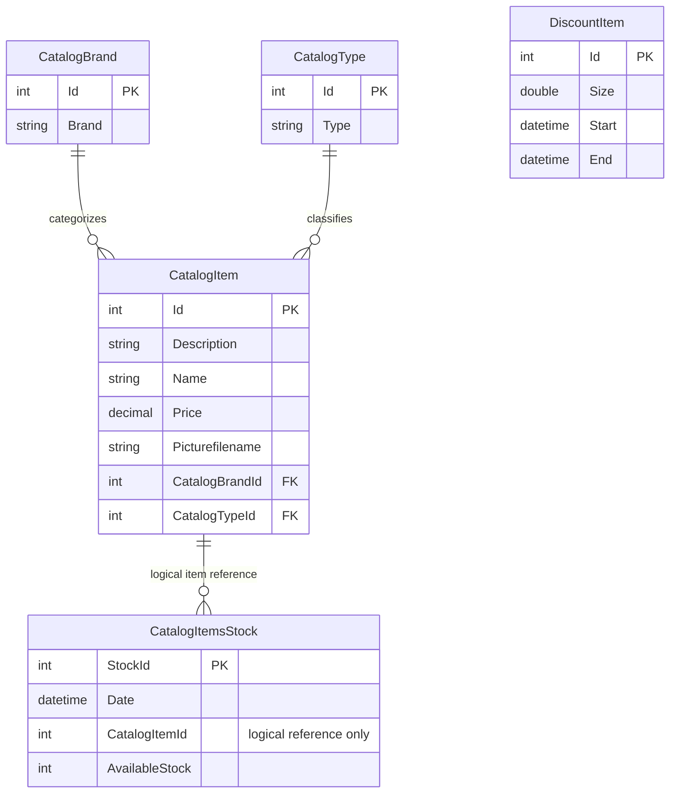

# Data Architecture & Persistence Layer

The scoped service uses EF6 with five entity sets and a default SQL Server LocalDB connection. Catalog reference data, dated stock and discounts are stored through a single context.

## Database Configuration

| Service/Module | DB Type | Profile | Driver | Connection | Migration Tool |
|---|---|---|---|---|---|
| eShopWCFService | SQL Server LocalDB default | Base configuration, shared by Debug/Release unless externally changed | System.Data.SqlClient / EF SQL Server provider | Named application connection; process environment override takes precedence; full value masked | Create-if-not-exists initializer; no versioned migration implementation found |
| eShopWinForms | No active direct DB path identified | Desktop base | EF package is declared, but active controller uses WCF | No desktop connection string declared | None evidenced |

Evidence: `src\eShopWCFService\Web.config:52-64`; `src\eShopWCFService\Models\Infrastructure\CatalogConfiguration.cs:10-17`; `src\eShopWCFService\EntityModel.cs:12-15`; `src\eShopWCFService\Models\Infrastructure\CatalogDBInitializer.cs:11-19`; `src\eShopWinForms\Controllers\CatalogController.cs:11-20`. See `configuration-inventory.md` for property keys.

Initialization creates a missing database rather than deliberately recreating an existing one. Seed methods save reference types, brands, items, stock and discounts separately (`src\eShopWCFService\Models\Infrastructure\CatalogDBInitializer.cs:11-79`). Sample data contains 12 items, five brands, four types, six stock records and six historic discount intervals (`src\eShopWCFService\Models\Infrastructure\PreconfiguredData.cs:10-75`). No explicit connection-pool sizing is declared; production database version, schema state and permissions are unknown.

## Data Ownership per Service

| Service | Tables Owned | ORM Framework | Caching | Notes |
|---|---|---|---|---|
| eShopWCFService | CatalogBrands, CatalogItems, CatalogTypes, DiscountItems by EF convention; CatalogItemsStock explicitly mapped | EF 6.1.3 | No explicit application cache | Five context sets (`src\eShopWCFService\EntityModel.cs:18-22`); stock table attribute (`src\eShopWCFService\Models\CatalogItemsStock.cs:10`) |
| eShopWinForms | None | No active persistence path | No explicit application cache | Consumes service contracts (`src\eShopWinForms\Program.cs:23-26`) |

Convention-derived table names have not been verified against a live database.

## Entity Model

All entities are service-owned. Brand/type relationships are inferred from non-nullable foreign-key IDs and reference navigation properties; stock's item relationship is **logical**, not an explicitly mapped ORM navigation/FK in the inspected model (`src\eShopWCFService\Models\CatalogItem.cs:27-35`; `src\eShopWCFService\Models\CatalogItemsStock.cs:14-25`; `src\eShopWCFService\EntityModel.cs:24-40`). No reverse collection or cascade/fetch configuration is explicitly specified.

| Entity | Source and persistence details |
|---|---|
| CatalogBrand | `src\eShopWCFService\Models\CatalogBrand.cs:13-19`: application-assigned Id, Brand length 50; non-Unicode mapping in `src\eShopWCFService\EntityModel.cs:26-28` |
| CatalogType | `src\eShopWCFService\Models\CatalogType.cs:13-19`: application-assigned Id, Type length 50; non-Unicode mapping in `src\eShopWCFService\EntityModel.cs:36-38` |
| CatalogItem | `src\eShopWCFService\Models\CatalogItem.cs:13-35`: application-assigned Id, decimal money price, image filename and reference navigation; precision 19,4 configured in `src\eShopWCFService\EntityModel.cs:30-32` |
| CatalogItemsStock | `src\eShopWCFService\Models\CatalogItemsStock.cs:10-25`: explicit table and StockId key, application-assigned key, SQL date, quantity and logical item reference |
| DiscountItem | `src\eShopWCFService\Models\DiscountItem.cs:18-31`: double fraction, SQL date bounds and Id key; no explicit identity override |

## Key Repository Methods

There is **no repository interface**: `CatalogService` queries `EntityModel` sets directly.

| Service | Repository | Notable Methods | Purpose |
|---|---|---|---|
| CatalogService | EntityModel.CatalogItems | `FindCatalogItem(int) -> CatalogItem` | First matching item, then explicit brand/type lookups (`src\eShopWCFService\CatalogService.svc.cs:33-44`) |
| CatalogService | EntityModel.CatalogItems | `GetCatalogItems(int,int) -> List<CatalogItem>` | Materializes all items before applying optional filters (`src\eShopWCFService\CatalogService.svc.cs:56-62`) |
| CatalogService | EntityModel.DiscountItems | `GetDiscount(DateTime) -> DiscountItem` | Materializes discounts and picks first inclusive date match (`src\eShopWCFService\CatalogService.svc.cs:28-30`) |
| CatalogService | EntityModel.CatalogItemsStocks | `GetAvailableStock(DateTime,int) -> int` | Filters item in DB, then matches date in memory; absent record returns zero (`src\eShopWCFService\CatalogService.svc.cs:90-96`) |
| CatalogService | EntityModel.CatalogItemsStocks | `CreateAvailableStock(CatalogItemsStock) -> void` | Update matching item/day or allocate max-plus-one StockId and insert (`src\eShopWCFService\CatalogService.svc.cs:99-117`) |

Catalog create/update/remove also save directly (`src\eShopWCFService\CatalogService.svc.cs:65-82`). No raw SQL, stored procedure or bulk cross-service finder is present in this implementation. Each explicit `SaveChanges` is a persistence boundary; no encompassing transaction, saga or concurrency-token configuration is declared. Max-plus-one allocation and lookup-then-write are not protected by an explicit application transaction/locking policy.

## Caching Strategy

No explicit Redis, MemoryCache, distributed cache, cache TTL or cache invalidation policy is evidenced in the scoped active service/controller and package manifests. EF context tracking and temporary `ToList` results are not an application query cache (`src\eShopWCFService\CatalogService.svc.cs:16-25,28-62,85-87`; `src\eShopWCFService\packages.config:3`). Catalog images are local files, not a configured image cache (`src\eShopWinForms\Views\CatalogView.cs:55-59`).

## Data Ownership Boundaries

This is one service-owned database, not database-per-microservice or shared ownership across business services. Desktop consumers cross the WCF boundary rather than querying tables; catalog, stock and discount operations share the same context. No CQRS read store, outbox, broker replication or eventual-consistency implementation is evidenced (`src\eShopWinForms\Program.cs:23-26`; `src\eShopWCFService\EntityModel.cs:18-22`; `src\eShopWCFService\CatalogService.svc.cs:16-25`). Desktop composition joins catalog results with a discount value, not separate service-owned datasets.

### Data Classification & Sensitivity

| Entity | Sensitive Fields | Classification (PII/PHI/PCI/None) | Controls in Place |
|---|---|---|---|
| CatalogItem / CatalogBrand / CatalogType | No personal, health or payment fields evidenced | None of PII/PHI/PCI detected; commercial catalog data | No field masking or field-level access controls declared |
| CatalogItemsStock | Inventory quantities and dates, not personal data | None of PII/PHI/PCI detected; potentially internal business data | No field masking/access controls declared |
| DiscountItem | Discount fraction and validity dates | None of PII/PHI/PCI detected; commercial data | No field masking/access controls declared |

Classification follows the complete model files cited above. No PII, PHI or PCI data detected in the entity model. Encryption-at-rest cannot be established from source; no database encryption provisioning appears in the scoped configuration. Connection material is sensitive configuration, not an entity field, and remains masked in these documents.
