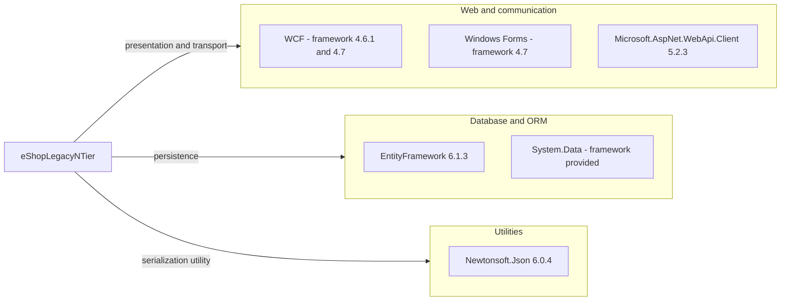

# Dependency Map

eShopLegacyNTier declares **3 distinct NuGet packages across 4 package declarations** in two projects. This inventory uses scoped project and package manifests only; framework assembly references are distinguished from NuGet packages.

## Dependencies

### Dependency Summary

Counts below count **distinct NuGet packages**, not framework assemblies.

| Category | Count | Key Libraries | Notes |
|---|---:|---|---|
| Web / HTTP client | 1 | Microsoft.AspNet.WebApi.Client 5.2.3 | Desktop only (`src\eShopWinForms\packages.config:4`); formatting assembly reference (`src\eShopWinForms\eShopWinForms.csproj:73-74`) |
| Database / ORM | 1 | EntityFramework 6.1.3 | Both projects (`src\eShopWCFService\packages.config:3`; `src\eShopWinForms\packages.config:3`); SQL Server assembly included with the package |
| Utilities | 1 | Newtonsoft.Json 6.0.4 | Desktop only (`src\eShopWinForms\packages.config:5`) |
| Framework assemblies, outside NuGet count | — | System.ServiceModel, System.Runtime.Serialization, System.Data, System.Web, System.Windows.Forms | Server references in `src\eShopWCFService\eShopWCFService.csproj:51-70`; desktop references in `src\eShopWinForms\eShopWinForms.csproj:67-86` |

All package declarations target `net461`, while the desktop project itself targets .NET Framework 4.7 (`src\eShopWinForms\packages.config:3-5`; `src\eShopWinForms\eShopWinForms.csproj:11`). Both projects use legacy non-SDK project files and `packages.config`, rather than central package management (`src\eShopWCFService\eShopWCFService.csproj:1,45-49,99`; `src\eShopWinForms\eShopWinForms.csproj:2,57-64`).

### Version & Compatibility Risks

The manifests pin older EF6, Web API client and Json.NET versions; migration must account for legacy framework assemblies and the System.Web-hosted WCF server rather than treating this as ASP.NET Core. This document does not establish current support dates, CVEs or upgrade compatibility: no live advisory query, package restore or build was performed. Framework targets and dependency versions are declared evidence, not proof of installed runtime versions.

### Notable Observations

- EF is declared by both projects; the manifests alone do not prove which runtime paths use each dependency.
- One EntityFramework package yields two explicit assembly references, so these must not be double-counted (`src\eShopWCFService\eShopWCFService.csproj:45-49`; `src\eShopWinForms\eShopWinForms.csproj:57-61`).
- Package assembly hint paths point to `..\packages\...` relative to each project; actual restoration/path availability is unverified (same project references).
- No package lock file, central package file, messaging, cache, resilience or telemetry package declaration was found within the scoped manifests. Transitive versions cannot be reliably reconstructed from these declarations.

## Test Dependencies

| Framework | Version | Notes |
|---|---|---|
| None detected | — | The solution declares only desktop and WCF projects (`eShopLegacyNTier.sln:6-9`); their package manifests contain the three packages above. |

Total test-scope dependencies: **0 detected**.

No test project or test framework declaration was found within this workspace. This is a manifest-level observation, not an assertion about tests outside scope.
