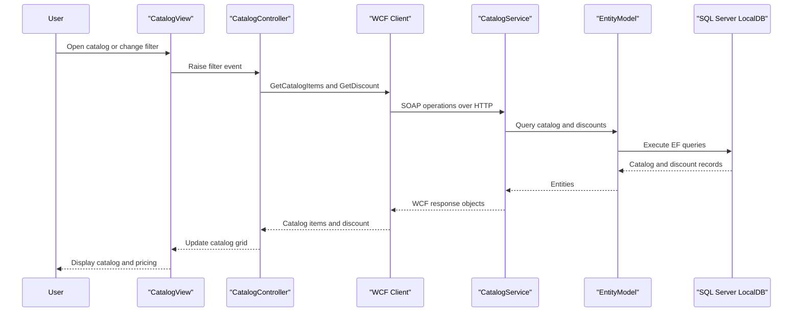

# API & Service Communication Contracts

The solution exposes one WCF service contract with ten synchronous operations. The WinForms client uses SOAP over HTTP; no asynchronous messaging or REST API surface was identified.

## Service Catalog

| Service | Port | Category | Purpose |
|---|---|---|---|
| eShopWinForms | Desktop process | Client | Displays catalog items and manages filters and stock availability |
| eShopWCFService `CatalogService.svc` | IIS Express endpoint configured at `localhost:62314` | Business / API Layer | Provides catalog, discount, and stock operations |

## API Endpoints Inventory

The service operations are WCF SOAP actions on `CatalogService.svc`, not REST resources.

| Service | Method | Path / Operation | Request Type | Response Type |
|---|---|---|---|---|
| CatalogService | FindCatalogItem | `ICatalogService/FindCatalogItem` | `int id` | `CatalogItem` |
| CatalogService | GetCatalogBrands | `ICatalogService/GetCatalogBrands` | None | `List<CatalogBrand>` |
| CatalogService | GetCatalogItems | `ICatalogService/GetCatalogItems` | `int brandIdFilter`, `int typeIdFilter` | `List<CatalogItem>` |
| CatalogService | GetCatalogTypes | `ICatalogService/GetCatalogTypes` | None | `List<CatalogType>` |
| CatalogService | GetAvailableStock | `ICatalogService/GetAvailableStock` | `DateTime date`, `int catalogItemId` | `int` |
| CatalogService | CreateAvailableStock | `ICatalogService/CreateAvailableStock` | `CatalogItemsStock` | `void` |
| CatalogService | CreateCatalogItem | `ICatalogService/CreateCatalogItem` | `CatalogItem` | `void` |
| CatalogService | UpdateCatalogItem | `ICatalogService/UpdateCatalogItem` | `CatalogItem` | `void` |
| CatalogService | RemoveCatalogItem | `ICatalogService/RemoveCatalogItem` | `CatalogItem` | `void` |
| CatalogService | GetDiscount | `ICatalogService/GetDiscount` | `DateTime day` | `DiscountItem` |

## Management & Observability Endpoints

| Service | Endpoint | Custom Metrics |
|---|---|---|
| CatalogService | WCF metadata exchange at `mex`; HTTP metadata enabled in `Web.config` | None detected |
| CatalogService | No health-check or metrics endpoint found | None detected |

## DTOs & Contracts

The WCF contract uses mutable `[DataContract]` model classes: `CatalogItem`, `CatalogBrand`, `CatalogType`, `CatalogItemsStock`, and `DiscountItem`. They are service-level domain entities and request/response DTOs; no immutable record types, OpenAPI/Swagger specification, protobuf schema, or GraphQL schema was found. WCF uses its data-contract serialization; Newtonsoft.Json is used in the client helper for local JSON data rather than this SOAP contract.

## Communication Patterns

Communication is synchronous WCF SOAP using `basicHttpBinding` at the local client endpoint. The service uses direct method calls and EF6; there is no message broker, service discovery, API gateway, client-side load balancing, retry policy, circuit breaker, or configured timeout policy in the inspected project files.

No application-level authentication or authorization configuration was identified for the WCF operations. The WinForms endpoint is HTTP, and the service explicitly declares a `basicHttpBinding` endpoint; the HTTPS protocol mapping does not change that explicit binding. Host-level IIS policy is outside the available project configuration.

## Service Technology Matrix

| Service | Web | Data Access | Discovery | Gateway | Health | Cache | Metrics |
|---|---|---|---|---|---|---|---|
| eShopWinForms | Windows Forms | WCF client | None | None | None | None | None |
| eShopWCFService | WCF | Entity Framework 6 | None | None | None | None | None |

## Service Communication Sequence

