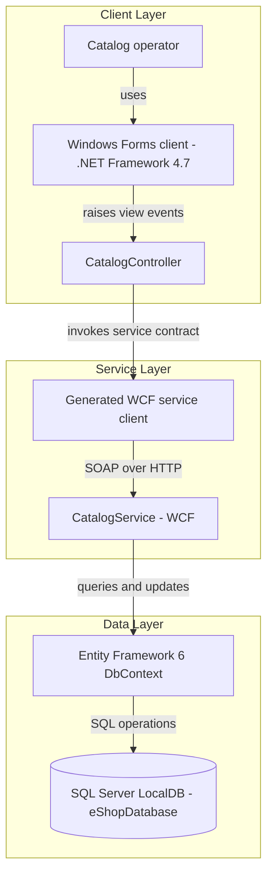

# Architecture Diagram

The solution is a Windows desktop client that uses a WCF service boundary for catalog operations. The service persists catalog data through Entity Framework 6 to SQL Server LocalDB.

## Application Architecture

### Technology Stack Summary

| Layer | Technology | Version | Purpose |
|---|---|---|---|
| Presentation | Windows Forms | .NET Framework 4.7 | Desktop catalog and inventory UI |
| Client service access | WCF client / BasicHttpBinding | .NET Framework 4.7 | Synchronous SOAP calls to the catalog service |
| Service | WCF hosted by IIS/IIS Express | .NET Framework 4.6.1 | Catalog, discount, and stock operations |
| Persistence | Entity Framework | 6.1.3 | ORM and database context |
| Database | SQL Server LocalDB | LocalDB instance | Catalog and stock persistence |

### Data Storage & External Services

The WCF service uses one SQL Server LocalDB database (`eShopDatabase`) through Entity Framework. The desktop client calls the service at a configured local HTTP endpoint; no other external APIs, caches, or message brokers were found.

### Key Architectural Decisions

- The solution separates the desktop UI from persistence behind the `ICatalogService` WCF contract.
- `CatalogController` mediates view events and synchronous service calls.
- `EntityModel` is the EF6 `DbContext`; service methods query its sets directly. A mock service implementation exists but is not wired into the application startup.

## Component Relationships

```mermaid
flowchart LR
    subgraph Presentation["Presentation"]
        View["CatalogView"]
        Controller["CatalogController"]
        View -->|"raises events and displays results"| Controller
    end
    subgraph ServiceBoundary["Service Boundary"]
        Client["CatalogServiceClient"]
        Contract["ICatalogService"]
        Service["CatalogService"]
        Controller -->|"calls"| Client
        Client -->|"implements contract"| Contract
        Contract -->|"dispatches operations"| Service
    end
    subgraph Persistence["Persistence"]
        Context["EntityModel"]
        DB[("SQL Server LocalDB")]
        Service -->|"uses DbSets"| Context
        Context -->|"persists entities"| DB
    end
```

### Component Inventory

| Component | Layer | Type | Responsibility |
|---|---|---|---|
| `CatalogView` | Presentation | Windows Form | Displays catalog items, discounts, filters, and stock availability |
| `CatalogController` | Presentation | Controller | Coordinates view events and service operations |
| `CatalogServiceClient` | Service Boundary | Generated WCF client | Calls the remote `ICatalogService` contract |
| `ICatalogService` | Service Boundary | WCF service contract | Defines catalog and stock operations |
| `CatalogService` | Business / Service | WCF service | Implements catalog, discount, and stock operations |
| `EntityModel` | Persistence | EF6 `DbContext` | Defines persistent entity sets and model configuration |
| `CatalogServiceMock` | Business / Service | Mock implementation | Provides in-memory catalog behavior; no startup registration was found |
