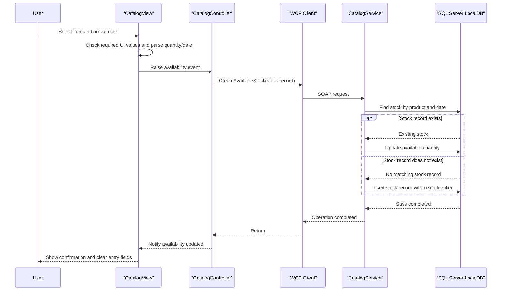

# Core Business Workflows

The application supports product catalog browsing and basic inventory availability management for an eShop operator. Users view product details and discounts, search stock by product and date, and record incoming stock.

## Domain Entities

| Entity | Service / Bounded Context | Description | Key Relationships |
|---|---|---|---|
| CatalogItem | Catalog | A product offered in the catalog | Belongs to a brand and type; has inventory records |
| CatalogBrand | Catalog | Brand classification for products | Groups catalog items |
| CatalogType | Catalog | Product type classification | Groups catalog items |
| CatalogItemsStock | Inventory | Available quantity recorded for an item and date | Refers to a catalog item by identifier |
| DiscountItem | Pricing | Discount active during a date interval | Applies to displayed catalog prices |

## Service-to-Domain Mapping

| Service | Domain Context | Owned Entities | External Dependencies |
|---|---|---|---|
| eShopWinForms | Catalog and inventory user interface | None; consumes service DTOs | `CatalogService.svc` |
| eShopWCFService | Catalog, pricing, and inventory | CatalogItem, CatalogBrand, CatalogType, CatalogItemsStock, DiscountItem | Entity Framework and SQL Server LocalDB |

## Primary Workflows

### Workflow 1: Browse and filter the catalog

At startup the `CatalogController` requests the current discount, catalog items, brand filters, and type filters. Selecting a brand or type raises a view event, and the controller calls `GetCatalogItems` with the selected identifiers. A filter value of zero represents “all”; the service returns matching items for the view to display.

### Workflow 2: Check and record stock availability

The user selects a product and date to query `GetAvailableStock`. To record incoming inventory, the view parses the selected product, quantity, and arrival date and raises an event. The controller sends a `CatalogItemsStock` object to `CreateAvailableStock`; the service updates an existing item/date record or creates a new stock record, then the UI confirms the operation.

### Workflow 3: Apply an active discount

The controller requests the discount for the current date. The service returns a discount whose start and end dates contain the requested date; the client applies the returned discount value to displayed prices and updates the banner.

## Cross-Service Data Flows

The desktop client calls the WCF service for catalog and stock data. The WCF service reads or updates its EF6 context, which persists to the LocalDB database. No multi-service aggregation, asynchronous event flow, or fallback service is configured. The in-memory mock service exists in source but no activation path was found in application startup.

## Business Workflow Sequence

## Business Rules & Decision Logic

- Brand and type filter identifier `0` means no filter.
- A discount is eligible when the requested date is on or after its start date and on or before its end date.
- Stock is looked up by catalog item identifier and date; a matching record is updated, otherwise a new record is created.
- New catalog and stock identifiers are derived from the current maximum identifier plus one.
- The view rejects empty stock fields and parses quantity and date before submitting; no service-side validation or business authorization was identified.
- EF `SaveChanges` persists service mutations. No explicit transaction orchestration, audit trail, or compensating workflow was found.
