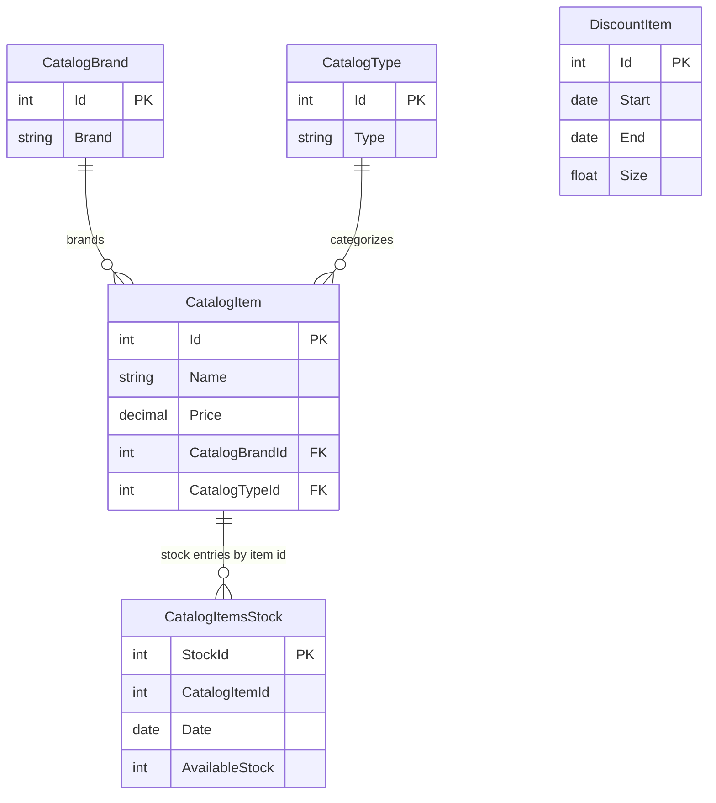

# Data Architecture & Persistence Layer

The service persists a small catalog and inventory model in SQL Server LocalDB through Entity Framework 6. The model contains five primary entity types and is owned by the WCF service.

## Database Configuration

| Service / Module | DB Type | Profile | Driver | Connection | Migration Tool |
|---|---|---|---|---|---|
| eShopWCFService | SQL Server LocalDB | Default | `System.Data.SqlClient` | Named `EntityModel` connection resolves to `(localdb)\MSSQLLocalDB`, database `eShopDatabase`; an environment variable can override the named connection | EF6 database initializer; no explicit migration tool detected |

The service initializes the database through `CatalogDBInitializer` and preconfigured catalog data. SQL scripts and versioned schema migrations were not detected.

## Data Ownership per Service

| Service | Tables Owned | ORM Framework | Caching | Notes |
|---|---|---|---|---|
| eShopWCFService | CatalogBrands, CatalogItems, CatalogItemsStocks, CatalogTypes, DiscountItems | Entity Framework 6.1.3 | None detected | `EntityModel` exposes the entity sets |
| eShopWinForms | None | None | None | Client consumes data through the WCF contract |

## Entity Model

`CatalogItem` references its brand and type through EF-convention foreign keys. Stock records are matched to items by `CatalogItemId` in service queries; no navigation property or explicit FK mapping was found. `DiscountItem` is an independent date-window record. Entity source files are under `src/eShopWCFService/Models/`.

## Key Repository Methods

| Service | Repository / Data Access | Notable Methods | Purpose |
|---|---|---|---|
| eShopWCFService | `EntityModel` (`src/eShopWCFService/EntityModel.cs`) | `DbSet` properties for catalog, brand, type, stock, and discounts | EF6 context used directly by service methods |
| eShopWCFService | `CatalogService` (`src/eShopWCFService/CatalogService.svc.cs`) | `GetCatalogItems`, `GetAvailableStock`, `CreateAvailableStock`, `CreateCatalogItem`, `UpdateCatalogItem`, `RemoveCatalogItem`, `GetDiscount` | Direct LINQ queries and EF state changes; no separate repository interfaces or custom query repository layer detected |

## Caching Strategy

No application-level cache provider or cache annotations were detected. The desktop view keeps displayed results in its UI controls; no server-side cache strategy is configured.

## Data Ownership Boundaries

The WCF service is the single owner of one shared LocalDB database. The WinForms client does not access the database directly; it requests catalog, discount, and stock data through `ICatalogService`. There are no separate service databases, cross-service joins, CQRS projections, or messaging-based data flows.

### Data Classification & Sensitivity

| Entity | Sensitive Fields | Classification (PII/PHI/PCI/None) | Controls in Place |
|---|---|---|---|
| CatalogBrand, CatalogType, CatalogItem, CatalogItemsStock, DiscountItem | No customer or payment fields found | None | Not applicable |

No PII, PHI, or PCI data was detected in the entity model.
