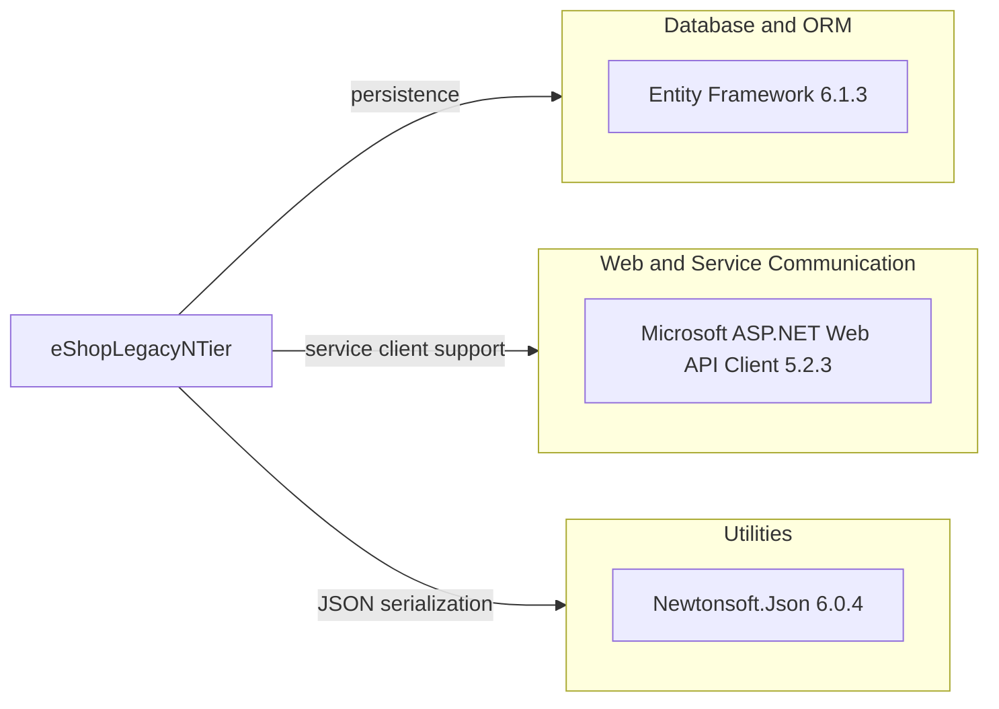

# Dependency Map

The `eShopLegacyNTier` solution declares three distinct external NuGet packages across its two projects.

## Dependencies

### Dependency Summary

| Category | Count | Key Libraries | Notes |
|---|---:|---|---|
| Database / ORM | 1 | Entity Framework 6.1.3 | Declared by both projects; used by the WCF service for SQL Server access |
| Web Frameworks / Service Communication | 1 | Microsoft ASP.NET Web API Client 5.2.3 | Declared by the WinForms project; WCF itself is provided by the .NET Framework |
| Utilities | 1 | Newtonsoft.Json 6.0.4 | Declared by the WinForms project for JSON serialization |

### Version & Compatibility Risks

Both projects use legacy non-SDK project files and target .NET Framework 4.7 or 4.6.1. The declared Newtonsoft.Json 6.0.4 dependency is affected by CVE-2024-21907; GitHub lists 13.0.1 as the first patched version. Entity Framework 6.1.3 and Web API Client 5.2.3 are also old package versions that require compatibility review for modernization.

### Notable Observations

- Entity Framework is declared in both the client and service projects, although database operations are implemented in the service.
- The WinForms app uses a generated WCF client and .NET Framework service assemblies rather than a separately declared modern HTTP client.
- No package lock file or centralized package management file was found, so resolved transitive versions are not pinned in repository metadata.

## Test Dependencies

| Framework | Version | Notes |
|---|---|---|
| None detected | — | No test project or test-scoped package declarations were found |

Total test-scope dependencies: 0

No test dependencies or dedicated test infrastructure were detected in the solution.
