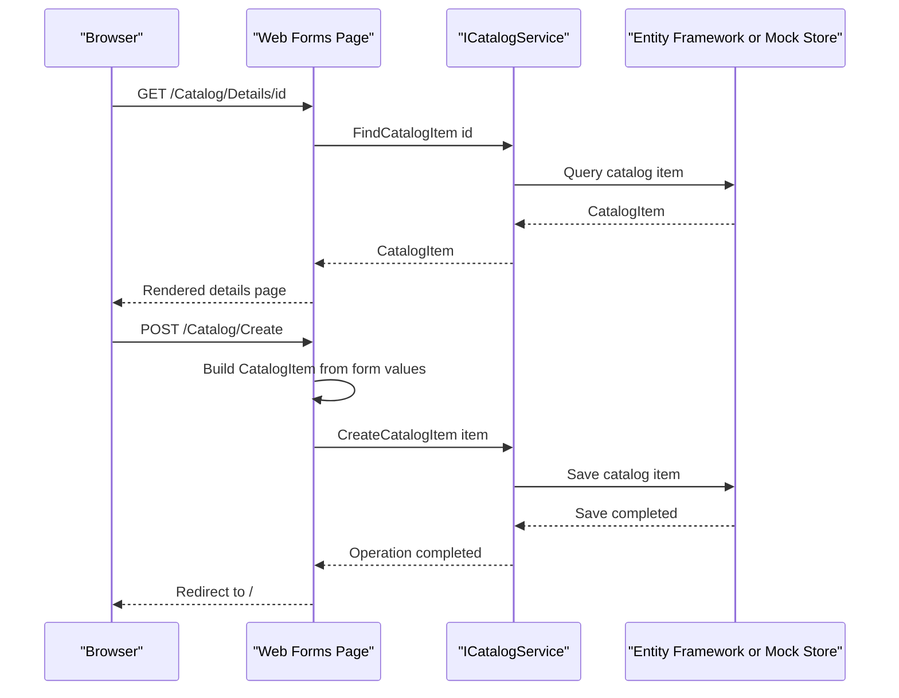

# API & Service Communication Contracts

The application exposes six server-rendered page routes and no REST, gRPC, or GraphQL API endpoints. Requests are handled synchronously in-process by Web Forms pages that call a catalog service.

## Service Catalog

| Service | Port | Category | Purpose |
|---|---|---|---|
| eShopLegacyWebForms | Not specified | Business | Serves catalog management and informational pages; uses `ICatalogService` for catalog operations |

## API Endpoints Inventory

These are page routes rather than REST API endpoints. Form submissions use Web Forms postbacks to the same page; successful create, update, and delete operations redirect to the application root.

| Service | Method | Path | Request Type | Response Type |
|---|---|---|---|---|
| eShopLegacyWebForms | GET | `/Default` | Optional paging parameters via `/Default/index/{index}/size/{size}` | Rendered catalog page |
| eShopLegacyWebForms | GET | `/Default/index/{index}/size/{size}` | Route parameters `index`, `size` | Rendered paginated catalog page |
| eShopLegacyWebForms | GET, POST | `/Catalog/Create` | Form values on postback; `CatalogItem` is assembled by the page | Rendered form or redirect to `/` |
| eShopLegacyWebForms | GET, POST | `/Catalog/Edit/{id}` | Route parameter `id`; form values on postback; `CatalogItem` is assembled by the page | Rendered form or redirect to `/` |
| eShopLegacyWebForms | GET | `/Catalog/Details/{id}` | Route parameter `id` | Rendered catalog item details |
| eShopLegacyWebForms | GET, POST | `/Catalog/Delete/{id}` | Route parameter `id`; delete confirmation postback | Rendered confirmation or redirect to `/` |

No separate versioning scheme or REST endpoint contract was found.

## Management & Observability Endpoints

| Service | Endpoint | Custom Metrics (if any) |
|---|---|---|
| eShopLegacyWebForms | No health-check, metrics, or management endpoint identified | No custom metric registration identified |

Application Insights instrumentation and log4net logging are configured, but no dedicated management endpoint was found.

## DTOs & Contracts

The page/service contract is in-process and uses `CatalogItem`, `CatalogBrand`, and `CatalogType` as mutable domain model classes. `PaginatedItemsViewModel<CatalogItem>` represents the paginated catalog response model. Create and edit postback values are read from Web Forms controls and assembled into `CatalogItem`; no separate immutable request or response DTOs, OpenAPI/Swagger specifications, protobuf schemas, or GraphQL schemas were found. JSON serialization is not part of the observed page contract.

## Communication Patterns

Browser communication is synchronous HTTP page rendering and Web Forms postback. Pages call `ICatalogService` directly; the selected implementation either uses Entity Framework synchronously or returns data from the in-memory mock service. There are no inter-service calls, message brokers, asynchronous communication patterns, API gateway, service discovery, load balancing, retries, circuit breakers, or configured timeout policies identified.

No API-level authentication, authorization, or TLS configuration was identified in the inspected application configuration; the application does not show endpoint role checks or a security middleware setup.

## Service Technology Matrix

| Service | Web | Data Access | Discovery | Gateway | Actuator | Cache | Metrics |
|---|---|---|---|---|---|---|---|
| eShopLegacyWebForms | ASP.NET Web Forms | Entity Framework 6 or in-memory mock | None | None | None identified | None identified | Application Insights instrumentation |

## Service Communication Sequence

