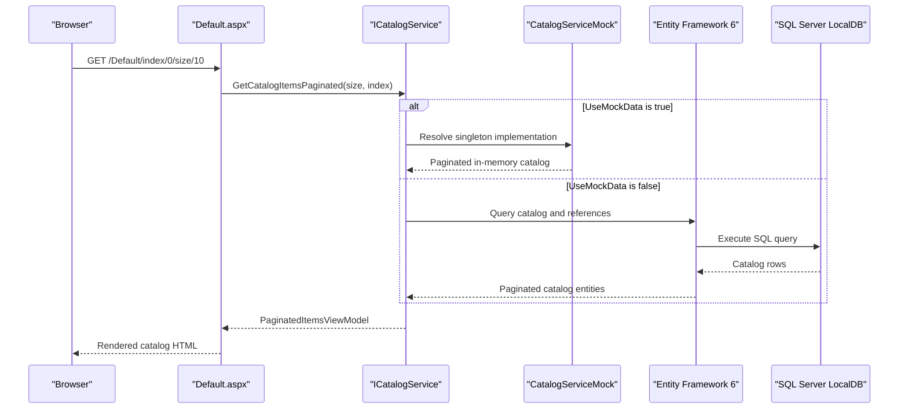

# API & Service Communication Contracts

The application exposes Web Forms page routes and form postbacks rather than a REST API. Its pages synchronously call one catalog service; database access is conditional on the configured mock-data mode.

## Service Catalog

| Service | Port | Category | Purpose |
|---|---|---|---|
| eShopLegacyWebForms | IIS Express `50586` locally; host-assigned in deployment | API Layer / Web UI | Renders and processes the catalog pages; no independently deployed backend service |

## API Endpoints Inventory

No REST or RPC endpoints were identified. The following page routes are the application's browser-facing contract; form submissions are Web Forms postbacks.

| Service | Method | Path | Request Type | Response Type |
|---|---|---|---|---|
| eShopLegacyWebForms | GET | `/Default` (also default document) | Optional page index and size route values | Rendered catalog page |
| eShopLegacyWebForms | GET | `/Default/index/{index}/size/{size}` | Integer route values `index`, `size` | Rendered catalog page |
| eShopLegacyWebForms | GET, POST | `/Catalog/Create` | Form fields for a catalog item | Form page or redirect to catalog |
| eShopLegacyWebForms | GET | `/Catalog/Details/{id}` | Integer route value `id` | Rendered catalog details |
| eShopLegacyWebForms | GET, POST | `/Catalog/Edit/{id}` | Integer route value `id`; edited form fields on postback | Edit form or redirect to catalog |
| eShopLegacyWebForms | GET, POST | `/Catalog/Delete/{id}` | Integer route value `id`; delete postback | Confirmation page or redirect to catalog |

## Management & Observability Endpoints

| Service | Endpoint | Custom Metrics |
|---|---|---|
| eShopLegacyWebForms | No health, metrics, or management route was identified | Application Insights telemetry modules; no custom metric endpoint found |

## DTOs & Contracts

`CatalogItem` is the mutable catalog data object used by the page code-behind and service. `PaginatedItemsViewModel<CatalogItem>` is the page response model; route values supply pagination and item identifiers. `CatalogBrand` and `CatalogType` provide reference data. No separate request/response DTOs, OpenAPI/Swagger documents, protobuf schemas, or GraphQL schemas were found. Communication to the browser is server-rendered HTML rather than JSON.

## Communication Patterns

- **Synchronous:** Web Forms page handlers call `ICatalogService` directly. `CatalogService` calls Entity Framework 6 and LocalDB when database mode is selected.
- **Default mode:** `UseMockData=true` selects `CatalogServiceMock`, which serves an in-memory list.
- **Asynchronous messaging and resilience:** No message broker, retry policy, circuit breaker, or service discovery client was identified.
- **Gateway and aggregation:** There is no API gateway or cross-service response aggregation.
- **Startup dependencies:** ASP.NET application startup registers routes, bundles, and Autofac; database initialization is configured only when mock data is disabled. See `configuration-inventory.md` for configuration details.
- **Security posture:** No API-level authentication, authorization, or TLS configuration was identified in the application configuration. The site uses page routes and postbacks, not secured service contracts.

## Service Technology Matrix

| Service | Web | Data Access | Discovery | Gateway | Health | Cache | Metrics |
|---|---|---|---|---|---|---|---|
| eShopLegacyWebForms | ASP.NET Web Forms | EF6 when mock mode is disabled | None | None | None found | None configured; mock data is in-memory application state | Application Insights telemetry |

## Service Communication Sequence

