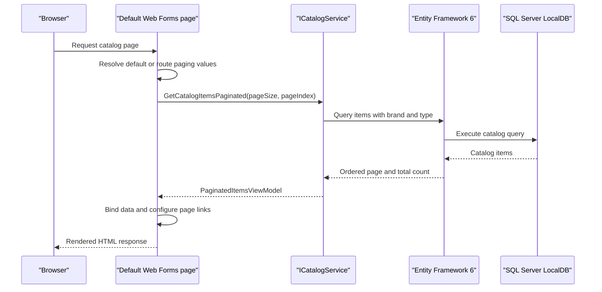

# API & Service Communication Contracts

The application exposes server-rendered Web Forms pages through friendly URL routes, not a REST/JSON API. Requests are handled synchronously in one web application and catalog operations are delegated to `ICatalogService`.

## Service Catalog

| Service | Port | Category | Purpose |
|---|---|---|---|
| eShopLegacyWebForms | Not specified; supplied by IIS/IIS Express | API Layer / Web application | Serves catalog browsing and catalog management pages |

## API Endpoints Inventory

The paths below are Web Forms page routes and postback actions; they are not REST endpoints.

| Service | Method | Path | Request Type | Response Type |
|---|---|---|---|---|
| eShopLegacyWebForms | GET | `/Default` | Optional paging route values | Rendered catalog page |
| eShopLegacyWebForms | GET | `/Default/index/{index}/size/{size}` | Route values `index`, `size` | Rendered paginated catalog page |
| eShopLegacyWebForms | GET / POST | `/Catalog/Create` | Web Forms controls / postback event | Rendered form or redirect to catalog |
| eShopLegacyWebForms | GET / POST | `/Catalog/Edit/{id}` | Route value `id`; Web Forms controls / postback | Rendered form or redirect to catalog |
| eShopLegacyWebForms | GET | `/Catalog/Details/{id}` | Route value `id` | Rendered item details page |
| eShopLegacyWebForms | GET / POST | `/Catalog/Delete/{id}` | Route value `id`; postback event | Rendered confirmation or redirect |

## Management & Observability Endpoints

| Service | Endpoint | Custom Metrics (if any) |
|---|---|---|
| eShopLegacyWebForms | None identified | Application Insights web telemetry is configured; no custom metric registrations found |

## DTOs & Contracts

`CatalogItem`, `CatalogBrand`, and `CatalogType` are domain/data model classes used by the page controls and service layer. `PaginatedItemsViewModel<CatalogItem>` packages page metadata and the current item sequence. These are mutable classes, not immutable records. The application renders HTML through Web Forms and does not declare an OpenAPI specification, protobuf schema, GraphQL schema, or JSON API contract.

## Communication Patterns

Page handlers call `ICatalogService` synchronously in-process. With `UseMockData=true`, Autofac selects the mock service; otherwise, `CatalogService` uses EF6 for synchronous database calls. No message broker, service discovery, API gateway, retry, timeout, circuit-breaker, or client-side load-balancing implementation was found. Application-level authentication and authorization are not configured in the inspected Web.config; transport TLS is left to the IIS hosting configuration and is not specified in this project.

## Service Technology Matrix

| Service | Web | Data Access | Discovery | Gateway | Actuator | Cache | Metrics |
|---|---|---|---|---|---|---|---|
| eShopLegacyWebForms | ASP.NET Web Forms | EF6 / SQL Server LocalDB | None | None | None | Mock in-memory list only when enabled | Application Insights web telemetry |

## Service Communication Sequence

