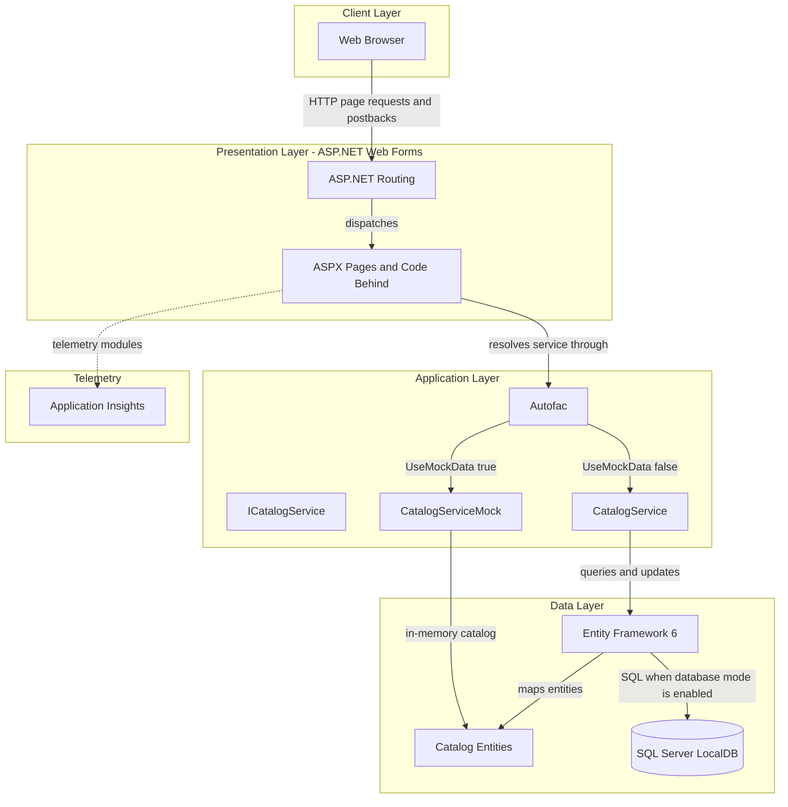
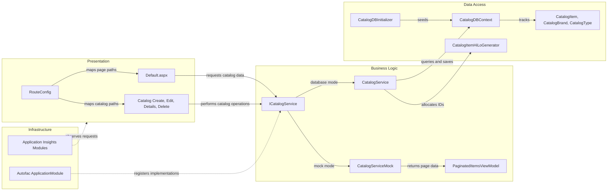

# Architecture Diagram

The application is a single server-rendered Web Forms site. Its catalog pages call one catalog service, which uses in-memory data by default or Entity Framework and SQL Server LocalDB when configured for database mode.

## Application Architecture

### Technology Stack Summary

| Layer | Technology | Version | Purpose |
|---|---|---:|---|
| Presentation | ASP.NET Web Forms | .NET Framework 4.7.2 | Server-rendered catalog pages and postbacks |
| Dependency injection | Autofac | 4.9.1 | Web Forms service and context registration |
| Business/data access | Entity Framework 6 | 6.2.0 | Catalog persistence when mock data is disabled |
| Database | SQL Server LocalDB | Not specified | Configured database for `CatalogDBContext` |
| Telemetry | Application Insights | 2.9.1 | Request and dependency telemetry |
| UI assets | Bootstrap, jQuery | 4.3.1, 3.5.0 | Styling and browser-side behavior |

### Data Storage & External Services

`UseMockData` is `true` in the checked-in `Web.config`, so the default runtime uses an in-memory catalog service. If this setting is disabled, Entity Framework 6 uses the configured SQL Server LocalDB connection. Application Insights modules provide telemetry; no other external service integration was identified.

### Key Architectural Decisions

- Server-rendered Web Forms pages and their code-behind form the presentation layer; there is no separate API gateway or REST service.
- Autofac selects either the singleton mock catalog service or a per-request-scope database service based on configuration.
- Entity Framework 6 maps catalog items to required brand and type references.

## Component Relationships

### Component Inventory

| Component | Layer | Type | Responsibility |
|---|---|---|---|
| `Default.aspx` | Presentation | Web Forms page | Lists and paginates catalog items |
| Catalog pages | Presentation | Web Forms pages | Create, edit, view, and delete catalog items |
| `RouteConfig` | Presentation | Routing configuration | Maps catalog paths to ASPX pages |
| `ICatalogService` | Business logic | Service interface | Defines catalog query and update operations |
| `CatalogService` | Business logic | Service | Performs catalog operations using EF6 |
| `CatalogServiceMock` | Business logic | In-memory service | Serves and mutates seeded catalog data |
| `CatalogDBContext` | Data access | EF6 context | Maps catalog entities to database tables |
| Catalog entities | Data access | Domain models | Represent items, brands, and types |
| `CatalogItemHiLoGenerator` | Data access | ID generator | Allocates catalog item identifiers in database mode |
| `CatalogDBInitializer` | Data access | Database initializer | Creates database seed data and sequence scripts |
| `ApplicationModule` | Infrastructure | Autofac module | Registers the service and data context lifetimes |
| Application Insights modules | Infrastructure | HTTP modules | Collect request and dependency telemetry |
