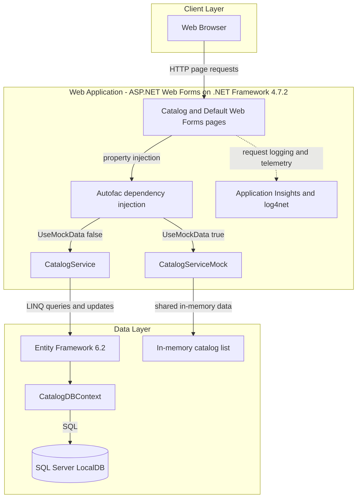
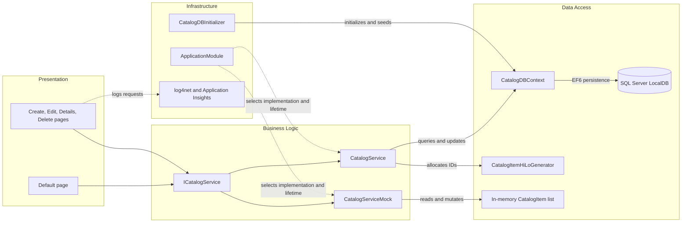

# Architecture Diagram

The solution is a single ASP.NET Web Forms catalog application. It serves server-rendered pages and accesses catalog data through an application service backed by Entity Framework 6 or, when configured, an in-memory mock service.

## Application Architecture

### Technology Stack Summary

| Layer | Technology | Version | Purpose |
|---|---|---|---|
| Presentation | ASP.NET Web Forms | .NET Framework 4.7.2 | Server-rendered catalog pages |
| Business/data services | C# catalog service | .NET Framework 4.7.2 | Catalog CRUD and pagination |
| Dependency injection | Autofac | 4.9.1 | Per-request service and context registration |
| ORM | Entity Framework | 6.2.0 | Catalog persistence |
| Database | SQL Server LocalDB | Connection configured in Web.config | Catalog storage |
| Observability | log4net and Application Insights | log4net 2.0.10; Application Insights 2.9.1 | Application logging and web telemetry |

### Data Storage & External Services

The application uses a SQL Server LocalDB connection configured for integrated security. Entity Framework owns catalog persistence; startup seed data can be selected from built-in data or local CSV files. Application Insights web tracking is configured, but no instrumentation key or explicit remote endpoint is present in the checked-in configuration. There is no cache or message broker.

### Key Architectural Decisions

- `ICatalogService` separates Web Forms pages from persistence and provides a mock implementation.
- Autofac selects a singleton mock service when `UseMockData` is true, and a per-lifetime-scope EF service otherwise.
- EF6 uses a custom high/low sequence generator for catalog identifiers and a database initializer for schema setup and seed data.

## Component Relationships

### Component Inventory

| Component | Layer | Type | Responsibility |
|---|---|---|---|
| `_Default` | Presentation | Web Forms page | Displays paginated catalog items |
| Catalog Create/Edit/Details/Delete | Presentation | Web Forms pages | Create, edit, view, and remove catalog items |
| `ICatalogService` | Business Logic | Service interface | Defines catalog operations used by pages |
| `CatalogService` | Business Logic | EF-backed service | Queries and persists catalog records |
| `CatalogServiceMock` | Business Logic | Mock service | Serves and mutates a preconfigured in-memory list |
| `CatalogDBContext` | Data Access | EF6 DbContext | Maps catalog entities to database tables |
| `CatalogItemHiLoGenerator` | Data Access | Identifier generator | Allocates catalog item IDs from a database sequence |
| `CatalogDBInitializer` | Infrastructure | EF initializer | Creates sequence objects and seeds catalog data |
| `ApplicationModule` | Infrastructure | Autofac module | Registers service implementations and lifetimes |
