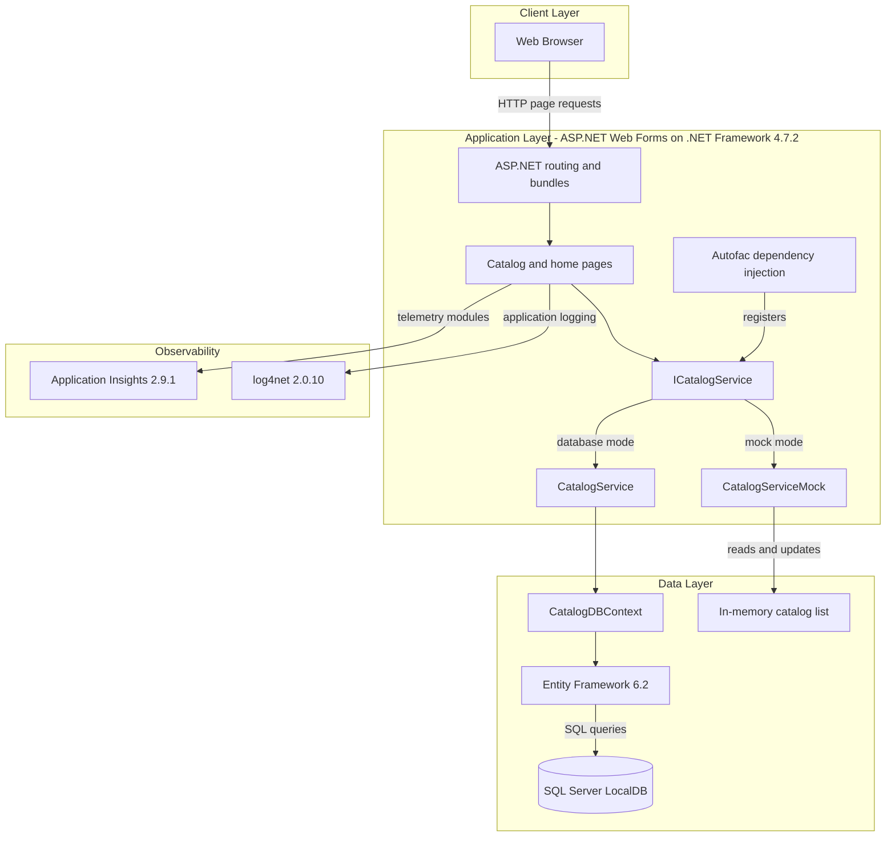
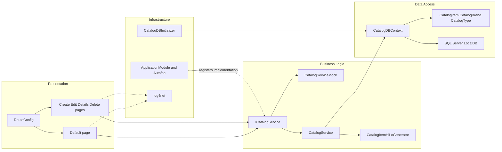

# Architecture Diagram

This single-project application serves a catalog through server-rendered Web Forms pages. Its default configuration uses in-memory mock data; Entity Framework and SQL Server LocalDB are used when mock data is disabled.

## Application Architecture

### Technology Stack Summary

| Layer | Technology | Version | Purpose |
|---|---|---:|---|
| Presentation | ASP.NET Web Forms | .NET Framework 4.7.2 | Server-rendered catalog pages and forms |
| Application | C# and Autofac | Autofac 4.9.1 | Catalog operations and dependency injection |
| Data access | Entity Framework 6 | 6.2.0 | ORM and SQL Server access |
| Data storage | SQL Server LocalDB | LocalDB instance | Persistent catalog when mock mode is disabled |
| Observability | Application Insights and log4net | 2.9.1 and 2.0.10 | Request telemetry and application logging |
| Browser assets | Bootstrap, jQuery | 4.3.1 and 3.3.1 | Client-side styling and interaction |

### Data Storage & External Services

The configured persistent store is SQL Server LocalDB, reached through `CatalogDBContext` and Entity Framework. `UseMockData` is set to `true` in `Web.config`, so the default runtime instead uses an in-memory catalog. Application Insights is configured for telemetry; the source does not show a separate remote business API or message broker.

### Key Architectural Decisions

- `ICatalogService` separates the Web Forms pages from the mock and Entity Framework-backed implementations.
- Autofac selects the mock or database service at application startup based on `UseMockData`.
- The database initializer creates sequence objects and seeds catalog data when mock mode is disabled.

## Component Relationships

### Component Inventory

| Component | Layer | Type | Responsibility |
|---|---|---|---|
| Default | Presentation | Web Forms page | Displays and paginates catalog items |
| Catalog Create/Edit/Details/Delete | Presentation | Web Forms pages | Maintains and displays catalog items |
| RouteConfig | Presentation | Route configuration | Maps friendly URLs to Web Forms pages |
| ICatalogService | Business Logic | Service interface | Defines catalog reads and mutations |
| CatalogService | Business Logic | EF-backed service | Executes catalog queries and changes |
| CatalogServiceMock | Business Logic | Mock service | Serves and mutates the in-memory catalog |
| CatalogDBContext | Data Access | EF6 DbContext | Maps catalog entities to SQL Server |
| CatalogItemHiLoGenerator | Data Access | Identifier generator | Allocates catalog item identifiers |
| CatalogDBInitializer | Infrastructure | EF initializer | Creates database sequences and seeds data |
| ApplicationModule | Infrastructure | Autofac module | Registers services and their lifetimes |
