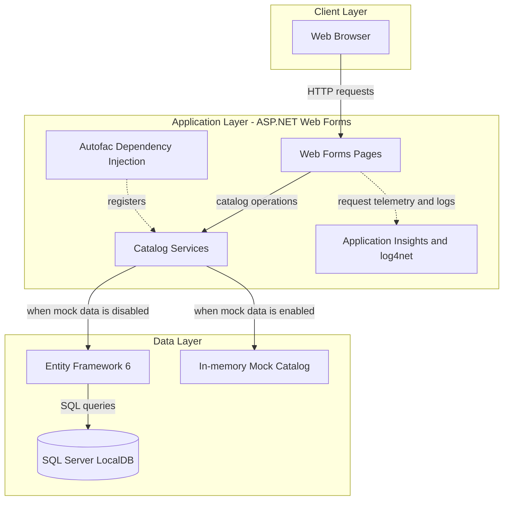
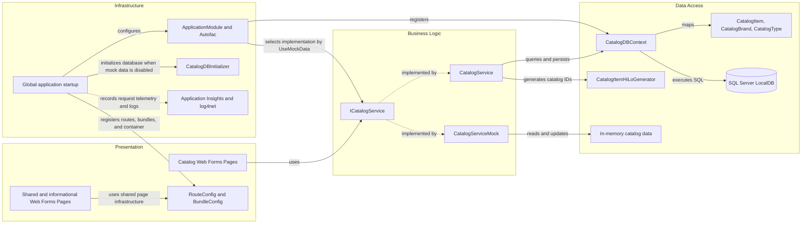

# Architecture Diagram

The application is a server-rendered catalog management site built with ASP.NET Web Forms on .NET Framework 4.7.2. Its catalog service can use either an in-memory mock or Entity Framework 6 backed by SQL Server LocalDB.

## Application Architecture

### Technology Stack Summary

| Layer | Technology | Version | Purpose |
|---|---|---|---|
| Presentation | ASP.NET Web Forms | .NET Framework 4.7.2 | Server-rendered catalog pages |
| Business Logic | C# catalog services | .NET Framework 4.7.2 | Catalog queries and create, update, and delete operations |
| Dependency Injection | Autofac | 4.9.1 | Registers catalog services and data components |
| Data Access | Entity Framework | 6.2.0 | Object-relational mapping and database operations |
| Database | SQL Server LocalDB | LocalDB | Catalog item, brand, and type storage |
| Telemetry and Logging | Application Insights and log4net | Application Insights 2.9.1; log4net 2.0.10 | Request telemetry and application logging |

### Data Storage & External Services

The configured database is SQL Server LocalDB, with Entity Framework mapping catalog items, brands, and types. When `UseMockData` is enabled, catalog operations instead use an in-memory mock service; the application also includes Application Insights instrumentation. No remote service endpoint is configured in the inspected application settings.

### Key Architectural Decisions

- ASP.NET Web Forms pages access catalog operations through the `ICatalogService` abstraction.
- Autofac selects an in-memory mock or Entity Framework-backed service using the `UseMockData` setting.
- Entity Framework 6 maps catalog items, brands, and types through `CatalogDBContext`.

## Component Relationships

### Component Inventory

| Component | Layer | Type | Responsibility |
|---|---|---|---|
| Catalog Web Forms Pages | Presentation | ASP.NET Web Forms pages | Browse and manage catalog items |
| Shared and informational Web Forms Pages | Presentation | ASP.NET Web Forms pages | Provide shared site and informational views |
| RouteConfig and BundleConfig | Presentation | Application configuration | Register URL routes and client-side bundles |
| ICatalogService | Business Logic | Service interface | Defines catalog operations used by pages |
| CatalogService | Business Logic | Service implementation | Performs catalog operations through Entity Framework |
| CatalogServiceMock | Business Logic | Mock service implementation | Provides in-memory catalog behavior |
| CatalogDBContext | Data Access | Entity Framework DbContext | Maps and queries catalog entities |
| CatalogItem, CatalogBrand, CatalogType | Data Access | Entity models | Represent catalog data |
| CatalogItemHiLoGenerator | Data Access | ID generator | Allocates catalog item identifiers |
| Global | Infrastructure | ASP.NET application class | Configures startup, dependency injection, database initialization, and request telemetry |
| ApplicationModule and Autofac | Infrastructure | Dependency injection module | Registers services and data components |
| CatalogDBInitializer | Infrastructure | Database initializer | Initializes catalog database data |
| Application Insights and log4net | Infrastructure | Telemetry and logging | Captures application telemetry and logs |
