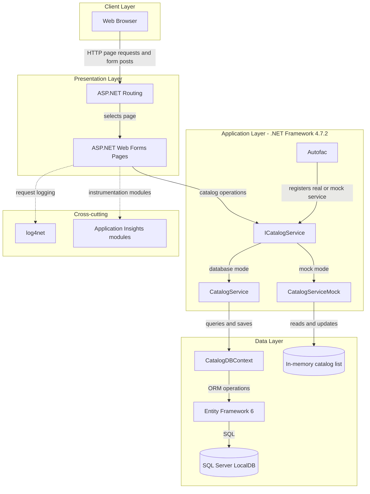
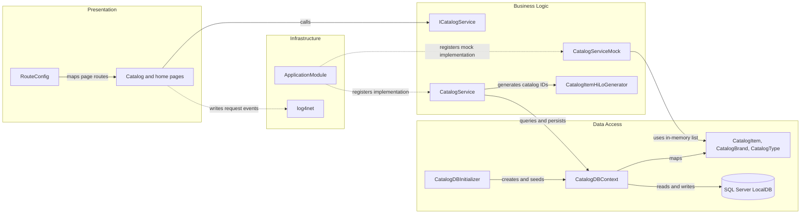

# Architecture Diagram

This application presents the eShop catalog through server-rendered Web Forms pages. Catalog operations use either an in-memory mock service or Entity Framework backed by SQL Server LocalDB.

## Application Architecture

### Technology Stack Summary

| Layer | Technology | Version | Purpose |
|---|---|---|---|
| Presentation | ASP.NET Web Forms | .NET Framework 4.7.2 | Server-rendered catalog pages and form workflows |
| Application | C# and Autofac | Autofac 4.9.1 | Catalog service abstraction and dependency registration |
| Data access | Entity Framework 6 | 6.2.0 | Catalog persistence and entity mapping |
| Storage | SQL Server LocalDB | Local instance | Catalog database when mock mode is disabled |
| Logging | log4net | 2.0.10 | Rolling-file and request logging |
| Telemetry | Application Insights | 2.9.1 family | ASP.NET and dependency telemetry modules |

### Data Storage & External Services

When mock mode is disabled, Entity Framework uses the configured SQL Server LocalDB connection. The project does not define remote APIs, message brokers, or a cache. Application Insights libraries and telemetry modules are present, but no instrumentation key or connection string is configured in the inspected application settings.

### Key Architectural Decisions

- Autofac binds `ICatalogService` to either the database service or the mock service based on `UseMockData`.
- The database path uses an Entity Framework context and a startup initializer to create and seed catalog data.
- The mock service is registered as a singleton and keeps a mutable in-memory catalog list shared across requests.

## Component Relationships

### Component Inventory

| Component | Layer | Type | Responsibility |
|---|---|---|---|
| Catalog and home pages | Presentation | Web Forms pages | Browse and manage catalog items |
| RouteConfig | Presentation | Route registration | Maps friendly routes to pages |
| ICatalogService | Business Logic | Service interface | Defines catalog operations |
| CatalogService | Business Logic | EF-backed service | Reads and updates persisted catalog data |
| CatalogServiceMock | Business Logic | Mock service | Serves and mutates in-memory catalog data |
| CatalogItemHiLoGenerator | Business Logic | ID generator | Allocates catalog item identifiers |
| CatalogDBContext | Data Access | Entity Framework context | Exposes catalog entity sets and mappings |
| CatalogDBInitializer | Data Access | Database initializer | Creates database objects and seeds catalog data |
| ApplicationModule | Infrastructure | Autofac module | Selects and registers application services |
| log4net | Infrastructure | Logging library | Records request and application log events |
