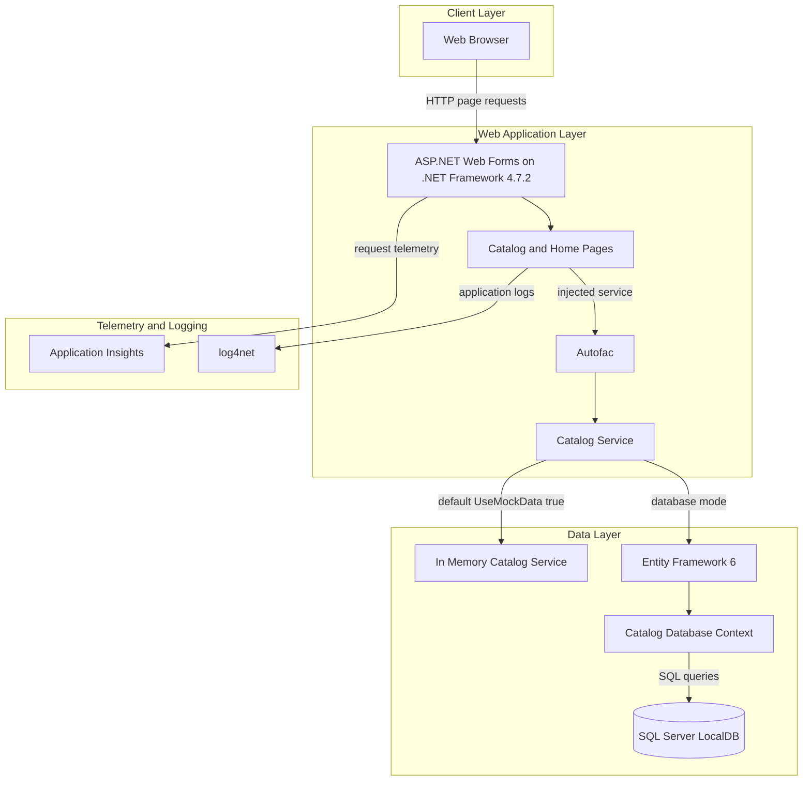
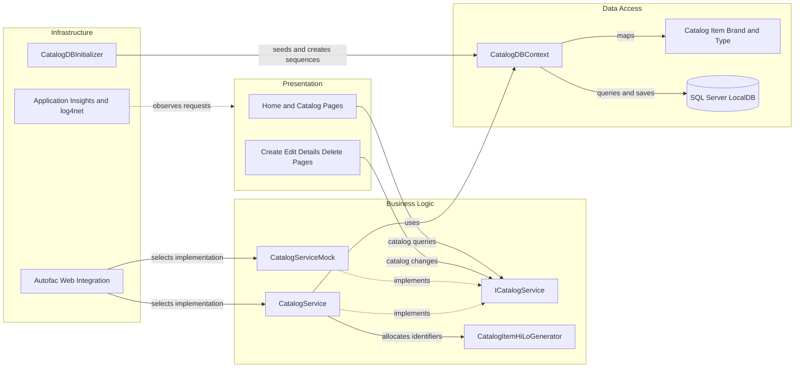

# Architecture Diagram

The application is a server-rendered catalog management website. Its single Web Forms application uses a mock catalog by default and can use SQL Server through Entity Framework when configured for database mode.

## Application Architecture

### Technology Stack Summary

| Layer | Technology | Version | Purpose |
|---|---|---|---|
| Presentation | ASP.NET Web Forms | .NET Framework 4.7.2 | Server-rendered catalog pages |
| Dependency injection | Autofac Web Integration | 4.9.1 / 4.0.0 | Page property injection and service registration |
| Business services | C# | .NET Framework 4.7.2 | Catalog operations |
| Persistence | Entity Framework 6 | 6.2.0 | ORM for SQL Server |
| Logging | log4net | 2.0.10 | Application logging |
| Telemetry | Application Insights SDK | 2.9.1 | Web and dependency telemetry |

### Data Storage & External Services

When mock data is disabled, Entity Framework connects to SQL Server LocalDB using integrated security. The shipped configuration sets `UseMockData=true`, so the default runtime uses the in-memory catalog service. Application Insights is configured for telemetry; no external business APIs, cache, or message broker were identified.

### Key Architectural Decisions

- Autofac selects either the in-memory catalog implementation or the Entity Framework implementation based on `UseMockData`.
- Entity Framework maps catalog items to required catalog-brand and catalog-type relationships.
- The application renders HTML pages and does not expose a separate REST API.

## Component Relationships

### Component Inventory

| Component | Layer | Type | Responsibility |
|---|---|---|---|
| Home and catalog pages | Presentation | Web Forms pages | List and paginate catalog items |
| Create, edit, details, delete pages | Presentation | Web Forms pages | Manage catalog records |
| ICatalogService | Business Logic | Service interface | Defines catalog operations |
| CatalogServiceMock | Business Logic | Mock service | Maintains catalog items in memory |
| CatalogService | Business Logic | Data-backed service | Implements catalog operations through EF |
| CatalogDBContext | Data Access | EF DbContext | Maps catalog entities to SQL Server |
| CatalogItemHiLoGenerator | Data Access | Identifier generator | Allocates item identifiers from a SQL sequence |
| CatalogDBInitializer | Infrastructure | EF initializer | Creates sequences and seeds initial records |
| ApplicationModule | Infrastructure | Autofac module | Registers the mock or database service |
| Application Insights and log4net | Infrastructure | Telemetry and logging | Captures request telemetry and application logs |
