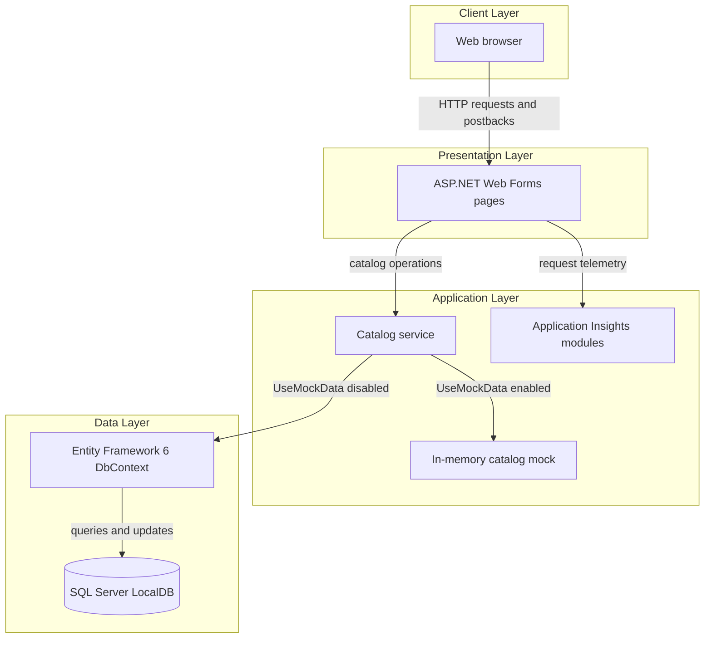
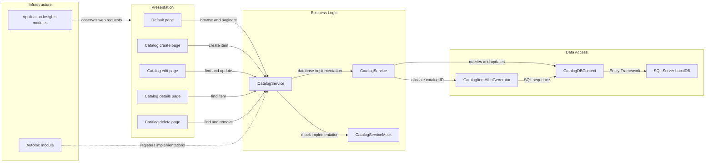

# Architecture Diagram

The application is a single ASP.NET Web Forms site for browsing and maintaining a product catalog. It runs with in-memory mock catalog data by default, with an Entity Framework and SQL Server LocalDB path available when mock mode is disabled.

## Application Architecture

### Technology Stack Summary

| Layer | Technology | Version | Purpose |
|---|---|---|---|
| Presentation | ASP.NET Web Forms on .NET Framework | 4.7.2 | Server-rendered catalog pages and postbacks |
| Dependency injection | Autofac and Autofac.Web | 4.9.1 / 4.0.0 | Register catalog services and Web Forms integration |
| Data access | Entity Framework 6 | 6.2.0 | Catalog persistence through `CatalogDBContext` |
| Database | SQL Server LocalDB | LocalDB | Catalog storage when mock mode is disabled |
| Observability | Application Insights | 2.9.1 | Web request and application telemetry |
| Logging | log4net | 2.0.10 | Application logging |

### Data Storage & External Services

The configured database is SQL Server LocalDB. `UseMockData` defaults to `true`, so the default runtime path uses a shared in-memory catalog; setting it to `false` activates Entity Framework persistence. Application Insights is the only identified external telemetry integration; no external business APIs or message brokers were found.

### Key Architectural Decisions

- Autofac registers the catalog service per request for database mode and as a singleton in mock mode.
- Entity Framework 6 maps catalog items, brands, and types to SQL Server tables.
- ASP.NET Web Forms handles both page rendering and catalog form submissions.

## Component Relationships

### Component Inventory

| Component | Layer | Type | Responsibility |
|---|---|---|---|
| Default page | Presentation | Web Forms page | Lists and paginates catalog items |
| Create, Edit, Details, Delete pages | Presentation | Web Forms pages | Perform catalog item CRUD interactions |
| `ICatalogService` | Business Logic | Service interface | Defines catalog operations used by pages |
| `CatalogService` | Business Logic | Service | Performs catalog reads and writes through EF6 |
| `CatalogServiceMock` | Business Logic | Mock service | Provides mutable in-memory catalog operations |
| `CatalogDBContext` | Data Access | EF6 DbContext | Maps catalog entities to SQL Server |
| `CatalogItemHiLoGenerator` | Data Access | ID generator | Allocates catalog IDs from a SQL sequence |
| `ApplicationModule` | Infrastructure | Autofac module | Selects and registers catalog implementations |
