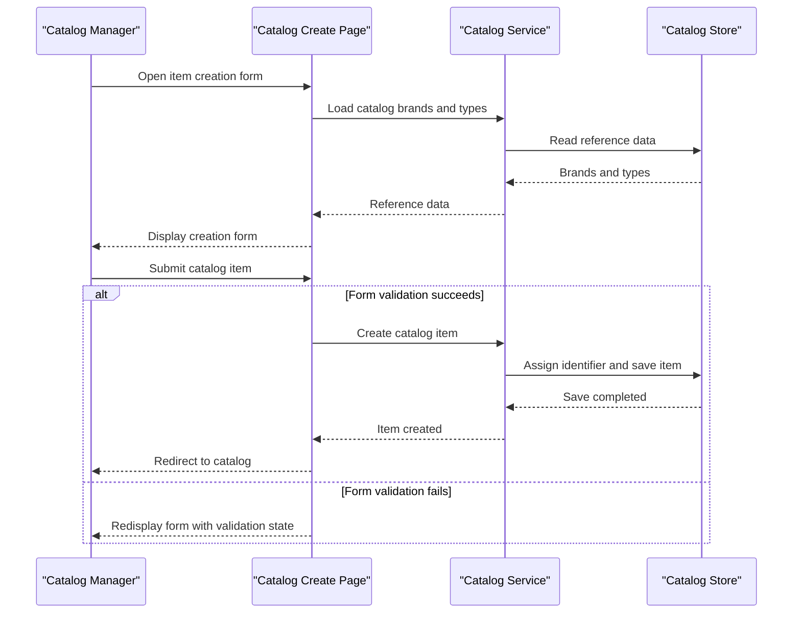

# Core Business Workflows

The application supports maintaining a product catalog for an online shop, including browsing, classifying, and editing catalog items. Catalog data is managed within one application boundary; no cross-service business workflows were identified.

## Domain Entities

| Entity | Service / Bounded Context | Description | Key Relationships |
|---|---|---|---|
| CatalogItem | eShopLegacyWebForms / Catalog Management | A product offered in the shop, with pricing, stock, and catalog presentation information | Belongs to one catalog brand and one catalog type |
| CatalogBrand | eShopLegacyWebForms / Catalog Management | Groups products under a brand | Associated with catalog items |
| CatalogType | eShopLegacyWebForms / Catalog Management | Classifies products by type | Associated with catalog items |

## Service-to-Domain Mapping

| Service | Domain Context | Owned Entities | External Dependencies |
|---|---|---|---|
| eShopLegacyWebForms | Catalog Management | CatalogItem, CatalogBrand, CatalogType | SQL Server LocalDB when database mode is selected; otherwise an in-memory mock catalog |

All domain state is managed within the same application. No independently deployed service or cross-context data exchange was identified.

## Primary Workflows

### Workflow 1: Create a Catalog Item

1. A user opens the catalog item creation page and the application loads the available brands and types.
2. The user submits the form. The page checks `ModelState.IsValid`; invalid submissions remain on the form without persisting an item.
3. For a valid submission, the page creates a `CatalogItem` from the form and calls the catalog service.
4. The service assigns an identifier and stores the new item through the selected data implementation.
5. On success, the page redirects to the catalog landing page.

### Workflow 2: Update or Remove a Catalog Item

1. The user selects an existing item; the application loads it by route identifier and displays its details or edit/delete page.
2. An edit submission is accepted only when `ModelState.IsValid`; the catalog service updates the item. A delete confirmation removes the selected item.
3. Successful updates and removals redirect to the catalog landing page.

### Workflow 3: Initialize Catalog Data

1. At application startup, database initialization is configured only when mock data is disabled.
2. When a new database is created, the initializer creates sequence objects and seeds catalog types, brands, and items.
3. Seed records come from predefined data by default; optional customization files are used when customization data is enabled.

## Cross-Service Data Flows

No cross-service data composition or aggregation pattern was found. Catalog item, brand, and type data are read and written within the same application; in mock mode, the in-memory service supplies catalog operations instead of the database-backed implementation. No remote-service fallback behavior is configured.

## Business Workflow Sequence

## Business Rules & Decision Logic

- Catalog changes are persisted only when the page model state is valid.
- Price input must be a non-negative value with no more than two decimal places and within the configured maximum range.
- Stock, restock threshold, and maximum stock values are constrained to the configured range from zero to ten million.
- Catalog items require associated brand and type records in database mode.
- Item identifiers are assigned by the catalog ID generator for newly created database-backed records.
- `UseMockData` selects whether catalog operations use the mock or database-backed implementation; database initialization is only configured for database mode.
- Database initialization seeds types and brands before catalog items so that the item references can be resolved.
- Entity Framework `SaveChanges` persists individual mutations; no broader transaction orchestration, compensation, audit trail, or role-based authorization rule was identified.
