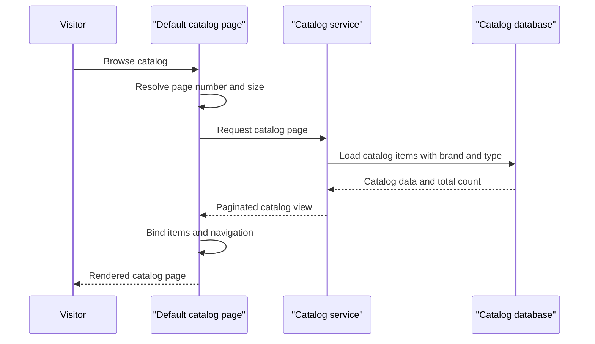

# Core Business Workflows

The application supports catalog browsing and basic catalog administration for an e-commerce storefront. Its primary business objects are products, brands, and product types.

## Domain Entities

| Entity | Service / Bounded Context | Description | Key Relationships |
|---|---|---|---|
| CatalogItem | Catalog | Product sold or displayed in the storefront | Belongs to one CatalogBrand and one CatalogType |
| CatalogBrand | Catalog | Product brand classification | Can classify multiple CatalogItems |
| CatalogType | Catalog | Product type/category classification | Can categorize multiple CatalogItems |

## Service-to-Domain Mapping

| Service | Domain Context | Owned Entities | External Dependencies |
|---|---|---|---|
| eShopLegacyWebForms | Catalog | CatalogItem, CatalogBrand, CatalogType | SQL Server LocalDB in database mode; none for in-memory mock mode |

## Primary Workflows

### Workflow 1: Browse Catalog

1. A visitor requests the default catalog page or a paginated route.
2. The page uses supplied route values or the default page size/index.
3. `ICatalogService.GetCatalogItemsPaginated` returns an ordered item page with its brand/type details and total count.
4. The page binds the items and builds previous/next navigation links.
5. The server returns rendered HTML.

### Workflow 2: Maintain a Catalog Item

1. A catalog editor opens Create or Edit and enters product information.
2. The page checks its model state and constructs a `CatalogItem`.
3. The catalog service assigns an identifier for new items or updates the existing EF entity, then saves changes.
4. The user is redirected to the catalog page.

### Workflow 3: Delete a Catalog Item

1. The page resolves an item by route ID and displays its details.
2. On the delete postback, the service removes the selected item.
3. The user is redirected to the catalog page.

## Cross-Service Data Flows

No independently deployed services or cross-service data aggregation were identified. The page layer calls one catalog service; database mode persists with EF6, while mock mode operates on an in-memory list.

## Business Workflow Sequence

## Business Rules & Decision Logic

- Catalog item prices are constrained to non-negative values with at most two fractional digits by the model validation attributes.
- Stock, restock threshold, and maximum stock values have non-negative range limits up to ten million.
- EF mapping requires a name (maximum 50 characters), price, picture filename, brand, and type; brand and type text fields are required and limited to 100 characters.
- New catalog item identifiers are supplied by a high/low SQL sequence in database mode or by incrementing the current maximum ID in mock mode.
- `UseMockData` selects the service implementation; `UseCustomizationData` selects built-in versus CSV/image seed content.
- No explicit transaction orchestration beyond EF `SaveChanges`, audit trail, or application-level authorization rules were identified.
