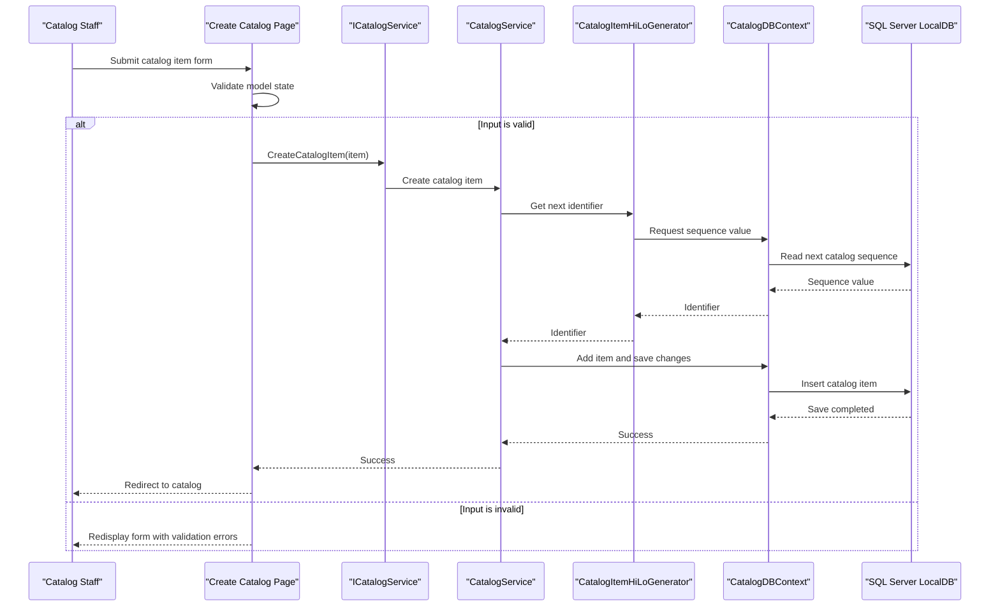

# Core Business Workflows

The application supports browsing and maintaining the eShop product catalog. Catalog staff can create, edit, or remove products, while visitors browse products by page.

## Domain Entities

| Entity | Service / Bounded Context | Description | Key Relationships |
|---|---|---|---|
| CatalogItem | Catalog Management | Product offered in the eShop catalog, including price and stock information | Belongs to one CatalogBrand and one CatalogType |
| CatalogBrand | Catalog Management | Brand classification for products | Can classify multiple CatalogItems |
| CatalogType | Catalog Management | Product type classification | Can categorize multiple CatalogItems |

## Service-to-Domain Mapping

| Service | Domain Context | Owned Entities | External Dependencies |
|---|---|---|---|
| eShopLegacyWebForms | Catalog Management | CatalogItem, CatalogBrand, CatalogType | SQL Server LocalDB in database mode; preconfigured in-memory data in mock mode |

The application has no cross-service domain exchange. `ICatalogService` is the catalog boundary used by the pages; `CatalogService` owns persisted catalog operations, while `CatalogServiceMock` supplies the mock implementation.

## Primary Workflows

### Workflow 1: Browse the Product Catalog

1. The visitor opens the catalog or requests a page using the index and size route values.
2. The home page calls `ICatalogService.GetCatalogItemsPaginated`.
3. In database mode, `CatalogService` counts and retrieves catalog items ordered by identifier, including each item's brand and type.
4. In mock mode, `CatalogServiceMock` composes the preconfigured brand and type data and returns the selected page.
5. The page binds the results and renders the catalog and pagination links.

### Workflow 2: Create or Update a Catalog Item

1. A staff member submits the create or edit form.
2. The page constructs a `CatalogItem` from the form and checks `ModelState`.
3. If valid, the page calls the corresponding `ICatalogService` operation.
4. Database mode assigns a new identifier for creation and saves changes through Entity Framework; updates mark the entity modified and save. Mock mode updates its in-memory list.
5. The page redirects to the catalog listing.

### Workflow 3: Delete a Catalog Item

1. The delete page loads the selected product by route identifier.
2. On the delete postback, it calls `ICatalogService.RemoveCatalogItem`.
3. The implementation removes the item from the database or mock list, then redirects to the catalog listing.

## Cross-Service Data Flows

No cross-service calls or data composition flows were found. The real catalog service loads brand and type navigation data through Entity Framework; the mock service composes equivalent relationships from local preconfigured lists. There is no remote-service fallback path.

## Business Workflow Sequence

In mock mode, the application service instead assigns an identifier from the in-memory catalog list and adds the item without database calls.

## Business Rules & Decision Logic

- Catalog item validation is performed through `ModelState` and data annotations on `CatalogItem`; price and inventory values have configured range/format rules.
- Each catalog item is mapped to a required brand and type.
- Create, update, and delete operations persist through `CatalogService` in database mode; `CatalogServiceMock` mutates its in-memory collection in mock mode.
- Database changes are committed through Entity Framework `SaveChanges`; no distributed transaction or cross-service consistency mechanism is present.
- No explicit role-based or resource-ownership checks were found in the catalog page handlers.
