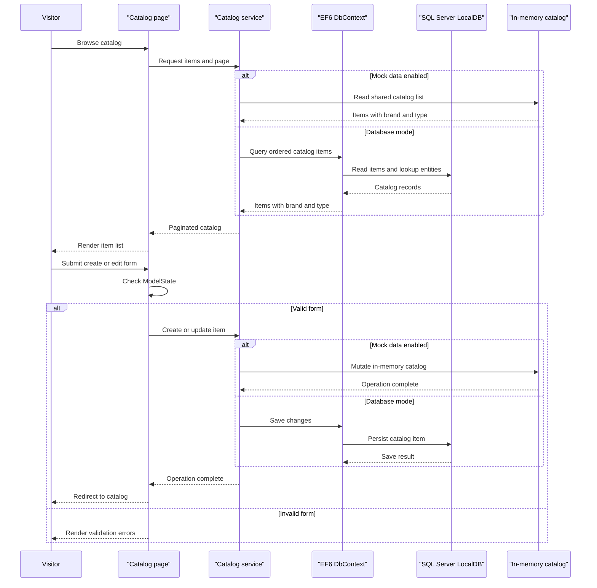

# Core Business Workflows

The application supports maintaining and browsing an e-commerce product catalog. Users can inspect catalog items and create, edit, or delete products; brands and types classify the catalog items.

## Domain Entities

| Entity | Service / Bounded Context | Description | Key Relationships |
|---|---|---|---|
| CatalogItem | eShopLegacyWebForms / Catalog | Product offered in the catalog, with price, stock, and image information | Each item belongs to one brand and one type |
| CatalogBrand | eShopLegacyWebForms / Catalog | Brand classification for products | A brand can classify many catalog items |
| CatalogType | eShopLegacyWebForms / Catalog | Type or category classification for products | A type can classify many catalog items |

## Service-to-Domain Mapping

| Service | Domain Context | Owned Entities | External Dependencies |
|---|---|---|---|
| eShopLegacyWebForms | Product Catalog | CatalogItem, CatalogBrand, CatalogType | SQL Server LocalDB when mock mode is disabled; otherwise an in-memory mock |

All catalog behavior belongs to one application; no cross-service ownership or event exchange was identified.

## Primary Workflows

### Workflow 1: Browse Catalog

1. A visitor opens the home page or a paginated catalog route.
2. The page resolves the requested page size and index and calls `ICatalogService`.
3. The service returns catalog items ordered by ID, together with brand and type data.
4. The page renders the item list and navigation summary.
5. In default mock mode, data comes from the singleton in-memory mock; database mode uses EF6.

### Workflow 2: Create Catalog Item

1. A user opens the create page and submits catalog fields.
2. The page checks `ModelState`; invalid input does not proceed to persistence.
3. The page constructs a `CatalogItem` from the form values and resolves brand and type selections.
4. The catalog service assigns an ID and adds the item to the mock collection or EF context; database mode saves changes.
5. The user is redirected to the catalog listing.

### Workflow 3: Edit or Delete Catalog Item

1. The page resolves the item ID from the route and loads the item through the catalog service.
2. For editing, the page creates an updated item from submitted form values and asks the service to update it.
3. For deletion, the page passes the loaded item to the service for removal.
4. Database mode persists each operation through EF6 `SaveChanges`; mock mode mutates the shared in-memory list.
5. The user is redirected to the catalog listing.

## Cross-Service Data Flows

No cross-service calls, message brokers, or gateway aggregation were found. Catalog items, brands, and types are composed within the same application through the catalog service; the database-backed service loads brand and type navigation data through EF6.

## Business Workflow Sequence

## Business Rules & Decision Logic

- `CatalogItem` price is constrained to non-negative values with at most two decimal places; stock, restock threshold, and maximum stock values are range-constrained by model annotations.
- Catalog items require a valid brand and type relationship in the EF6 model.
- The service assigns IDs using a SQL HiLo sequence in database mode and increments the maximum ID in mock mode.
- Create and edit handlers proceed only when `ModelState.IsValid`; the delete handler removes the loaded item.
- Persistence operations are saved through EF6 `SaveChanges`; no distributed transaction, saga, or explicit audit trail was found.
- The application has no identified role-based authorization checks for catalog mutation workflows.
