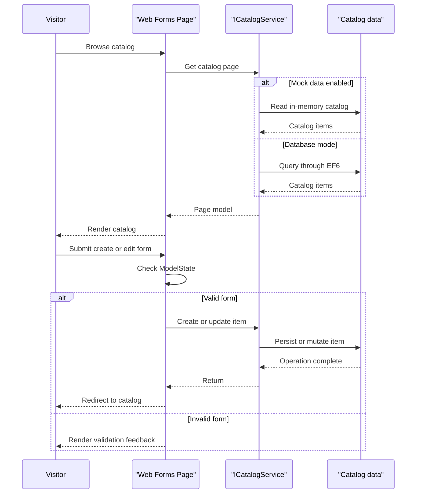

# Core Business Workflows

The application supports browsing and maintaining a product catalog, including catalog types and brands. Its user-facing flows are implemented as individual Web Forms pages, with a service abstraction selecting either mock data or EF-backed persistence.

## Domain Entities

| Entity | Service / Bounded Context | Description | Key Relationships |
|---|---|---|---|
| CatalogItem | Catalog | Product available for browsing and maintenance | Belongs to one CatalogBrand and one CatalogType |
| CatalogBrand | Catalog | Brand classification for catalog items | Can classify multiple CatalogItems |
| CatalogType | Catalog | Type classification for catalog items | Can classify multiple CatalogItems |

## Service-to-Domain Mapping

| Service | Domain Context | Owned Entities | External Dependencies |
|---|---|---|---|
| eShopLegacyWebForms | Catalog | CatalogItem, CatalogBrand, CatalogType | No external business services; optional SQL Server LocalDB |

The application is a single deployable web project. Catalog pages use `ICatalogService`; there is no cross-service exchange or aggregation.

## Primary Workflows

### Workflow 1: Browse and paginate catalog

1. A visitor opens the home page or a page route with an index and size.
2. The page asks `ICatalogService` for a page of items and binds the result to the catalog view.
3. The service returns catalog items and their brand/type information from mock data or EF.
4. Previous/next links are generated from the current page model.

The route-provided page size and index are converted to integers and used in pagination. No dedicated workflow-level authorization is present in the application.

### Workflow 2: Create or edit catalog item

1. An operator opens the create or edit form and supplies catalog values.
2. The Web Forms page checks `ModelState.IsValid`; it then builds a `CatalogItem` using the submitted values and selected brand/type.
3. `ICatalogService` creates or updates the catalog item and returns the browser to the home page.
4. Database mode uses EF and a HiLo identifier generator; mock mode mutates the in-memory catalog.

The model defines price and stock range/format validation. The create workflow defaults the picture name through the model constructor; edit accepts a submitted picture filename.

### Workflow 3: View or delete catalog item

1. A visitor follows the details or delete route with an item identifier.
2. The page retrieves the item through `ICatalogService` and binds it for display or confirmation.
3. A delete form submission calls the service to remove the item and redirects to the catalog.

## Cross-Service Data Flows

No cross-service data flow exists. All catalog reads and writes stay within the web application and are handled by either the in-process mock service or the EF-backed service using LocalDB.

## Business Workflow Sequence

## Business Rules & Decision Logic

- A catalog item is associated with a brand and a type.
- Price uses a decimal format/range validation, and stock-related values have numeric range checks on the entity.
- Create, update, and delete operations are submitted through Web Forms controls and call the catalog service.
- Database initialization and persistence are conditional on `UseMockData`; seed customization is conditional on `UseCustomizationData`.
- The application has no identified authentication or authorization configuration for catalog maintenance pages.
- Database persistence is managed through EF operations; the mock implementation mutates a shared in-memory list.
