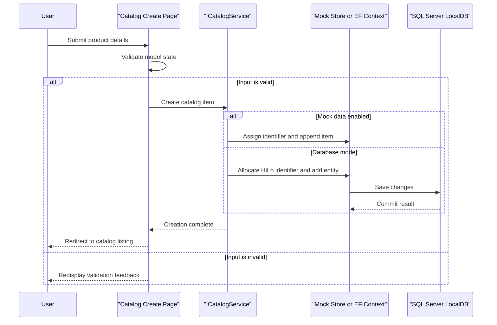

# Core Business Workflows

The application supports browsing and maintaining a product catalog, including product types, brands, pricing, and inventory thresholds. Catalog data is served from preconfigured in-memory data by default or from SQL Server when database mode is enabled.

## Domain Entities

| Entity | Service / Bounded Context | Description | Key Relationships |
|---|---|---|---|
| CatalogItem | Catalog Management | Product available for browsing and maintenance | Belongs to one catalog brand and one catalog type |
| CatalogBrand | Catalog Management | Brand classification for products | Can be associated with multiple catalog items |
| CatalogType | Catalog Management | Type classification for products | Can be associated with multiple catalog items |

## Service-to-Domain Mapping

| Service | Domain Context | Owned Entities | External Dependencies |
|---|---|---|---|
| eShopLegacyWebForms | Catalog Management | CatalogItem, CatalogBrand, CatalogType | Optional SQL Server LocalDB; default mock implementation |

## Primary Workflows

### Workflow 1: Create a Catalog Item

1. A user opens the catalog creation page and supplies product details, brand/type, price, and inventory values.
2. The page checks `ModelState`; invalid values are not submitted to the catalog service.
3. `CatalogServiceMock` assigns an in-memory identifier when mock mode is enabled. Database mode uses the HiLo sequence generator and saves through EF6.
4. The page redirects to the catalog listing.

### Workflow 2: Update or Delete a Catalog Item

1. A user selects an item from the listing; route data supplies the item identifier.
2. The edit or delete page loads the item through `ICatalogService`.
3. Edit validates the bound form state before calling `UpdateCatalogItem`; delete calls `RemoveCatalogItem`.
4. The user is redirected to the catalog listing after the operation.

### Workflow 3: Browse Catalog

The home page retrieves a page of catalog items and binds the item, brand, and type information to the server-rendered list. Paging uses the route's `index` and `size` values; the default is page index 0 and page size 10.

## Cross-Service Data Flows

No cross-service calls or distributed data aggregation were identified. The catalog page obtains product and lookup data from the same `ICatalogService`; the active implementation is selected locally by configuration.

## Business Workflow Sequence

## Business Rules & Decision Logic

- Catalog item price must satisfy its numeric format and range annotations; inventory and restock thresholds have configured numeric ranges.
- Each database-backed catalog item requires one brand and one type.
- The application selects mock or database behavior from `UseMockData`; customization data is separately controlled by `UseCustomizationData`.
- Database mode initializes lookup/product seed data and uses SQL sequence values to allocate identifiers.
- Catalog changes are local to the application; no external business events or compensating transactions were found.
- No authentication or authorization rules were identified in the assessed application routes.
