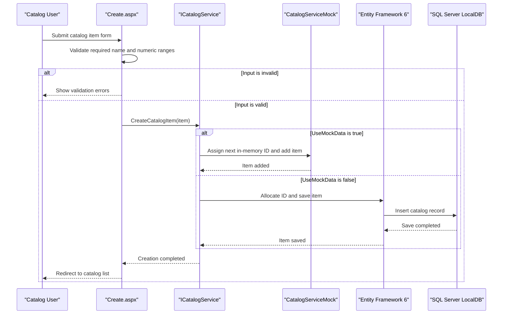

# Core Business Workflows

The application supports browsing and maintaining a product catalog. Catalog items are associated with a brand and a type, with stock and pricing information presented to users.

## Domain Entities

| Entity | Service / Bounded Context | Description | Key Relationships |
|---|---|---|---|
| CatalogItem | Catalog | A listed product, including price, picture reference, and stock thresholds | Belongs to one CatalogBrand and one CatalogType |
| CatalogBrand | Catalog | A maker or label associated with products | Has many CatalogItems |
| CatalogType | Catalog | A classification for products | Has many CatalogItems |

## Service-to-Domain Mapping

| Service | Domain Context | Owned Entities | External Dependencies |
|---|---|---|---|
| eShopLegacyWebForms / `ICatalogService` | Catalog | CatalogItem, CatalogBrand, CatalogType | None in mock mode; LocalDB through EF6 when mock mode is disabled |

The application is a single bounded context. No inter-service data exchange or cross-context aggregation was found.

## Primary Workflows

### Workflow 1: Browse and view catalog items

The default page requests a page of catalog items and binds the returned data to the Web Forms list. Selecting a product opens its details page. Pagination is driven by the route's `index` and `size` values; the service orders items by identifier and returns the selected page.

### Workflow 2: Create a catalog item

The user submits the create form. Required-name and numeric range validators run, and the page checks model state before constructing a `CatalogItem`. The catalog service assigns an identifier and persists the item, then redirects to the catalog list. In mock mode, the identifier is based on the current maximum; in database mode, the Hi/Lo generator obtains identifiers from a SQL sequence.

### Workflow 3: Update or delete a catalog item

The edit and delete pages load an item by route identifier. A valid edit replaces the catalog item through the service; a delete postback removes it. Both successful operations redirect to the catalog list.

## Cross-Service Data Flows

No cross-service calls or data composition flows were identified. In database mode, EF6 loads a catalog item together with its brand and type references. In the default mock mode, `CatalogServiceMock` composes those references from in-memory catalog lists.

## Business Workflow Sequence

## Business Rules & Decision Logic

- A catalog item's name is required on the create and edit forms.
- The form constrains price to a non-negative value up to 1,000,000 and stock, restock, and maximum-stock values to 0–10,000,000.
- The entity model applies range and price-format validation to numeric catalog fields.
- Items reference an existing brand and type; the EF model requires both relationships.
- A successful create, update, or delete saves the corresponding service operation and returns the user to the catalog list.
- Each database-mode write is persisted through EF6 `SaveChanges`; no cross-service transaction or compensation flow was identified.
