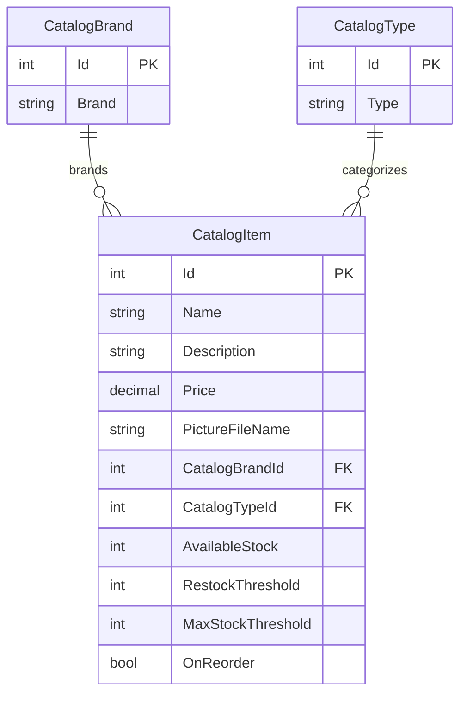

# Data Architecture & Persistence Layer

The catalog data model contains three entities and is persisted with Entity Framework 6 when database mode is enabled. The default configuration instead uses an in-memory catalog service and preconfigured catalog data.

## Database Configuration

| Service/Module | DB Type | Profile | Driver | Connection | Migration Tool |
|---|---|---|---|---|---|
| eShopLegacyWebForms | SQL Server LocalDB | Default configuration; used only when `UseMockData=false` | System.Data.SqlClient | LocalDB `MSSQLLocalDB`, integrated security | EF6 `CreateDatabaseIfNotExists` initializer and SQL sequence scripts |
| eShopLegacyWebForms | In-memory mock | Default (`UseMockData=true`) | — | Process memory | None |

The EF initializer creates three HiLo sequences and seeds catalog types, brands, and items. No schema migration framework or external database profile was found.

## Data Ownership per Service

| Service | Tables Owned | ORM Framework | Caching | Notes |
|---|---|---|---|---|
| eShopLegacyWebForms catalog | Catalog, CatalogBrand, CatalogType | Entity Framework 6 | None detected | The mock implementation keeps catalog items in a process-local list |

## Entity Model

`CatalogItem`, `CatalogBrand`, and `CatalogType` are defined under `src/eShopLegacyWebForms/Models/`. `CatalogDBContext` maps them to the `Catalog`, `CatalogBrand`, and `CatalogType` tables; each item requires one brand and one type. Writes are saved through EF6 `SaveChanges`.

## Key Repository Methods

| Service | Repository | Notable Methods | Purpose |
|---|---|---|---|
| eShopLegacyWebForms | `CatalogService` (`Services/CatalogService.cs`) | `GetCatalogItemsPaginated(pageSize, pageIndex)`, `FindCatalogItem(id)`, `GetCatalogTypes()`, `GetCatalogBrands()` | Query and page catalog entities through `CatalogDBContext` |
| eShopLegacyWebForms | `CatalogService` (`Services/CatalogService.cs`) | `CreateCatalogItem`, `UpdateCatalogItem`, `RemoveCatalogItem` | Persist catalog mutations |

The code uses a service class as the EF data-access boundary; no dedicated repository interface was found.

## Caching Strategy

No explicit cache provider, cache annotations, TTL policy, or cache-aside behavior was detected. The mock service retains catalog records in an in-memory list for the process lifetime; this is its backing store rather than a separate cache.

## Data Ownership Boundaries

All catalog entities are owned by one application and one logical data context. Database mode uses a single LocalDB database; mock mode keeps data in memory. No cross-service data exchange, CQRS, or service-level data isolation was found.

### Data Classification & Sensitivity

| Entity | Sensitive Fields | Classification (PII/PHI/PCI/None) | Controls in Place |
|---|---|---|---|
| CatalogItem | Product description, name, price, inventory | None | Not applicable |
| CatalogBrand | Brand name | None | Not applicable |
| CatalogType | Type name | None | Not applicable |

No PII, PHI, or PCI data was detected in the catalog entity model.
