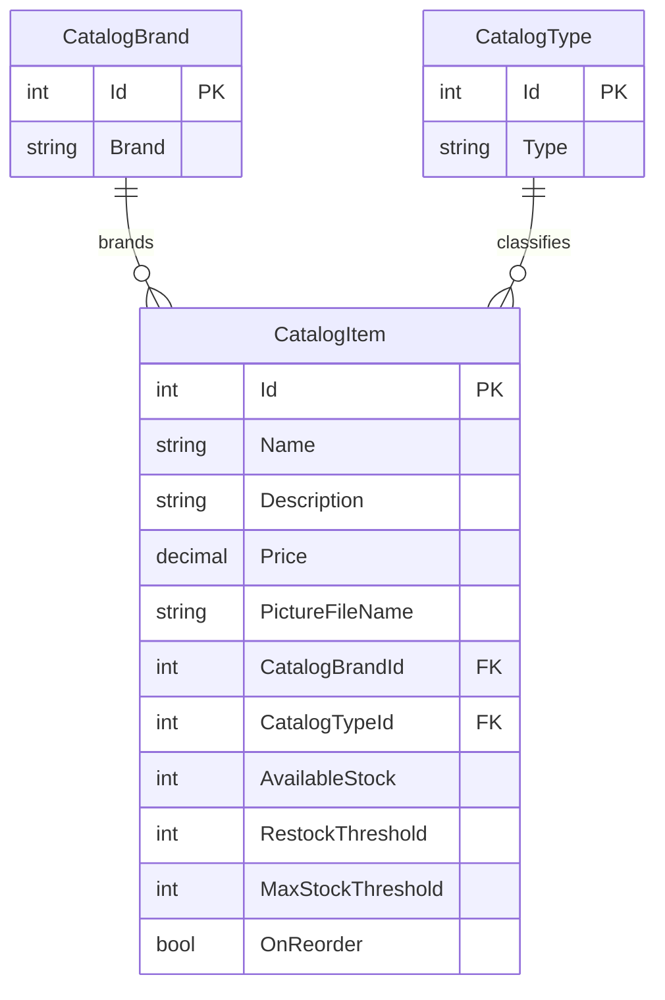

# Data Architecture & Persistence Layer

The data model contains three catalog entities and uses Entity Framework 6.2.0 with SQL Server LocalDB for persistence. The default configuration selects an in-memory mock service, so the database path is inactive unless `UseMockData` is disabled.

## Database Configuration

| Service/Module | DB Type | Profile | Driver | Connection | Migration Tool |
|---|---|---|---|---|---|
| eShopLegacyWebForms | SQL Server LocalDB | Default database mode; not used while mock mode is enabled | System.Data.SqlClient | `CatalogDBContext` connection string in `Web.config`, using integrated security | EF6 `CreateDatabaseIfNotExists` initializer and bundled sequence SQL scripts |

The database initializer seeds brands, types, and items from built-in data by default; CSV customization data is available when enabled.

## Data Ownership per Service

| Service | Tables Owned | ORM Framework | Caching | Notes |
|---|---|---|---|---|
| eShopLegacyWebForms catalog | Catalog, CatalogBrand, CatalogType | Entity Framework 6 | None detected | Single application owns the catalog data; mock mode stores items in a process-local list |

## Entity Model

Entity definitions are in `Models/CatalogItem.cs`, `Models/CatalogBrand.cs`, and `Models/CatalogType.cs`; EF mappings are configured in `Models/CatalogDBContext.cs`.

## Key Repository Methods

| Service | Repository | Notable Methods | Purpose |
|---|---|---|---|
| eShopLegacyWebForms catalog | No repository abstraction | `CatalogService.GetCatalogItemsPaginated`, `FindCatalogItem`, `CreateCatalogItem`, `UpdateCatalogItem`, `RemoveCatalogItem` | Uses `CatalogDBContext` directly for CRUD and paginated reads |

The EF service uses LINQ queries and `DbSet` operations; there are no repository interfaces or custom SQL query classes.

## Caching Strategy

No dedicated cache provider or caching annotations were detected. When mock mode is selected, `CatalogServiceMock` retains a mutable catalog list in the application process; this is mock data storage rather than a configured cache.

## Data Ownership Boundaries

The application has one catalog bounded context and one configured LocalDB database, with no service-to-service data exchange. `CatalogService` accesses EF entities through a single `CatalogDBContext`; `CatalogServiceMock` instead owns a local list.

### Data Classification & Sensitivity

| Entity | Sensitive Fields | Classification (PII/PHI/PCI/None) | Controls in Place |
|---|---|---|---|
| CatalogItem | None identified | None | No sensitive personal, health, or payment data identified |
| CatalogBrand | None identified | None | No sensitive personal, health, or payment data identified |
| CatalogType | None identified | None | No sensitive personal, health, or payment data identified |
