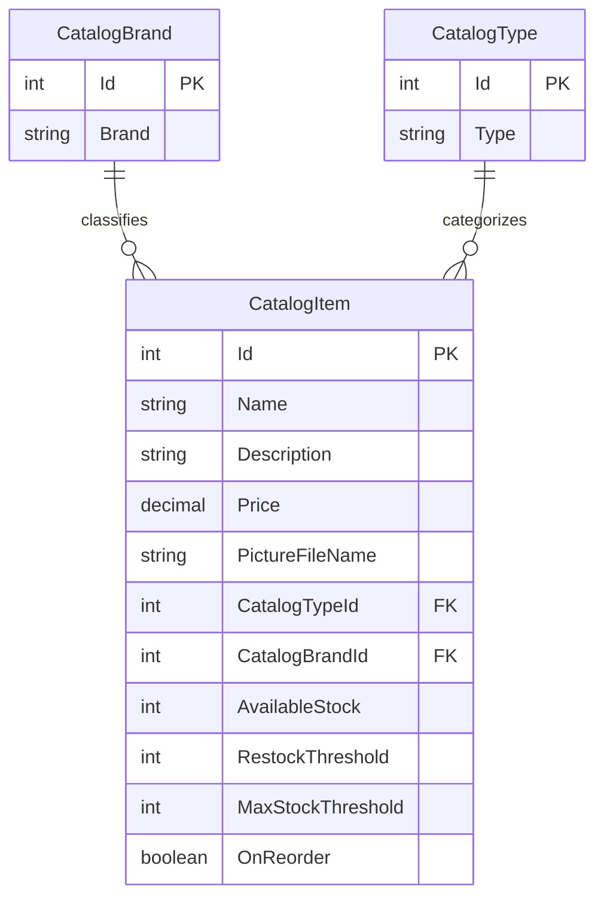

# Data Architecture & Persistence Layer

The application models a product catalog with three Entity Framework entities and supports both a local SQL Server database and in-memory mock data. Persistence is handled by Entity Framework 6, with a database initializer responsible for initial schema objects and seed data.

## Database Configuration

| Service/Module | DB Type | Profile | Driver | Connection | Migration Tool |
|---|---|---|---|---|---|
| eShopLegacyWebForms | SQL Server LocalDB | Default, when `UseMockData` is false | System.Data.SqlClient | `CatalogDBContext` in `Web.config`; integrated authentication | Entity Framework `CreateDatabaseIfNotExists` initializer and seed scripts; no versioned migration tool detected |

## Data Ownership per Service

| Service | Tables Owned | ORM Framework | Caching | Notes |
|---|---|---|---|---|
| eShopLegacyWebForms | Catalog, CatalogBrand, CatalogType | Entity Framework 6 | None | A single application owns all catalog entities; mock mode uses an in-memory list |

## Entity Model

`CatalogItem` is the primary catalog record; each item requires one brand and one type. Entity mappings and table names are defined in `src/eShopLegacyWebForms/Models/CatalogDBContext.cs`; entity classes are under `src/eShopLegacyWebForms/Models/`.

## Key Repository Methods

| Service | Repository | Notable Methods | Purpose |
|---|---|---|---|
| eShopLegacyWebForms | No repository abstraction detected; `CatalogService` implements `ICatalogService` | `GetCatalogItemsPaginated(pageSize, pageIndex)`, `FindCatalogItem(id)`, `GetCatalogTypes()`, `GetCatalogBrands()` | Reads catalog records, eager-loads brand/type navigation properties, and provides lookup lists |
| eShopLegacyWebForms | `CatalogService` | `CreateCatalogItem`, `UpdateCatalogItem`, `RemoveCatalogItem` | Adds, updates, or deletes catalog records and saves changes |
| eShopLegacyWebForms | `CatalogItemHiLoGenerator` | `GetNextSequenceValue` | Allocates catalog item identifiers from the database sequence |

## Caching Strategy

No application cache, distributed cache, or ORM second-level cache is configured. Mock mode serves catalog data from a singleton in-memory list; this is the mock data store rather than a cache.

## Data Ownership Boundaries

The application has one catalog data boundary and one configured LocalDB database; there are no independently deployed services or cross-service database calls. The real catalog service reads and writes through `CatalogDBContext`. The mock service uses preconfigured in-memory data. The application does not implement CQRS or a separate read model.

### Data Classification & Sensitivity

| Entity | Sensitive Fields | Classification | Controls in Place |
|---|---|---|---|
| CatalogItem | None identified | None | Not applicable |
| CatalogBrand | None identified | None | Not applicable |
| CatalogType | None identified | None | Not applicable |

No PII, PHI, or PCI data was detected in the catalog entity model.
