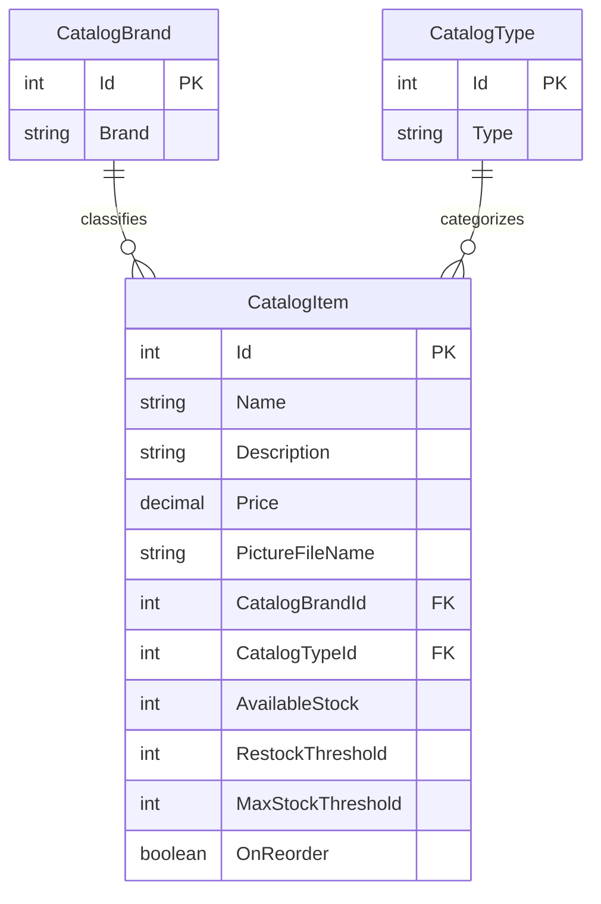

# Data Architecture & Persistence Layer

The data layer contains three catalog entities, persisted through Entity Framework 6 to SQL Server LocalDB. A configurable mock implementation uses an in-memory catalog list instead of database persistence.

## Database Configuration

| Service/Module | DB Type | Profile | Driver | Connection | Migration Tool |
|---|---|---|---|---|---|
| eShopLegacyWebForms | SQL Server LocalDB | Default configuration | System.Data.SqlClient | LocalDB with integrated security; database name is defined in Web.config | No EF migration set detected; `CreateDatabaseIfNotExists` initializer and SQL sequence scripts are used |

## Data Ownership per Service

| Service | Tables Owned | ORM Framework | Caching | Notes |
|---|---|---|---|---|
| eShopLegacyWebForms | Catalog, CatalogBrand, CatalogType | Entity Framework 6 | No dedicated cache; optional mock list | One application owns all catalog tables; sequence scripts and seed data are included |

## Entity Model

## Key Repository Methods

No repository interface is defined; `CatalogService` is the data access abstraction used by the pages.

| Service | Repository | Notable Methods | Purpose |
|---|---|---|---|
| eShopLegacyWebForms | `CatalogService` (`Services/CatalogService.cs`) | `GetCatalogItemsPaginated(pageSize, pageIndex)` | Counts and returns ordered catalog items with brand and type |
| eShopLegacyWebForms | `CatalogService` (`Services/CatalogService.cs`) | `FindCatalogItem(id)` | Loads one item and its brand/type |
| eShopLegacyWebForms | `CatalogService` (`Services/CatalogService.cs`) | `CreateCatalogItem`, `UpdateCatalogItem`, `RemoveCatalogItem` | Persists catalog changes with EF6 |
| eShopLegacyWebForms | `CatalogItemHiLoGenerator` (`Models/CatalogItemHiLoGenerator.cs`) | `GetNextSequenceValue(db)` | Queries the SQL sequence and allocates high/low item identifiers |

## Caching Strategy

No dedicated caching provider or cache policy is configured. When `UseMockData` is true, `CatalogServiceMock` holds a mutable preconfigured list in memory; this is application state rather than a configured cache. In database mode, data is queried from EF6 without an explicit result cache.

## Data Ownership Boundaries

The single web application is the source of truth for catalog items, brands, and types. All tables reside in the same configured database; no cross-service reads, aggregation, CQRS, or event-based data exchange was identified. Web Forms pages call the catalog service, which owns normal EF6 reads and writes; the initializer separately performs database setup and seed operations.

### Data Classification & Sensitivity

| Entity | Sensitive Fields | Classification (PII/PHI/PCI/None) | Controls in Place |
|---|---|---|---|
| CatalogItem | None identified; product description and image filename | None | Not applicable |
| CatalogBrand | None identified | None | Not applicable |
| CatalogType | None identified | None | Not applicable |

No PII, PHI, or PCI data detected in the entity model.
