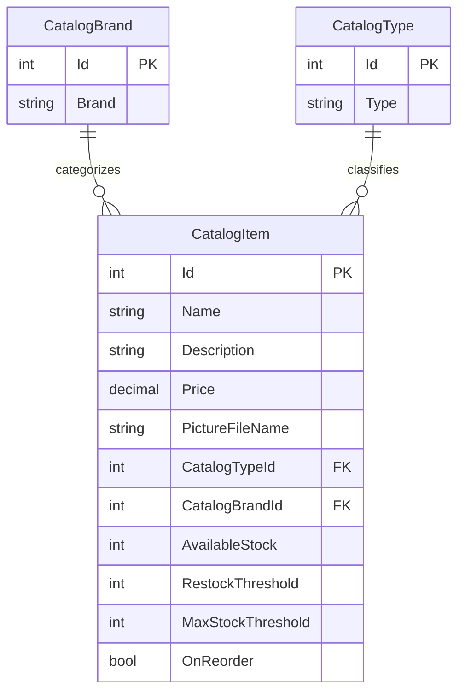

# Data Architecture & Persistence Layer

The data model is a product catalog with three Entity Framework 6 entities stored in SQL Server LocalDB when database mode is selected. The default configuration enables mock data, so the normal startup path uses an in-memory catalog instead.

## Database Configuration

| Service/Module | DB Type | Profile | Driver | Connection | Migration Tool |
|---|---|---|---|---|---|
| eShopLegacyWebForms | SQL Server LocalDB | Default configuration; database path enabled when `UseMockData` is false | `System.Data.SqlClient` | LocalDB with Windows integrated security | None identified; EF initializer and SQL scripts are used |

Catalog data can be initialized from the `Setup` CSV files. The initializer also executes a project SQL script and extracts bundled catalog pictures.

## Data Ownership per Service

| Service | Tables Owned | ORM Framework | Caching | Notes |
|---|---|---|---|---|
| eShopLegacyWebForms | Catalog, CatalogBrand, CatalogType | Entity Framework 6 | No persistent cache; singleton in-memory mock when enabled | One application owns the catalog data |

## Entity Model

Entity definitions are in `src/eShopLegacyWebForms/Models/CatalogItem.cs`, `CatalogBrand.cs`, and `CatalogType.cs`. EF6 maps catalog items to `Catalog`, brands to `CatalogBrand`, and types to `CatalogType`; each item requires one brand and one type.

## Key Repository Methods

| Service | Repository | Notable Methods | Purpose |
|---|---|---|---|
| eShopLegacyWebForms | None; `CatalogService` directly uses `CatalogDBContext` | `GetCatalogItemsPaginated`, `FindCatalogItem`, `GetCatalogTypes`, `GetCatalogBrands` | Query and page catalog data and retrieve lookup values |
| eShopLegacyWebForms | `CatalogService` | `CreateCatalogItem`, `UpdateCatalogItem`, `RemoveCatalogItem` | Persist catalog changes |

## Caching Strategy

No dedicated cache provider or cache policy was found. With `UseMockData=true`, Autofac registers `CatalogServiceMock` as a singleton containing a mutable in-memory list. The database-backed service uses EF6 and does not declare a query cache. ASP.NET session state is configured in-process but is not used as a catalog cache.

## Data Ownership Boundaries

The application is a single bounded context and uses one catalog database; no cross-service database access or service-to-service data exchange was identified. The catalog service is the single application-level data access path, although it uses the EF `DbContext` directly rather than a separate repository abstraction.

### Data Classification & Sensitivity

| Entity | Sensitive Fields | Classification (PII/PHI/PCI/None) | Controls in Place |
|---|---|---|---|
| CatalogItem | Product details and stock information | None | No sensitive personal or payment fields identified |
| CatalogBrand | Brand name | None | No sensitive personal or payment fields identified |
| CatalogType | Type name | None | No sensitive personal or payment fields identified |

No PII, PHI, or PCI data was detected in the entity model.
