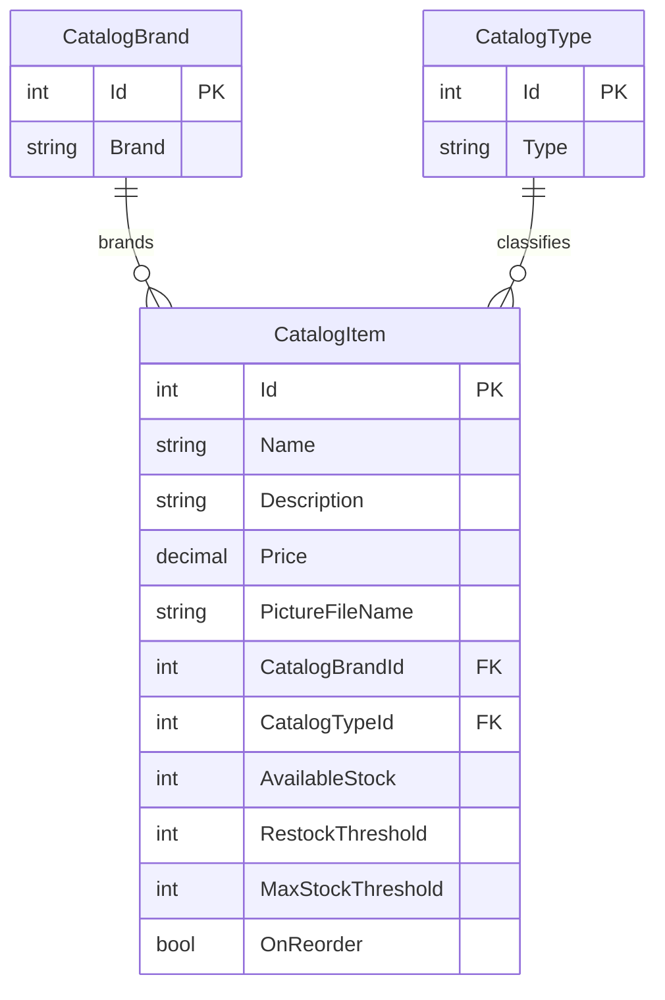

# Data Architecture & Persistence Layer

The data model contains three catalog entities and is backed by Entity Framework 6 when database mode is selected. The checked-in configuration enables an in-memory mock catalog by default.

## Database Configuration

| Service/Module | DB Type | Profile | Driver | Connection | Migration Tool |
|---|---|---|---|---|---|
| eShopLegacyWebForms | SQL Server LocalDB | `Web.config`; used only when `UseMockData=false` | System.Data.SqlClient | LocalDB `MSSQLLocalDB`, catalog `Microsoft.eShopOnContainers.Services.CatalogDb`, integrated security | No migration tool found; EF6 `CreateDatabaseIfNotExists` initializer and SQL sequence scripts |
| eShopLegacyWebForms | In-memory list | Default (`UseMockData=true`) | Not applicable | Process memory | Preconfigured data; no schema migration |

Database seeding uses preconfigured data by default. When customization data is enabled, CSV files under `Setup/` supply catalog values and an archive supplies pictures.

## Data Ownership per Service

| Service | Tables Owned | ORM Framework | Caching | Notes |
|---|---|---|---|---|
| eShopLegacyWebForms | `Catalog`, `CatalogBrand`, `CatalogType` | Entity Framework 6.2.0 | No cache configured; mock mode keeps application state in memory | One catalog context; mock mode is enabled in the checked-in configuration |

## Entity Model

`CatalogItem`, `CatalogBrand`, and `CatalogType` are defined under `src/eShopLegacyWebForms/Models/`. `CatalogDBContext` maps them to `Catalog`, `CatalogBrand`, and `CatalogType`, respectively. Catalog items require a brand and type; identifiers for catalog items are generated through the Hi/Lo sequence path in database mode.

## Key Repository Methods

No repository interface was found; catalog persistence is exposed through `ICatalogService` and implemented directly with `CatalogDBContext`.

| Service | Repository | Notable Methods | Purpose |
|---|---|---|---|
| eShopLegacyWebForms | `CatalogService` | `GetCatalogItemsPaginated(pageSize, pageIndex)` | Queries ordered catalog items with brand and type references |
| eShopLegacyWebForms | `CatalogService` | `FindCatalogItem(id)`, `GetCatalogBrands()`, `GetCatalogTypes()` | Loads catalog and reference data |
| eShopLegacyWebForms | `CatalogService` | `CreateCatalogItem`, `UpdateCatalogItem`, `RemoveCatalogItem` | Writes catalog changes and saves through EF6 |
| eShopLegacyWebForms | `CatalogServiceMock` | Matching catalog service operations | Reads and mutates an in-memory list in mock mode |

## Caching Strategy

No explicit cache provider, cache regions, or time-to-live settings were found. `CatalogServiceMock` stores its catalog in a singleton in-memory list; this is the selected data implementation under the default configuration, not a read-through or cache-aside layer. ASP.NET session state is configured in-process but is used for session metadata rather than catalog caching.

## Data Ownership Boundaries

All catalog entities are owned by this single application. In database mode, one EF6 context provides access to all three tables; in mock mode, one in-memory catalog list is used. There are no cross-service database calls, separate service databases, or CQRS read/write stores.

### Data Classification & Sensitivity

| Entity | Sensitive Fields | Classification (PII/PHI/PCI/None) | Controls in Place |
|---|---|---|---|
| CatalogItem | Product description, price, stock and picture reference | None | Not applicable; no personal, health, or payment-card fields identified |
| CatalogBrand | Brand name | None | Not applicable |
| CatalogType | Type name | None | Not applicable |

No PII, PHI, or PCI data was detected in the entity model.
