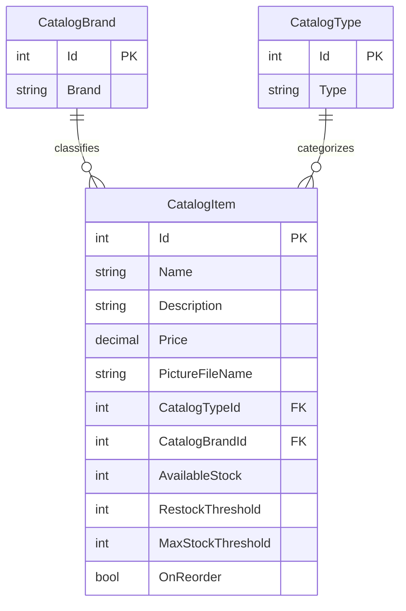

# Data Architecture & Persistence Layer

The data model contains three catalog entities persisted through Entity Framework 6 to SQL Server LocalDB when the application is configured for database-backed operation. A mock-data mode uses an in-memory catalog service instead.

## Database Configuration

| Service/Module | DB Type | Profile | Driver | Connection | Migration Tool |
|---|---|---|---|---|---|
| eShopLegacyWebForms | SQL Server LocalDB | Mock data disabled | System.Data.SqlClient | LocalDB with integrated Windows authentication; no explicit connection-pool settings identified | No migration tool identified; database creation and seed initialization use Entity Framework |
| eShopLegacyWebForms | In-memory mock data | Mock data enabled (configured default) | Not applicable | Process memory | Not applicable |

When database initialization is enabled, `CatalogDBInitializer` creates a database if it does not exist, executes SQL sequence scripts, and seeds catalog types, brands, and items. Seed data comes from preconfigured code data or optional customization files. No schema-versioned migration framework was found.

## Data Ownership per Service

| Service | Tables Owned | ORM Framework | Caching | Notes |
|---|---|---|---|---|
| eShopLegacyWebForms | Catalog, CatalogBrand, CatalogType | Entity Framework 6.2.0 | None identified | One application owns all catalog entities; optional in-memory mock service replaces database-backed operations |

## Entity Model

`CatalogItem` is persisted as the `Catalog` table, with foreign keys to `CatalogBrand` and `CatalogType`. The EF relationship is unidirectional from the item to its brand and type; each item requires one of each. `PictureUri` is a non-persisted property. Entity definitions are in `src/eShopLegacyWebForms/Models/CatalogItem.cs`, `CatalogBrand.cs`, and `CatalogType.cs`; the mappings are in `src/eShopLegacyWebForms/Models/CatalogDBContext.cs`.

## Key Repository Methods

| Service | Repository | Notable Methods | Purpose |
|---|---|---|---|
| eShopLegacyWebForms | `ICatalogService` / `CatalogService` (`src/eShopLegacyWebForms/Services/ICatalogService.cs`, `CatalogService.cs`) | `GetCatalogItemsPaginated(pageSize, pageIndex)`, `FindCatalogItem(id)`, `GetCatalogTypes()`, `GetCatalogBrands()`, `CreateCatalogItem(item)`, `UpdateCatalogItem(item)`, `RemoveCatalogItem(item)` | Queries and mutates catalog entities using `CatalogDBContext`; this is a service abstraction, not a separate repository interface |

No separate repository classes, custom repository query annotations, or explicit transaction-scope configuration were identified. Entity Framework `SaveChanges` is used for individual mutations.

## Caching Strategy

No caching provider or cache policy was identified. The in-memory mock service is an alternate data implementation, not a cache for the database-backed service. ASP.NET session state is configured in-process but is not used as a catalog cache.

## Data Ownership Boundaries

All catalog data is owned by the single Web Forms application and stored in one SQL Server LocalDB database in non-mock mode; no cross-service database access or service-level data separation was found. The `CatalogService` accesses data directly through `CatalogDBContext` and performs synchronous reads and writes. The mock-data configuration substitutes an in-memory catalog implementation. No CQRS or cross-service aggregation pattern was identified.

### Data Classification & Sensitivity

| Entity | Sensitive Fields | Classification (PII/PHI/PCI/None) | Controls in Place |
|---|---|---|---|
| CatalogItem | None identified | None | No PII, PHI, or PCI fields identified |
| CatalogBrand | None identified | None | No PII, PHI, or PCI fields identified |
| CatalogType | None identified | None | No PII, PHI, or PCI fields identified |

No PII, PHI, or PCI data was detected in the catalog entity model.
