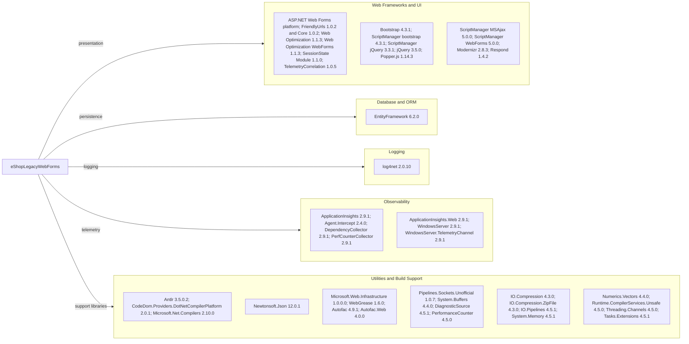

# Dependency Map

The eShopLegacyWebForms application declares 44 NuGet packages in `packages.config`, all targeting .NET Framework 4.7.2. There are no test-scoped packages in the project manifest.

## Dependencies

### Dependency Summary

| Category | Count | Key Libraries | Notes |
|---|---:|---|---|
| Web Frameworks and UI | 15 | ASP.NET Web Forms, Bootstrap 4.3.1, jQuery 3.5.0 | Legacy server-rendered UI and browser assets |
| Database / ORM | 1 | EntityFramework 6.2.0 | Entity Framework 6, using the configured SQL Server provider |
| Logging | 1 | log4net 2.0.10 | Application logging |
| Observability | 7 | Application Insights 2.9.1 and its collectors | Web, dependency, performance-counter, and server telemetry |
| Utilities | 20 | Autofac 4.9.1, Newtonsoft.Json 12.0.1, System.* libraries | Includes build support and framework compatibility packages |
| **Total** | **44** |  | All packages target net472 |

### Version & Compatibility Risks

The application targets .NET Framework 4.7.2 and uses legacy ASP.NET Web Forms, Entity Framework 6.2.0, and older UI and telemetry packages. These dependencies require compatibility review for modernization; the existing Web Forms application model is tied to .NET Framework, and moving to a newer .NET runtime is not a simple target-framework change.

### Notable Observations

- NuGet dependencies are managed through the legacy `packages.config` format rather than SDK-style project package references.
- The package inventory includes numerous .NET Framework support libraries and a compiler package, increasing the migration surface.
- No security-specific package or dedicated caching, messaging, or test framework dependency is declared.

## Test Dependencies

| Framework | Version | Notes |
|---|---|---|
| None detected | — | No packages are declared as test dependencies in `packages.config`. |

Total test-scope dependencies: 0

No test dependencies were detected in the project package manifest.
