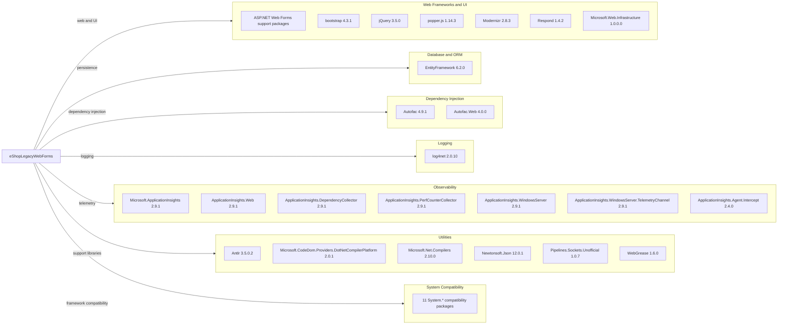

# Dependency Map

The `eShopLegacyWebForms` project declares 44 NuGet packages in `packages.config`. The diagram groups low-level framework compatibility packages to remain readable.

## Dependencies

### Dependency Summary

| Category | Count | Key Libraries | Notes |
|---|---:|---|---|
| Web Frameworks and UI | 16 | ASP.NET Web Forms packages, Bootstrap 4.3.1, jQuery 3.5.0 | Legacy `System.Web` application and client-side UI |
| Database / ORM | 1 | EntityFramework 6.2.0 | EF6 persistence |
| Dependency Injection | 2 | Autofac 4.9.1, Autofac.Web 4.0.0 | Web Forms service registration |
| Logging | 1 | log4net 2.0.10 | Application logs |
| Observability | 7 | Application Insights 2.9.1 family | Web, server, dependency, and performance telemetry |
| Utilities | 6 | Newtonsoft.Json 12.0.1, CodeDom provider 2.0.1 | Build, serialization, and support libraries |
| System Compatibility | 11 | System.Buffers, System.Memory, System.IO.Pipelines, and related packages | Older framework compatibility packages |

### Version & Compatibility Risks

The project targets .NET Framework 4.7.2 and relies on older `System.Web`, EF6, and package versions. The dependency scan found medium-or-higher advisories affecting Newtonsoft.Json 12.0.1 and log4net 2.0.10; see the security assessment for the advisory details. The legacy project format and Web Forms packages constrain migration to modern .NET.

### Notable Observations

- `packages.config` lists packages individually; no central package management or lock file was found.
- No test-scoped packages or test project were detected in this solution.
- The 11 grouped compatibility packages are System.Buffers 4.4.0, System.Diagnostics.DiagnosticSource 4.5.1, System.Diagnostics.PerformanceCounter 4.5.0, System.IO.Compression 4.3.0, System.IO.Compression.ZipFile 4.3.0, System.IO.Pipelines 4.5.1, System.Memory 4.5.1, System.Numerics.Vectors 4.4.0, System.Runtime.CompilerServices.Unsafe 4.5.0, System.Threading.Channels 4.5.0, and System.Threading.Tasks.Extensions 4.5.1.
- The ASP.NET UI group also includes AspNet.ScriptManager.bootstrap 4.3.1, AspNet.ScriptManager.jQuery 3.3.1, Microsoft.AspNet.FriendlyUrls 1.0.2, Microsoft.AspNet.FriendlyUrls.Core 1.0.2, Microsoft.AspNet.ScriptManager.MSAjax 5.0.0, Microsoft.AspNet.ScriptManager.WebForms 5.0.0, Microsoft.AspNet.SessionState.SessionStateModule 1.1.0, Microsoft.AspNet.TelemetryCorrelation 1.0.5, Microsoft.AspNet.Web.Optimization 1.1.3, and Microsoft.AspNet.Web.Optimization.WebForms 1.1.3.

## Test Dependencies

| Framework | Version | Notes |
|---|---|---|
| None detected | — | No test dependencies declared |

Total test-scope dependencies: 0

No test project or test framework dependency was detected.
