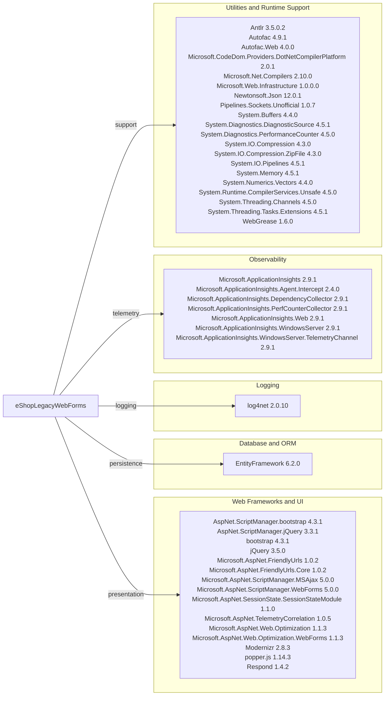

# Dependency Map

The eShopLegacyWebForms application declares 44 NuGet packages in `src/eShopLegacyWebForms/packages.config`.

## Dependencies

### Dependency Summary

| Category | Count | Key Libraries | Notes |
|---|---:|---|---|
| Web Frameworks and UI | 15 | ASP.NET Web Forms packages, Bootstrap 4.3.1, jQuery 3.5.0 | Legacy server-side UI and bundled browser libraries |
| Database and ORM | 1 | EntityFramework 6.2.0 | EF6 SQL Server persistence |
| Logging | 1 | log4net 2.0.10 | Application logging |
| Observability | 7 | Application Insights 2.9.1 components | Web, dependency, performance-counter, and Windows telemetry |
| Utilities and Runtime Support | 20 | Autofac 4.9.1, Newtonsoft.Json 12.0.1, .NET support packages | Includes compiler/build and runtime compatibility packages |
| **Total** | **44** |  | Declared package count from `packages.config` |

### Version & Compatibility Risks

The project targets .NET Framework 4.7.2 and depends on older Web Forms, EF6, Bootstrap, and telemetry packages. Newtonsoft.Json 12.0.1 is affected by high-severity CVE-2024-21907; the patched version is 13.0.1 or later. NuGet CLI dependency resolution could not load the legacy WebApplication targets, so transitive dependencies were not enumerated.

### Notable Observations

- `packages.config` lists 44 direct dependencies and no test-scoped packages.
- The project uses both ASP.NET Web Forms UI libraries and Autofac's older Web Forms integration.
- AppCAT identified the checked-in connection string as a configuration concern; the connection uses LocalDB and integrated security rather than an embedded password.

## Test Dependencies

| Framework | Version | Notes |
|---|---|---|
| None detected | — | No test-scoped packages or test project found in the assessed workspace. |

Total test-scope dependencies: 0

No test dependencies were declared in the inspected project package configuration.
