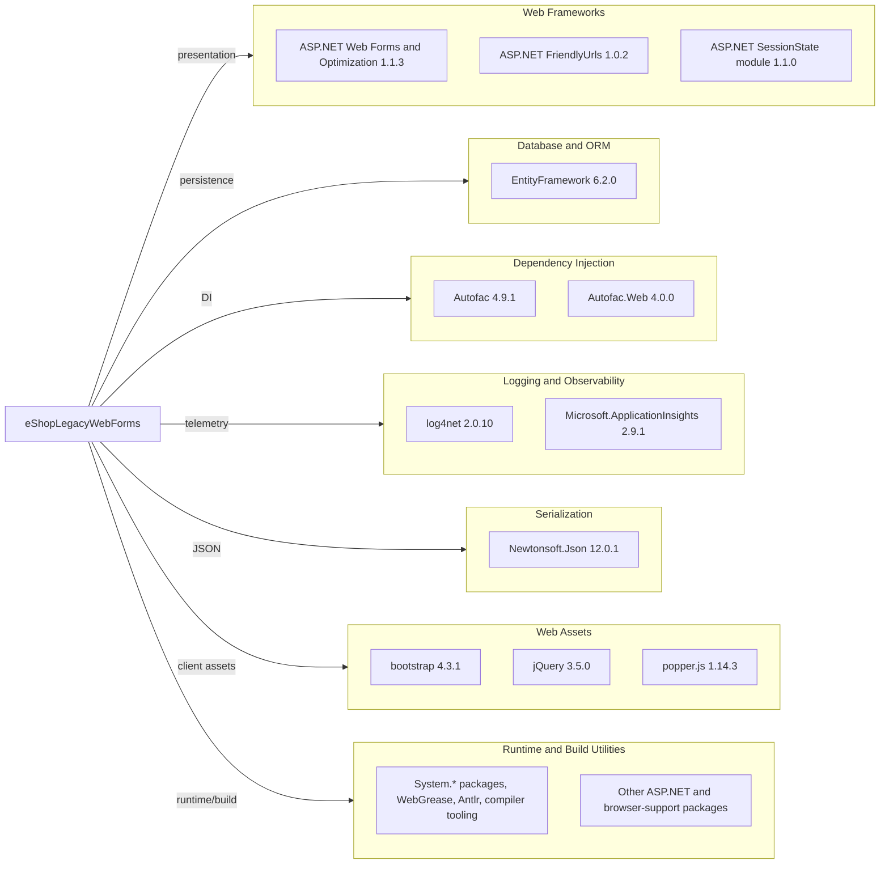

# Dependency Map

The `eShopLegacyWebForms` project declares 44 NuGet packages in `packages.config`; transitive dependency resolution was unavailable because the build runner does not contain the Visual Studio Web Application MSBuild targets.

## Dependencies

### Dependency Summary

| Category | Count | Key Libraries | Notes |
|---|---:|---|---|
| Web frameworks | 11 | ASP.NET Web Optimization, FriendlyUrls, SessionState | Legacy System.Web packages |
| Database / ORM | 1 | EntityFramework 6.2.0 | EF6 with SQL Server provider from the framework package set |
| Dependency injection | 2 | Autofac 4.9.1, Autofac.Web 4.0.0 | Web Forms property injection |
| Logging / observability | 7 | log4net 2.0.10, Application Insights packages 2.9.1 | Application Insights web modules and collectors |
| Serialization | 1 | Newtonsoft.Json 12.0.1 | Older version affected by CVE-2024-21907 |
| Web assets | 8 | bootstrap 4.3.1, jQuery 3.5.0, popper.js 1.14.3 | Browser-side libraries and script-manager integration |
| Utilities / runtime / build | 14 | Antlr, System.* packages, WebGrease, compiler tooling | Includes framework support and build-time packages |

### Version & Compatibility Risks

The project targets .NET Framework 4.7.2 and uses legacy `packages.config` package management. Newtonsoft.Json 12.0.1 is affected by high-severity CVE-2024-21907; the advisory’s patched version is 13.0.1. The AppCAT upgrade assessment also reports incompatible or upgrade-recommended NuGet packages for a net10.0 target. A dependency-tree command could not evaluate transitive packages because `Microsoft.WebApplication.targets` is missing from the assessment runner.

### Notable Observations

- The framework dependency is ASP.NET Web Forms/System.Web, which is not part of modern .NET.
- The checked-in package set includes separate Application Insights collectors and web packages.
- `Microsoft.Net.Compilers` is marked as a development dependency in `packages.config`.
- No test-scoped NuGet dependencies were declared.

## Test Dependencies

| Framework | Version | Notes |
|---|---|---|
| None detected | — | No test project or test-scoped package was found in this solution. |

Total test-scope dependencies: 0

No test dependencies detected.
