# Dependency Map

The `eShopLegacyWebForms` application declares 44 direct NuGet packages in `src/eShopLegacyWebForms/packages.config`. The legacy project could not resolve a transitive package tree because the installed .NET SDK does not include the Visual Studio WebApplication build targets.

## Dependencies

```mermaid
flowchart LR
    App["eShopLegacyWebForms"]

    subgraph Web["Web Frameworks"]
        Friendly["Microsoft.AspNet.FriendlyUrls 1.0.2"]
        FriendlyCore["Microsoft.AspNet.FriendlyUrls.Core 1.0.2"]
        ScriptBootstrap["AspNet.ScriptManager.bootstrap 4.3.1"]
        ScriptJQuery["AspNet.ScriptManager.jQuery 3.3.1"]
        ScriptAjax["Microsoft.AspNet.ScriptManager.MSAjax 5.0.0"]
        ScriptForms["Microsoft.AspNet.ScriptManager.WebForms 5.0.0"]
        Session["Microsoft.AspNet.SessionState.SessionStateModule 1.1.0"]
        Correlation["Microsoft.AspNet.TelemetryCorrelation 1.0.5"]
        Optimization["Microsoft.AspNet.Web.Optimization 1.1.3"]
        OptimizationForms["Microsoft.AspNet.Web.Optimization.WebForms 1.1.3"]
        WebInfra["Microsoft.Web.Infrastructure 1.0.0.0"]
        Autofac["Autofac 4.9.1"]
        AutofacWeb["Autofac.Web 4.0.0"]
    end
    subgraph Database["Database and ORM"]
        EF["EntityFramework 6.2.0"]
    end
    subgraph Observability["Observability"]
        Insights["Application Insights 2.9.1 family - 7 packages"]
    end
    subgraph Logging["Logging"]
        Log4Net["log4net 2.0.10"]
    end
    subgraph Utilities["Utilities and Front-end"]
        Antlr["Antlr 3.5.0.2"]
        Bootstrap["bootstrap 4.3.1"]
        JQuery["jQuery 3.5.0"]
        CodeDom["Microsoft.CodeDom.Providers.DotNetCompilerPlatform 2.0.1"]
        Compilers["Microsoft.Net.Compilers 2.10.0"]
        Modernizr["Modernizr 2.8.3"]
        Json["Newtonsoft.Json 12.0.1"]
        Pipelines["Pipelines.Sockets.Unofficial 1.0.7"]
        Popper["popper.js 1.14.3"]
        Respond["Respond 1.4.2"]
        Buffers["System.Buffers 4.4.0"]
        DiagnosticSource["System.Diagnostics.DiagnosticSource 4.5.1"]
        PerformanceCounter["System.Diagnostics.PerformanceCounter 4.5.0"]
        Compression["System.IO.Compression 4.3.0"]
        CompressionZip["System.IO.Compression.ZipFile 4.3.0"]
        IoPipelines["System.IO.Pipelines 4.5.1"]
        Memory["System.Memory 4.5.1"]
        Vectors["System.Numerics.Vectors 4.4.0"]
        Unsafe["System.Runtime.CompilerServices.Unsafe 4.5.0"]
        Channels["System.Threading.Channels 4.5.0"]
        Tasks["System.Threading.Tasks.Extensions 4.5.1"]
        WebGrease["WebGrease 1.6.0"]
    end

    App -->|"web integration"| Web
    App -->|"persistence"| Database
    App -->|"telemetry"| Observability
    App -->|"logging"| Logging
    App -->|"support libraries"| Utilities
```

### Dependency Summary

| Category | Count | Key Libraries | Notes |
|---|---:|---|---|
| Web Frameworks | 13 | ASP.NET FriendlyUrls, Web Optimization, Autofac | Web Forms integration, routing, bundling, and dependency injection |
| Database / ORM | 1 | Entity Framework 6.2.0 | Entity Framework data access |
| Observability | 7 | Microsoft Application Insights 2.9.1 family | Includes web, dependency, server, and performance collectors |
| Logging | 1 | log4net 2.0.10 | Rolling-file logging |
| Utilities | 22 | Newtonsoft.Json 12.0.1, System.* packages, Bootstrap, jQuery | Runtime helpers, front-end libraries, and build tooling |
| **Total** | **44** |  | Direct package declarations from `packages.config` |

### Version & Compatibility Risks

The project targets .NET Framework 4.7.2 and uses legacy Web Forms packages. Several dependencies are old; notably, Newtonsoft.Json 12.0.1 is affected by CVE-2024-21907, for which the advisory lists 13.0.1 as the first patched version. The package tree could not be restored through `dotnet list package` because the Visual Studio WebApplication targets are not installed, so this inventory reflects direct declarations only.

### Notable Observations

- Entity Framework 6.2.0 is the only declared database/ORM package.
- The package set includes seven Application Insights packages, while no instrumentation key or connection string is configured.
- The project has no test-scoped package entries or test project in the assessed solution.

## Test Dependencies

| Framework | Version | Notes |
|---|---|---|
| None detected | — | No test-scoped packages are declared in `packages.config`. |

Total test-scope dependencies: 0

No test dependencies were detected in the project package manifest.
