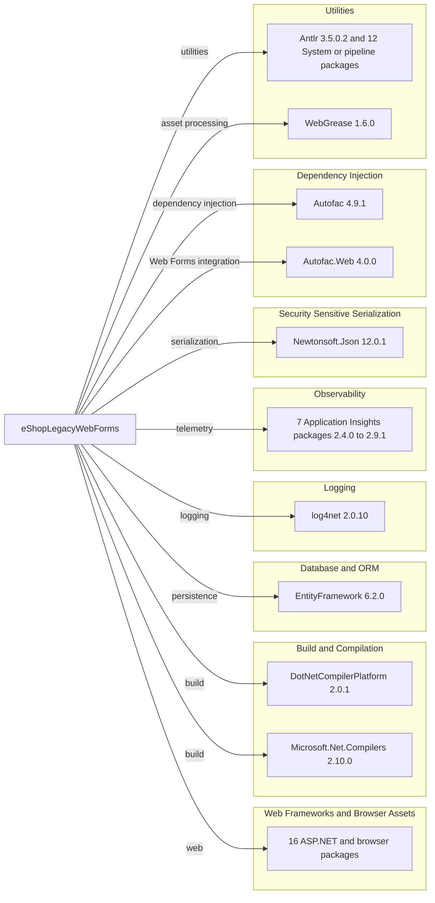

# Dependency Map

The eShopLegacyWebForms project declares 44 NuGet package dependencies in `packages.config`. No test-scoped packages are declared.

## Dependencies

### Dependency Summary

| Category | Count | Key Libraries | Notes |
|---|---:|---|---|
| Web Frameworks and Browser Assets | 16 | ASP.NET Web Forms packages, Bootstrap 4.3.1, jQuery 3.3.1 | Legacy server-rendered UI stack |
| Build and Compilation | 2 | DotNetCompilerPlatform 2.0.1, Microsoft.Net.Compilers 2.10.0 | Build-time compiler support |
| Database and ORM | 1 | EntityFramework 6.2.0 | EF6 with SQL Server provider |
| Logging | 1 | log4net 2.0.10 | Application logging |
| Observability | 7 | Application Insights 2.9.1 packages; Agent Intercept 2.4.0 | Web telemetry and collectors |
| Security Sensitive Serialization | 1 | Newtonsoft.Json 12.0.1 | Known affected by CVE-2024-21907 |
| Dependency Injection | 2 | Autofac 4.9.1, Autofac.Web 4.0.0 | Web Forms DI integration |
| Utilities | 14 | Antlr, WebGrease, Pipelines and System packages | Runtime and build helpers |

### Version & Compatibility Risks

The application targets .NET Framework 4.7.2 and uses legacy ASP.NET Web Forms, which limits modernization options. Several direct packages are older; notably, Newtonsoft.Json 12.0.1 is affected by CVE-2024-21907 and has a patched version beginning at 13.0.1. Entity Framework 6.2.0 and the bundled browser libraries also warrant compatibility review.

### Notable Observations

- The project has 44 declared NuGet packages and no test-framework packages.
- Application Insights is split across multiple collector and hosting packages.
- The project uses Autofac.Web integration and EF6 rather than modern ASP.NET Core dependency injection and EF Core.

## Test Dependencies

| Framework | Version | Notes |
|---|---|---|
| None detected | — | No test-scoped NuGet dependencies are declared. |

Total test-scope dependencies: 0

No test framework dependencies were found in the project package manifest.
