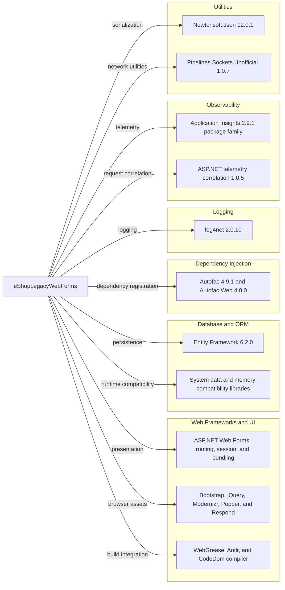

# Dependency Map

The eShopLegacyWebForms project declares 44 NuGet packages in `src/eShopLegacyWebForms/packages.config`. The legacy project could not resolve its full package tree in this environment, so this inventory reports declared packages only.

## Dependencies

### Dependency Summary

| Category | Count | Key Libraries | Notes |
|---|---:|---|---|
| Web Frameworks and UI | 17 | Web Forms and ASP.NET Web Optimization, Bootstrap, jQuery | Legacy .NET Framework web stack and bundled browser assets |
| Database / ORM | 1 | EntityFramework 6.2.0 | EF6 database access |
| Dependency Injection | 2 | Autofac 4.9.1, Autofac.Web 4.0.0 | Web Forms integration |
| Logging | 1 | log4net 2.0.10 | Rolling file logging |
| Observability | 8 | Microsoft.ApplicationInsights 2.9.1 family | Web request and dependency telemetry |
| Utilities and runtime compatibility | 15 | Newtonsoft.Json 12.0.1, System.* packages | Includes compiler, data-pipeline, and framework compatibility packages |

#### Declared Package Inventory

| Category | Package | Version |
|---|---|---:|
| Web Frameworks and UI | Antlr | 3.5.0.2 |
| Web Frameworks and UI | AspNet.ScriptManager.bootstrap | 4.3.1 |
| Web Frameworks and UI | AspNet.ScriptManager.jQuery | 3.3.1 |
| Dependency Injection | Autofac | 4.9.1 |
| Dependency Injection | Autofac.Web | 4.0.0 |
| Web Frameworks and UI | bootstrap | 4.3.1 |
| Database / ORM | EntityFramework | 6.2.0 |
| Web Frameworks and UI | jQuery | 3.5.0 |
| Logging | log4net | 2.0.10 |
| Observability | Microsoft.ApplicationInsights | 2.9.1 |
| Observability | Microsoft.ApplicationInsights.Agent.Intercept | 2.4.0 |
| Observability | Microsoft.ApplicationInsights.DependencyCollector | 2.9.1 |
| Observability | Microsoft.ApplicationInsights.PerfCounterCollector | 2.9.1 |
| Observability | Microsoft.ApplicationInsights.Web | 2.9.1 |
| Observability | Microsoft.ApplicationInsights.WindowsServer | 2.9.1 |
| Observability | Microsoft.ApplicationInsights.WindowsServer.TelemetryChannel | 2.9.1 |
| Web Frameworks and UI | Microsoft.AspNet.FriendlyUrls | 1.0.2 |
| Web Frameworks and UI | Microsoft.AspNet.FriendlyUrls.Core | 1.0.2 |
| Web Frameworks and UI | Microsoft.AspNet.ScriptManager.MSAjax | 5.0.0 |
| Web Frameworks and UI | Microsoft.AspNet.ScriptManager.WebForms | 5.0.0 |
| Web Frameworks and UI | Microsoft.AspNet.SessionState.SessionStateModule | 1.1.0 |
| Observability | Microsoft.AspNet.TelemetryCorrelation | 1.0.5 |
| Web Frameworks and UI | Microsoft.AspNet.Web.Optimization | 1.1.3 |
| Web Frameworks and UI | Microsoft.AspNet.Web.Optimization.WebForms | 1.1.3 |
| Utilities and runtime compatibility | Microsoft.CodeDom.Providers.DotNetCompilerPlatform | 2.0.1 |
| Utilities and runtime compatibility | Microsoft.Net.Compilers | 2.10.0 |
| Web Frameworks and UI | Microsoft.Web.Infrastructure | 1.0.0.0 |
| Web Frameworks and UI | Modernizr | 2.8.3 |
| Utilities and runtime compatibility | Newtonsoft.Json | 12.0.1 |
| Utilities and runtime compatibility | Pipelines.Sockets.Unofficial | 1.0.7 |
| Web Frameworks and UI | popper.js | 1.14.3 |
| Web Frameworks and UI | Respond | 1.4.2 |
| Utilities and runtime compatibility | System.Buffers | 4.4.0 |
| Utilities and runtime compatibility | System.Diagnostics.DiagnosticSource | 4.5.1 |
| Utilities and runtime compatibility | System.Diagnostics.PerformanceCounter | 4.5.0 |
| Utilities and runtime compatibility | System.IO.Compression | 4.3.0 |
| Utilities and runtime compatibility | System.IO.Compression.ZipFile | 4.3.0 |
| Utilities and runtime compatibility | System.IO.Pipelines | 4.5.1 |
| Utilities and runtime compatibility | System.Memory | 4.5.1 |
| Utilities and runtime compatibility | System.Numerics.Vectors | 4.4.0 |
| Utilities and runtime compatibility | System.Runtime.CompilerServices.Unsafe | 4.5.0 |
| Utilities and runtime compatibility | System.Threading.Channels | 4.5.0 |
| Utilities and runtime compatibility | System.Threading.Tasks.Extensions | 4.5.1 |
| Web Frameworks and UI | WebGrease | 1.6.0 |

### Version & Compatibility Risks

The project targets .NET Framework 4.7.2 and uses legacy Web Forms, EF6, and older UI packages. The direct dependency set includes Newtonsoft.Json 12.0.1 and log4net 2.0.10, both below the patched versions identified by the medium-or-higher CVE assessment. The complete transitive dependency graph was not available because the legacy WebApplication MSBuild targets are missing from this environment.

### Notable Observations

- `Microsoft.Net.Compilers` is marked as a development dependency in `packages.config`; no test-scoped packages are declared.
- The package set includes multiple ASP.NET ScriptManager/Web Forms compatibility packages in addition to the application framework.
- No centralized package version management or lock file was found.

## Test Dependencies

| Framework | Version | Notes |
|---|---|---|
| None detected | — | No test-scoped packages or test project was found in the selected solution. |

Total test-scope dependencies: 0

No test dependencies were detected in the solution.
