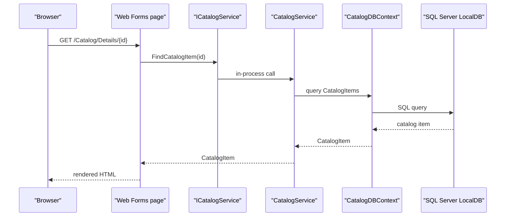

# API & Service Communication Contracts

The project exposes six server-rendered page routes, including a catalog listing and product-management pages; it does not define a REST API or independently deployable backend services. Communication is synchronous and in-process between the Web Forms pages and the catalog service.

## Service Catalog

| Service | Port | Category | Purpose |
|---|---|---|---|
| eShopLegacyWebForms | Not specified | API Layer | Serves catalog pages and handles product-management form submissions |

## API Endpoints Inventory

The routes below are page routes, not REST API endpoints. Requests render Web Forms pages; form submissions use the framework's postback mechanism.

| Service | Method | Path | Request Type | Response Type |
|---|---|---|---|---|
| eShopLegacyWebForms | GET / POST | `/Default` | Optional `index` and `size` route values; Web Forms postback on submit | Rendered catalog page |
| eShopLegacyWebForms | GET / POST | `/Default/index/{index}/size/{size}` | `index`, `size` route values; Web Forms postback on submit | Rendered catalog page |
| eShopLegacyWebForms | GET / POST | `/Catalog/Create` | Web Forms form postback | Rendered create page or redirect |
| eShopLegacyWebForms | GET / POST | `/Catalog/Edit/{id}` | `id` route value; Web Forms form postback | Rendered edit page or redirect |
| eShopLegacyWebForms | GET / POST | `/Catalog/Details/{id}` | `id` route value | Rendered product details page |
| eShopLegacyWebForms | GET / POST | `/Catalog/Delete/{id}` | `id` route value; Web Forms form postback | Rendered delete page or redirect |

No REST controller endpoints were identified. The paths are registered with `RouteConfig.MapPageRoute`.

## Management & Observability Endpoints

| Service | Endpoint | Custom Metrics (if any) |
|---|---|---|
| eShopLegacyWebForms | None identified | No custom metrics endpoint or metric registration identified |

Application Insights modules collect telemetry from the Web application; no health-check or Swagger endpoint is configured.

## DTOs & Contracts

`CatalogItem` is the catalog entity used by catalog operations and rendered by the pages. `PaginatedItemsViewModel<CatalogItem>` represents the paginated listing response model, while `CatalogType` and `CatalogBrand` provide catalog lookup data. The project does not define gateway aggregation DTOs, immutable request records, OpenAPI specifications, protobuf schemas, or GraphQL schemas. JSON serialization is available through Newtonsoft.Json, but no JSON API contract was identified.

## Communication Patterns

Web Forms pages call `ICatalogService` synchronously in-process. `CatalogService` performs synchronous Entity Framework queries and writes through `CatalogDBContext`; no remote service calls, message broker, asynchronous integration, service discovery, API gateway, retry policy, circuit breaker, or client-side load balancing was identified. There is no explicit API-level authentication, authorization, or TLS configuration identified in the project; hosting may apply additional controls outside this project.

## Service Technology Matrix

| Service | Web | Data Access | Discovery | Gateway | Actuator | Cache | Metrics |
|---|---|---|---|---|---|---|---|
| eShopLegacyWebForms | ASP.NET Web Forms | Entity Framework 6 | None | None | None | None identified | Application Insights telemetry |

## Service Communication Sequence

