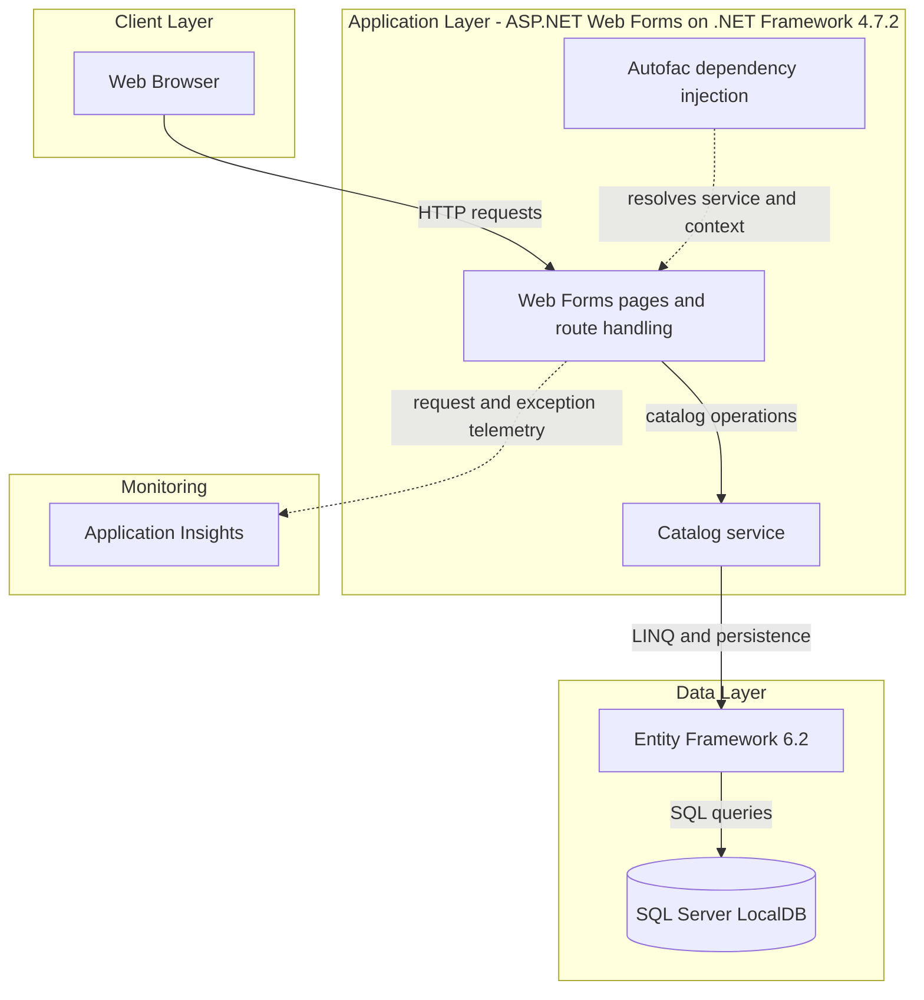
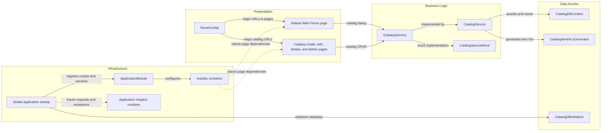

# Architecture Diagram

The application is a single ASP.NET Web Forms catalog site. Its presentation and catalog operations run in one IIS-hosted .NET Framework application, with Entity Framework persisting catalog data to SQL Server LocalDB.

## Application Architecture

### Technology Stack Summary

| Layer | Technology | Version | Purpose |
|---|---|---|---|
| Presentation | ASP.NET Web Forms | .NET Framework 4.7.2 | Server-rendered catalog pages |
| Dependency injection | Autofac and Autofac.Web | 4.9.1 / 4.0.0 | Web Forms service and context registration |
| Business and data access | Entity Framework | 6.2.0 | Catalog queries and persistence |
| Database | SQL Server LocalDB | `(localdb)\MSSQLLocalDB` | Local catalog database |
| Telemetry | Application Insights | 2.9.1 | Request, dependency, and exception telemetry |

### Data Storage & External Services

`CatalogDBContext` uses Entity Framework 6 with the `CatalogDBContext` connection string, configured for SQL Server LocalDB and the `Microsoft.eShopOnContainers.Services.CatalogDb` catalog. Application Insights modules are configured for web request, dependency, performance-counter, and exception telemetry. No remote API, cache, or message broker is configured in this project.

### Key Architectural Decisions

- The Web Forms application combines presentation, catalog service, and data access in one deployable project.
- `ICatalogService` abstracts catalog operations; Autofac selects either a database-backed service or a mock implementation from `UseMockData`.
- Entity Framework 6 maps catalog items, brands, and types to SQL Server.

## Component Relationships

### Component Inventory

| Component | Layer | Type | Responsibility |
|---|---|---|---|
| Default Web Forms page | Presentation | ASP.NET Web Forms page | Displays and paginates catalog items |
| Catalog create, edit, details, and delete pages | Presentation | ASP.NET Web Forms pages | Provide catalog item operations |
| RouteConfig | Presentation | Routing configuration | Maps friendly routes to catalog pages |
| ICatalogService | Business Logic | Service interface | Defines catalog operations |
| CatalogService | Business Logic | Service | Executes catalog queries and writes |
| CatalogServiceMock | Business Logic | Mock service | Supplies mock catalog data when enabled |
| CatalogDBContext | Data Access | Entity Framework DbContext | Maps catalog entities and database sets |
| CatalogItemHiLoGenerator | Data Access | ID generator | Generates catalog item identifiers |
| CatalogDBInitializer | Data Access | Database initializer | Initializes the catalog database |
| Global | Infrastructure | HTTP application | Configures routes, dependency injection, database, and request logging |
| ApplicationModule | Infrastructure | Autofac module | Registers the catalog service and data components |
| Application Insights modules | Infrastructure | Telemetry | Collect application request, dependency, and exception telemetry |
