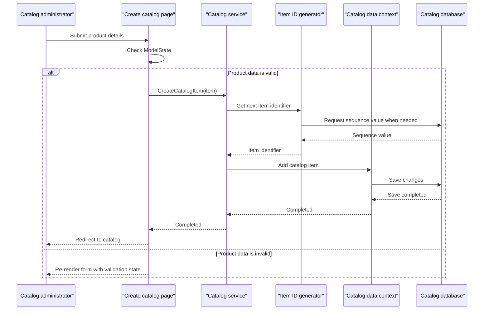

# Core Business Workflows

The application supports a product catalog: users can browse and page through catalog items, view item details, and maintain product listings. Catalog items are organized by brand and type, with stock and restocking information maintained as part of each listing.

## Domain Entities

| Entity | Service / Bounded Context | Description | Key Relationships |
|---|---|---|---|
| CatalogItem | Catalog Management | A sellable product listing with descriptive, pricing, image, and stock information | Belongs to one CatalogBrand and one CatalogType |
| CatalogBrand | Catalog Management | A product brand used to group catalog listings | Can be associated with many CatalogItems |
| CatalogType | Catalog Management | A product category or type used to classify catalog listings | Can be associated with many CatalogItems |

## Service-to-Domain Mapping

| Service | Domain Context | Owned Entities | External Dependencies |
|---|---|---|---|
| eShopLegacyWebForms | Catalog Management | CatalogItem, CatalogBrand, CatalogType | None; catalog data is accessed through the application's database |

The application is the sole source of truth for these catalog entities. No cross-context data exchange or service aggregation was identified.

## Primary Workflows

### Workflow 1: Browse and View Catalog Items

1. A user opens the catalog page or a product-details page.
2. The page requests a paginated item list or a single item from `ICatalogService`.
3. The service reads catalog items, brand, and type data from the catalog context.
4. The page renders the resulting catalog listing or item details. Paging uses the requested page index and size.

### Workflow 2: Create or Update a Catalog Item

1. A user opens the create or edit page; the page loads available brands and types. The edit page also loads the existing item.
2. The user submits the product form. The page checks `ModelState.IsValid`, using the model's configured validation rules.
3. If valid, the page constructs a `CatalogItem` and calls the corresponding catalog service operation.
4. The service assigns a new ID for a created item, or updates the existing item, and persists changes.
5. On success, the page redirects to the catalog.

### Workflow 3: Delete a Catalog Item

1. A user opens the delete page for a catalog item.
2. The page loads the item, then a postback invokes the delete action.
3. The service removes the item and saves changes.
4. The page redirects to the catalog.

## Cross-Service Data Flows

No cross-service flows or response aggregation were identified. Catalog pages obtain catalog, brand, and type data through the single catalog service and the same application-owned data context; no remote-service fallback behavior is configured.

## Business Workflow Sequence

## Business Rules & Decision Logic

- A catalog item must have a name, price, picture filename, brand, and type according to EF mapping; the name is limited to 50 characters and the brand and type names to 100 characters.
- Price input is constrained to a non-negative value with at most two decimal places and an upper range defined by the model's validation attributes.
- Available stock, restock threshold, and maximum stock threshold are each constrained to the range 0 through 10,000,000.
- Catalog item creation assigns an ID through the HiLo sequence generator; create and update pages persist only when `ModelState.IsValid`.
- The database initializer seeds catalog types, brands, and products from built-in data or optional customization files.
- No explicit business transaction beyond EF save operations, audit trail, authorization rules, or multi-service state transition was identified.
