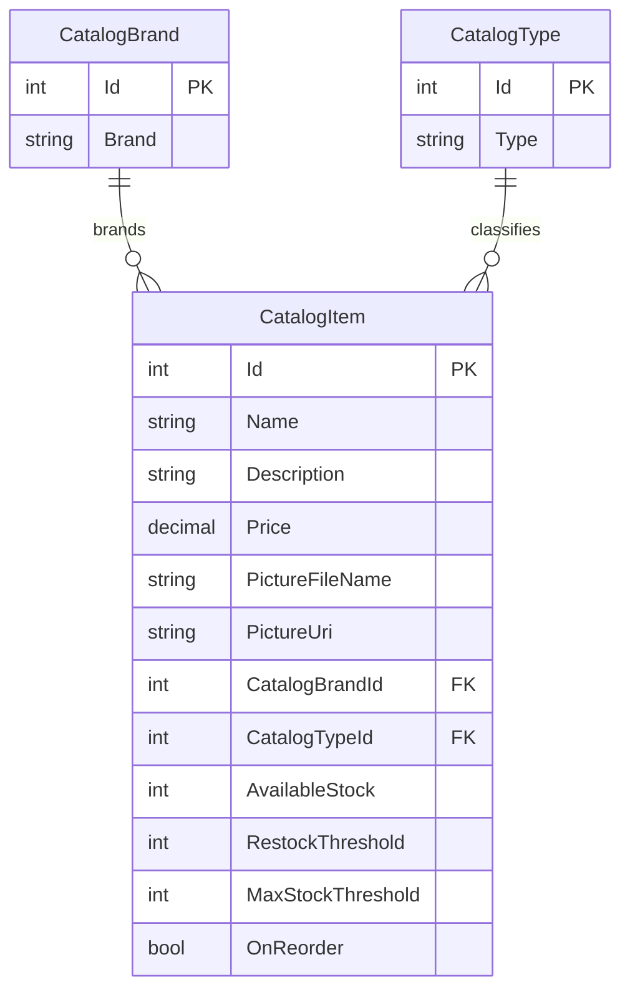

# Data Architecture & Persistence Layer

The data layer defines three catalog entities and uses Entity Framework 6 with SQL Server LocalDB. The application owns and accesses the catalog database directly through a single `DbContext`.

## Database Configuration

| Service/Module | DB Type | Profile | Driver | Connection | Migration Tool |
|---|---|---|---|---|---|
| eShopLegacyWebForms | SQL Server LocalDB | Default development configuration | `System.Data.SqlClient` | LocalDB instance and `Microsoft.eShopOnContainers.Services.CatalogDb` database; debug/release transforms contain sample SQL Server settings | No migration tool detected; `CreateDatabaseIfNotExists` initializer creates and seeds the database |

The initializer creates catalog sequences and seeds catalog types, brands, and items. Seed values can come from built-in data or project CSV files when customization data is enabled.

## Data Ownership per Service

| Service | Tables Owned | ORM Framework | Caching | Notes |
|---|---|---|---|---|
| eShopLegacyWebForms | `Catalog`, `CatalogBrand`, `CatalogType` | Entity Framework 6.2.0 | None identified | Single application-owned catalog database |

## Entity Model

`CatalogItem`, `CatalogBrand`, and `CatalogType` are defined under `src/eShopLegacyWebForms/Models/`. `CatalogDBContext` maps them to `Catalog`, `CatalogBrand`, and `CatalogType`; each item has required, unidirectional many-to-one relationships to one brand and one type. `PictureUri` is ignored by the ORM. The service uses EF `DbContext` save operations; no explicit transaction boundary was identified beyond EF's save behavior.

## Key Repository Methods

| Service | Repository | Notable Methods | Purpose |
|---|---|---|---|
| eShopLegacyWebForms | `ICatalogService` (`Services/ICatalogService.cs`); no repository interface identified | `GetCatalogItemsPaginated(pageSize, pageIndex)`, `FindCatalogItem(id)`, `GetCatalogTypes()`, `GetCatalogBrands()`, `CreateCatalogItem(item)`, `UpdateCatalogItem(item)`, `RemoveCatalogItem(item)` | Provides catalog reads and CRUD operations; `CatalogService` implements these operations using the context and LINQ |

## Caching Strategy

No application or ORM query cache was identified. `CatalogItemHiLoGenerator` keeps a small sequence-ID allocation state in memory for the lifetime of its singleton instance; this is identifier allocation state rather than a data-read cache.

## Data Ownership Boundaries

The single Web Forms application owns the catalog tables in one SQL Server LocalDB database. There are no separate service databases or cross-service database/API access patterns; pages use `ICatalogService`, which reads and writes the same `CatalogDBContext`. Reads and writes are implemented through EF queries and `SaveChanges`; no CQRS separation was identified.

### Data Classification & Sensitivity

| Entity | Sensitive Fields | Classification (PII/PHI/PCI/None) | Controls in Place |
|---|---|---|---|
| CatalogItem | None identified | None | No data-specific masking or field-level controls identified |
| CatalogBrand | None identified | None | No data-specific masking or field-level controls identified |
| CatalogType | None identified | None | No data-specific masking or field-level controls identified |
