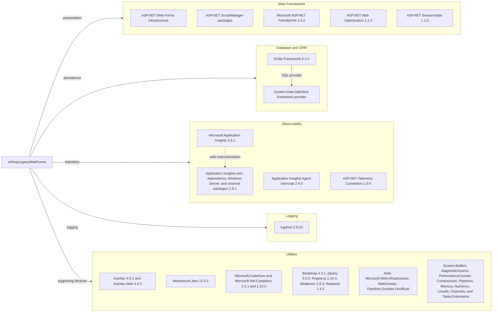

# Dependency Map

The eShopLegacyWebForms project declares 44 NuGet dependencies in `packages.config`, all targeting .NET Framework 4.7.2. The diagram highlights the framework and infrastructure packages; compact groups keep the complete dependency map readable.

## Dependencies

### Dependency Summary

| Category | Count | Key Libraries | Notes |
|---|---:|---|---|
| Web Frameworks | 14 | ASP.NET Web Forms, FriendlyUrls 1.0.2, Web Optimization 1.1.3, SessionState 1.1.0 | Classic System.Web application and client asset integration |
| Database / ORM | 1 | Entity Framework 6.2.0 | Uses the .NET Framework SQL Server provider |
| Observability | 8 | Application Insights 2.9.1, Telemetry Correlation 1.0.5 | Multiple Application Insights collection modules |
| Logging | 1 | log4net 2.0.10 | Application logging |
| Utilities | 20 | Autofac 4.9.1, Newtonsoft.Json 12.0.1, Bootstrap 4.3.1, jQuery 3.5.0 | Includes UI assets, compiler support, and System.* compatibility libraries |

### Version & Compatibility Risks

The application targets .NET Framework 4.7.2 and uses classic ASP.NET Web Forms, which constrains hosting and modernization options. Entity Framework 6.2.0, Autofac 4.x, Newtonsoft.Json 12.0.1, jQuery 3.5.0, and the Application Insights 2.9.1 family are older package versions; compatibility should be checked before any framework or platform migration.

### Notable Observations

- The application uses legacy `packages.config` dependency management rather than SDK-style package references or central package management.
- Application Insights is split across several independently versioned instrumentation packages.
- The declared package set contains no explicit test-scoped packages.

## Test Dependencies

| Framework | Version | Notes |
|---|---|---|

Total test-scope dependencies: 0

No test dependencies are declared in `packages.config`; no test project was found in the target solution.
