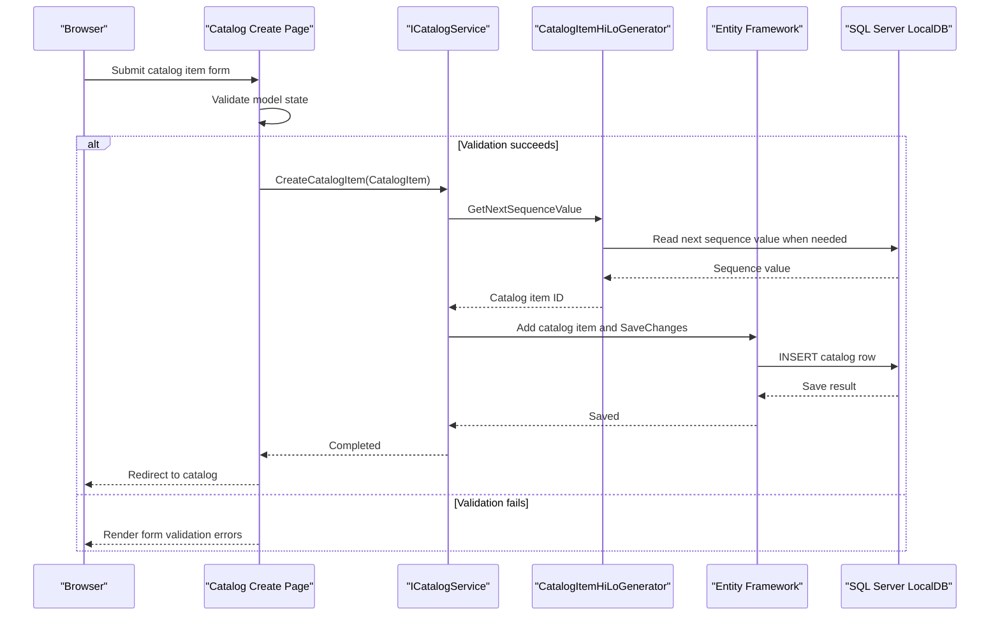

# API & Service Communication Contracts

The application exposes server-rendered Web Forms page routes and form-post actions, not a REST or RPC API. All catalog operations are synchronous, in-process calls to one catalog service and its configured data store.

## Service Catalog

| Service | Port | Category | Purpose |
|---|---|---|---|
| `eShopLegacyWebForms` | Not specified by the project; hosted by IIS/IIS Express | API Layer / Presentation | Serves catalog pages and handles their form submissions |
| `CatalogService` / `CatalogServiceMock` | In-process | Business | Implements catalog queries and mutations |
| SQL Server LocalDB | Local instance | Infrastructure | Persists catalog data when mock mode is disabled |

## API Endpoints Inventory

These are Web Forms page routes, not attribute-based API endpoints. Requests return HTML pages or redirects; forms submit server-side postbacks.

| Service | Method | Path | Request Type | Response Type |
|---|---|---|---|---|
| Web Forms | GET | `/Default` | None | Catalog page |
| Web Forms | GET | `/Default/index/{index}/size/{size}` | Route values `index`, `size` | Paginated catalog page |
| Web Forms | GET | `/Catalog/Create` | None | Create form |
| Web Forms | POST | `/Catalog/Create` | Web Forms postback fields | Redirect on success; form on validation failure |
| Web Forms | GET | `/Catalog/Edit/{id}` | Route value `id` | Edit form |
| Web Forms | POST | `/Catalog/Edit/{id}` | Route value and form fields | Redirect on success; form on validation failure |
| Web Forms | GET | `/Catalog/Details/{id}` | Route value `id` | Item details page |
| Web Forms | GET | `/Catalog/Delete/{id}` | Route value `id` | Delete confirmation page |
| Web Forms | POST | `/Catalog/Delete/{id}` | Route value and Web Forms postback | Redirect after deletion |

No API versioning scheme or REST controller is present.

## Management & Observability Endpoints

| Service | Endpoint | Custom Metrics (if any) |
|---|---|---|
| `eShopLegacyWebForms` | No application health or metrics route found | Application Insights request, dependency, exception, and performance telemetry modules are configured |

## DTOs & Contracts

There are no dedicated API request or response DTOs because the application does not expose a JSON API. `CatalogItem`, `CatalogBrand`, and `CatalogType` are service-level domain entities; `PaginatedItemsViewModel<CatalogItem>` is the presentation model returned for browsing. The classes are mutable C# classes, not immutable records. Newtonsoft.Json is declared as a package, but no API serialization contract or OpenAPI specification is present.

## Communication Patterns

Web Forms handlers synchronously call `ICatalogService`; the active implementation is selected through Autofac using `UseMockData`. `CatalogService` uses EF6 against LocalDB, while `CatalogServiceMock` reads and mutates an in-memory list. There are no inter-service HTTP clients, message queues, retry/circuit-breaker policies, API gateway, or service discovery mechanisms. The application contains no explicit API authentication, authorization, or TLS configuration; deployment-level IIS settings are not included in the project configuration.

## Service Technology Matrix

| Service | Web | Data Access | Discovery | Gateway | Actuator | Cache | Metrics |
|---|---|---|---|---|---|---|---|
| `eShopLegacyWebForms` | Web Forms | EF6 or in-memory mock | None | None | None | None | Application Insights telemetry |
| `CatalogService` | In-process | EF6 | None | None | None | None | None |
| `CatalogServiceMock` | In-process | Mutable in-memory list | None | None | None | None | None |

## Service Communication Sequence

