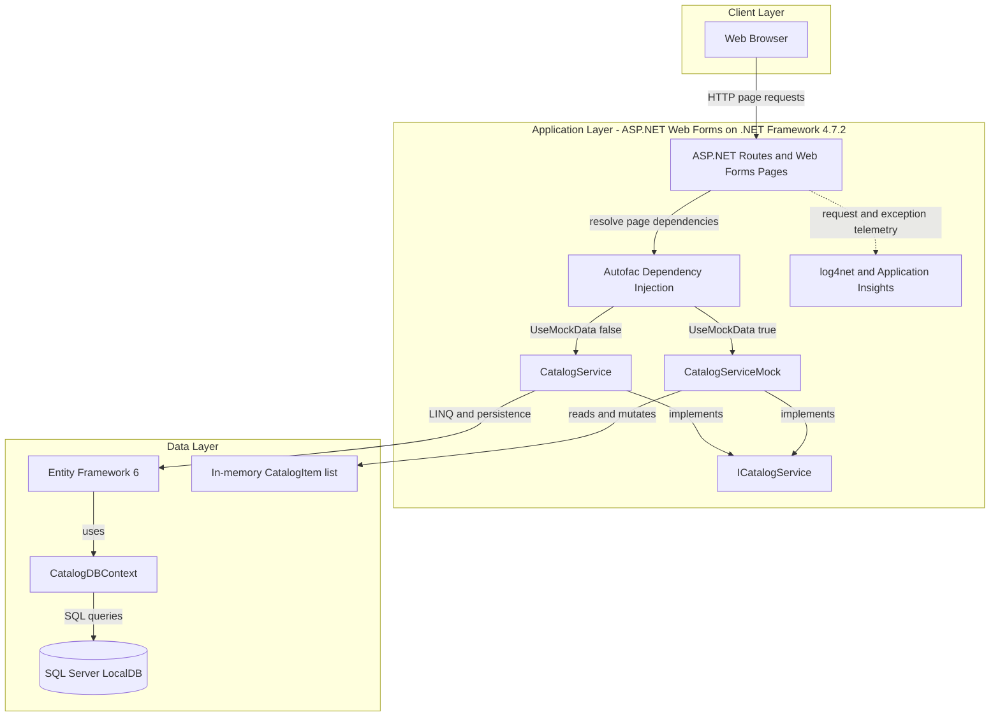
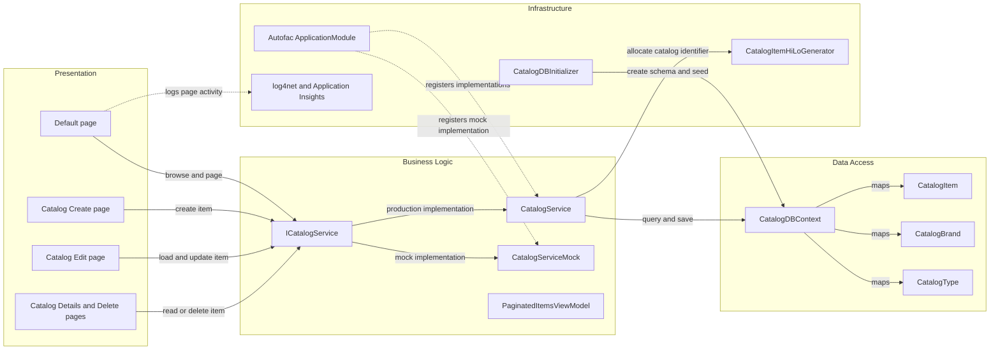

# Architecture Diagram

The solution contains one server-rendered catalog web application with a selectable mock-data mode or an Entity Framework-backed SQL Server mode. Catalog pages call an in-process service; no separately deployed application services are defined in this solution.

## Application Architecture

### Technology Stack Summary

| Layer | Technology | Version | Purpose |
|---|---|---:|---|
| Presentation | ASP.NET Web Forms | .NET Framework 4.7.2 | Server-rendered catalog pages |
| Dependency injection | Autofac and Autofac.Web | 4.9.1 / 4.0.0 | Web Forms page injection and service registration |
| Business logic | `ICatalogService` implementations | Application code | Catalog query and mutation operations |
| Data access | Entity Framework 6 | 6.2.0 | ORM and database context |
| Telemetry | log4net and Application Insights | 2.0.10 / 2.9.1 | Application logging and telemetry |

### Data Storage & External Services

When mock data is disabled, Entity Framework connects to SQL Server LocalDB using the `CatalogDBContext` connection string. With the checked-in `UseMockData=true` setting, the application instead uses a shared in-memory catalog list. Application Insights is configured for request, dependency, and exception telemetry; no remote business-service integration or message broker is configured.

### Key Architectural Decisions

- The application uses Web Forms page handlers and an `ICatalogService` abstraction rather than a REST API.
- Autofac selects either the in-memory mock service or the Entity Framework service from `UseMockData`.
- Entity Framework maps catalog items to required catalog-brand and catalog-type relationships.

## Component Relationships

### Component Inventory

| Component | Layer | Type | Responsibility |
|---|---|---|---|
| `Default` | Presentation | Web Forms page | Displays catalog items and pagination |
| `Catalog.Create` | Presentation | Web Forms page | Accepts new catalog item data |
| `Catalog.Edit` | Presentation | Web Forms page | Displays and updates an existing item |
| `Catalog.Details` / `Catalog.Delete` | Presentation | Web Forms pages | Displays or deletes an item |
| `ICatalogService` | Business Logic | Service interface | Defines catalog operations |
| `CatalogService` | Business Logic | Service | Performs Entity Framework catalog operations |
| `CatalogServiceMock` | Business Logic | Mock service | Stores catalog items in an in-memory list |
| `CatalogDBContext` | Data Access | EF6 DbContext | Defines catalog entity sets and mappings |
| `CatalogDBInitializer` | Infrastructure | EF initializer | Creates sequence objects and seeds catalog data |
| `CatalogItemHiLoGenerator` | Infrastructure | Identifier generator | Allocates catalog item IDs with a locked hi-lo sequence |
| `ApplicationModule` | Infrastructure | Autofac module | Registers service implementations and lifetimes |
