# Core Business Workflows

The application supports browsing and maintaining a product catalog: users can view paginated products, inspect details, and create, update, or delete catalog entries. Product categories and brands provide the catalog's classification data.

## Domain Entities

| Entity | Service / Bounded Context | Description | Key Relationships |
|---|---|---|---|
| CatalogItem | Catalog | A product offered in the catalog, with price and inventory information | Belongs to one catalog brand and one catalog type |
| CatalogBrand | Catalog | Brand classification for catalog items | Can be associated with multiple catalog items |
| CatalogType | Catalog | Type/category classification for catalog items | Can be associated with multiple catalog items |

## Service-to-Domain Mapping

| Service | Domain Context | Owned Entities | External Dependencies |
|---|---|---|---|
| `eShopLegacyWebForms` / `CatalogService` | Catalog | CatalogItem, CatalogBrand, CatalogType | EF6 and SQL Server LocalDB when database mode is selected |
| `CatalogServiceMock` | Catalog mock | In-memory CatalogItem list; preconfigured brands and types | None |

This is a single application and bounded context. There are no cross-domain services or remote data-exchange patterns.

## Primary Workflows

### Workflow 1: Browse the catalog

1. A visitor opens the catalog or requests a page using the index and size route values.
2. The page uses defaults of page size 10 and index 0 unless route values are supplied.
3. `ICatalogService.GetCatalogItemsPaginated` obtains a page; the EF implementation includes brand and type data, while mock mode uses its shared list.
4. The page renders product data and previous/next navigation.

### Workflow 2: Create or update a catalog item

1. A catalog editor opens the create or edit page and enters product values.
2. The page checks `ModelState.IsValid`; the model defines price format/range and inventory-range constraints.
3. On create, the service assigns an identifier, adds the item, and saves it; mock mode assigns an in-memory identifier.
4. On update, the service marks the item modified and saves it.
5. Successful operations redirect to the catalog; invalid model state leaves the user on the form.

### Workflow 3: Delete a catalog item

1. An editor opens the delete page for an item and reviews its details.
2. The delete postback identifies the item and calls `ICatalogService.RemoveCatalogItem`.
3. The active service removes it from the database or mock collection, then the page redirects to the catalog.

## Cross-Service Data Flows

No cross-service composition occurs. The page layer gets catalog data from one in-process catalog service; the production implementation retrieves it from EF6, and the mock implementation reads the in-memory collection. The database initializer can seed preconfigured records or application-local customization files.

## Business Workflow Sequence

```mermaid
sequenceDiagram
    participant Editor as "Catalog Editor"
    participant Page as "Create Catalog Page"
    participant Service as "Catalog Service"
    participant Generator as "HiLo ID Generator"
    participant DB as "SQL Server LocalDB"

    Editor->>Page: Submit new product details
    Page->>Page: Check model validation
    alt Values are valid
        Page->>Service: Create catalog item
        Service->>Generator: Request item identifier
        Generator->>DB: Read next sequence when current range is exhausted
        DB-->>Generator: Sequence value
        Generator-->>Service: Assign identifier
        Service->>DB: Save catalog item with EF6
        DB-->>Service: Save succeeds
        Service-->>Page: Operation completed
        Page-->>Editor: Redirect to catalog
    else Validation fails
        Page-->>Editor: Show form with validation errors
    end
```

## Business Rules & Decision Logic

- Catalog items require a type and brand in the EF model.
- Price is constrained to non-negative values with at most two decimal places; stock, restock, and maximum-stock values have a 0 to 10,000,000 range.
- Catalog item identifiers come from the SQL sequence/hi-lo generator in database mode and from the current maximum ID in mock mode.
- `UseMockData` selects whether catalog changes persist to EF/LocalDB or to the process-local mock list.
- Create and edit page handlers only save when `ModelState.IsValid`; the service methods perform create/update/delete persistence and do not implement a separate approval or state-transition process.
- Page actions do not show explicit business-role or resource-ownership checks; deployment authentication and authorization are not established by these application files.
