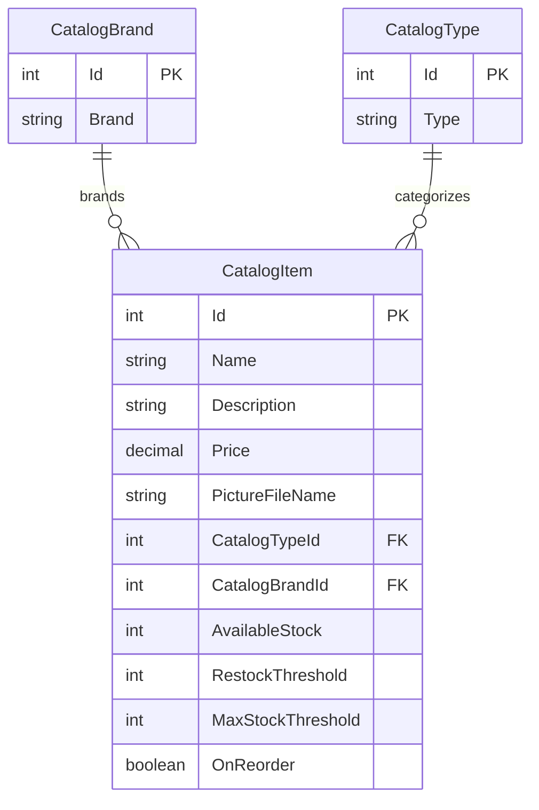

# Data Architecture & Persistence Layer

The catalog model contains three EF6 entities stored in SQL Server LocalDB when database mode is selected. An in-memory mock service is also registered by default in the checked-in application settings.

## Database Configuration

| Service/Module | DB Type | Profile | Driver | Connection | Migration Tool |
|---|---|---|---|---|---|
| `CatalogDBContext` | SQL Server LocalDB | Default; used when `UseMockData=false` | `System.Data.SqlClient` | LocalDB `CatalogDBContext` connection string; integrated Windows security | No EF migrations detected; `CreateDatabaseIfNotExists` initializer creates and seeds the database |
| `CatalogServiceMock` | In-memory list | Default checked-in mode (`UseMockData=true`) | Not applicable | Process memory | Not applicable |

Database initialization executes SQL scripts for catalog sequences and seeds catalog items, brands, and types. Optional customization data is read from application-local CSV and ZIP files when enabled.

## Data Ownership per Service

| Service | Tables Owned | ORM Framework | Caching | Notes |
|---|---|---|---|---|
| `CatalogService` | `Catalog`, `CatalogBrand`, `CatalogType` | Entity Framework 6.2.0 | None | Single catalog context; the initializer seeds the entities |
| `CatalogServiceMock` | No database tables; `CatalogItem` objects in memory | None | No cache; mutable process-local test/mock store | Selected when `UseMockData=true` |

## Entity Model

`CatalogItem` is defined in `src/eShopLegacyWebForms/Models/CatalogItem.cs`; `CatalogBrand` and `CatalogType` are in their correspondingly named files. The EF mapping makes each item's brand and type required. `PictureUri` is not persisted. The catalog item identifier is generated using a SQL sequence and the hi-lo generator.

## Key Repository Methods

| Service | Repository | Notable Methods | Purpose |
|---|---|---|---|
| Catalog | No repository interface is defined; `CatalogService` uses `CatalogDBContext` directly | `GetCatalogItemsPaginated(pageSize, pageIndex)` | Counts and returns a page of items with their brand and type |
| Catalog | `CatalogService` | `FindCatalogItem(id)`, `GetCatalogTypes()`, `GetCatalogBrands()` | Finds an item or returns available catalog types and brands |
| Catalog | `CatalogService` | `CreateCatalogItem(item)`, `UpdateCatalogItem(item)`, `RemoveCatalogItem(item)` | Adds, modifies, or removes catalog records and saves changes |
| Catalog mock | `CatalogServiceMock` | Same `ICatalogService` methods | Performs corresponding operations against the in-memory list |

## Caching Strategy

No cache provider, cache annotations, or explicit cache policy is configured. The mock implementation keeps catalog data in a process-wide in-memory list because it is registered as a singleton in mock mode; this is the data source, not a read-through cache. Database mode reads through EF6.

## Data Ownership Boundaries

The application is a single catalog bounded context with one database and no cross-service database access. `CatalogService` is the database-facing owner of catalog operations; the page handlers call its interface rather than querying EF directly. Mock mode replaces persistence with an in-process collection. There is no CQRS or cross-service aggregation.

### Data Classification & Sensitivity

| Entity | Sensitive Fields | Classification (PII/PHI/PCI/None) | Controls in Place |
|---|---|---|---|
| `CatalogItem` | None identified; product names, descriptions, prices, and stock | None | Not applicable |
| `CatalogBrand` | None identified | None | Not applicable |
| `CatalogType` | None identified | None | Not applicable |

No PII, PHI, or PCI data was detected in the catalog entity model.
