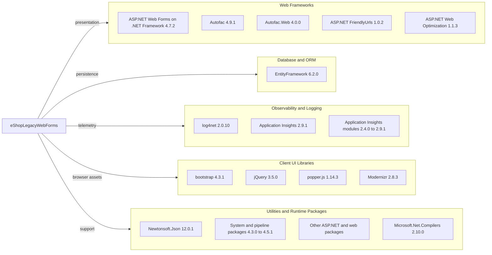

# Dependency Map

`eShopLegacyWebForms` declares 44 NuGet packages in `packages.config`; it has no separate test project or test-scoped packages.

## Dependencies

### Dependency Summary

| Category | Count | Key Libraries | Notes |
|---|---:|---|---|
| Web Frameworks | 21 | ASP.NET Web Forms, Autofac, FriendlyUrls, Web Optimization | Legacy .NET Framework web stack and UI support packages |
| Database / ORM | 1 | EntityFramework 6.2.0 | SQL Server provider is supplied by the framework/package setup |
| Logging | 1 | log4net 2.0.10 | Used by page and application lifecycle code |
| Observability | 7 | Microsoft.ApplicationInsights 2.9.1 and modules | Includes telemetry, dependency, and performance collectors |
| Utilities | 14 | Newtonsoft.Json 12.0.1, System.* packages, compiler tooling | Includes support libraries and a development-only compiler package |

### Declared Package Inventory

| Package | Version | Category |
|---|---:|---|
| Antlr | 3.5.0.2 | Web Frameworks |
| AspNet.ScriptManager.bootstrap | 4.3.1 | Web Frameworks |
| AspNet.ScriptManager.jQuery | 3.3.1 | Web Frameworks |
| Autofac | 4.9.1 | Web Frameworks |
| Autofac.Web | 4.0.0 | Web Frameworks |
| bootstrap | 4.3.1 | Web Frameworks |
| EntityFramework | 6.2.0 | Database / ORM |
| jQuery | 3.5.0 | Web Frameworks |
| log4net | 2.0.10 | Logging |
| Microsoft.ApplicationInsights | 2.9.1 | Observability |
| Microsoft.ApplicationInsights.Agent.Intercept | 2.4.0 | Observability |
| Microsoft.ApplicationInsights.DependencyCollector | 2.9.1 | Observability |
| Microsoft.ApplicationInsights.PerfCounterCollector | 2.9.1 | Observability |
| Microsoft.ApplicationInsights.Web | 2.9.1 | Observability |
| Microsoft.ApplicationInsights.WindowsServer | 2.9.1 | Observability |
| Microsoft.ApplicationInsights.WindowsServer.TelemetryChannel | 2.9.1 | Observability |
| Microsoft.AspNet.FriendlyUrls | 1.0.2 | Web Frameworks |
| Microsoft.AspNet.FriendlyUrls.Core | 1.0.2 | Web Frameworks |
| Microsoft.AspNet.ScriptManager.MSAjax | 5.0.0 | Web Frameworks |
| Microsoft.AspNet.ScriptManager.WebForms | 5.0.0 | Web Frameworks |
| Microsoft.AspNet.SessionState.SessionStateModule | 1.1.0 | Web Frameworks |
| Microsoft.AspNet.TelemetryCorrelation | 1.0.5 | Web Frameworks |
| Microsoft.AspNet.Web.Optimization | 1.1.3 | Web Frameworks |
| Microsoft.AspNet.Web.Optimization.WebForms | 1.1.3 | Web Frameworks |
| Microsoft.CodeDom.Providers.DotNetCompilerPlatform | 2.0.1 | Web Frameworks |
| Microsoft.Net.Compilers | 2.10.0 | Utilities, development-only |
| Microsoft.Web.Infrastructure | 1.0.0.0 | Web Frameworks |
| Modernizr | 2.8.3 | Web Frameworks |
| Newtonsoft.Json | 12.0.1 | Utilities |
| Pipelines.Sockets.Unofficial | 1.0.7 | Utilities |
| popper.js | 1.14.3 | Web Frameworks |
| Respond | 1.4.2 | Web Frameworks |
| System.Buffers | 4.4.0 | Utilities |
| System.Diagnostics.DiagnosticSource | 4.5.1 | Utilities |
| System.Diagnostics.PerformanceCounter | 4.5.0 | Utilities |
| System.IO.Compression | 4.3.0 | Utilities |
| System.IO.Compression.ZipFile | 4.3.0 | Utilities |
| System.IO.Pipelines | 4.5.1 | Utilities |
| System.Memory | 4.5.1 | Utilities |
| System.Numerics.Vectors | 4.4.0 | Utilities |
| System.Runtime.CompilerServices.Unsafe | 4.5.0 | Utilities |
| System.Threading.Channels | 4.5.0 | Utilities |
| System.Threading.Tasks.Extensions | 4.5.1 | Utilities |
| WebGrease | 1.6.0 | Web Frameworks |

### Version & Compatibility Risks

The project targets .NET Framework 4.7.2 and uses legacy Web Forms, EF6, and older ASP.NET packages. The declared Newtonsoft.Json 12.0.1 package is affected by CVE-2024-21907; the first patched version is 13.0.1. A direct `dotnet list package --include-transitive` inventory could not complete because the legacy project imports a missing Visual Studio WebApplication target, so the count and versions here are from `packages.config`.

### Notable Observations

- The package set includes several separate Application Insights modules at version 2.9.1, plus the 2.4.0 agent intercept package.
- The project also declares browser libraries through NuGet (Bootstrap, jQuery, Popper.js, Modernizr, and Respond).
- `Microsoft.Net.Compilers` is marked `developmentDependency=true`; it is compiler tooling rather than an application runtime library.
- No package is declared with a test scope, and no test dependencies were detected.

## Test Dependencies

| Framework | Version | Notes |
|---|---|---|
| None detected | — | No test project or test-scoped NuGet package is declared in the selected solution. |

Total test-scope dependencies: 0

No test dependencies were detected.
