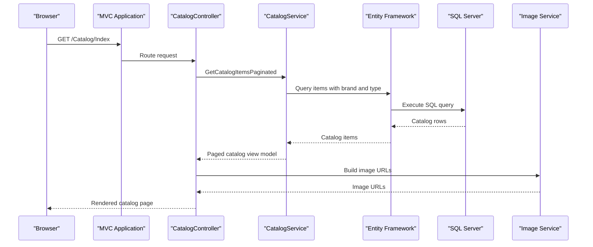

# API & Service Communication Contracts

The application exposes MVC page and form actions, plus one image-upload action. The application uses synchronous in-process service calls and SQL/blob SDK operations; no independent REST services or message broker were discovered.

## Service Catalog

| Service | Port | Category | Purpose |
|---|---:|---|---|
| eShopModernizedMVC | 80 (container; local host mapping 5115) | API Layer / Web | Serves catalog pages and handles catalog administration |
| sql.data | 1433 (container; local host mapping 5433) | Infrastructure | Local SQL Server database for the application |
| Azure Blob Storage | External | Infrastructure | Optional image storage |
| Azure Active Directory | External | Infrastructure | Optional OpenID Connect identity provider |

## API Endpoints Inventory

The application uses the conventional `{controller}/{action}/{id}` MVC route unless an action has an attribute route.

| Service | Method | Path | Request Type | Response Type |
|---|---|---|---|---|
| CatalogController | GET | `/Catalog/Index` | Optional `pageSize`, `pageIndex` query values | `PaginatedItemsViewModel<CatalogItem>` Razor view |
| CatalogController | GET | `/Catalog/Details/{id}` | `id` route value | Catalog item Razor view; 400/404 when invalid or missing |
| CatalogController | GET | `/Catalog/Create` | None | Create form view |
| CatalogController | POST | `/Catalog/Create` | Bound `CatalogItem` form model | Redirect to catalog or validation view |
| CatalogController | GET | `/Catalog/Edit/{id}` | `id` route value | Edit form view; 400/404 when invalid or missing |
| CatalogController | POST | `/Catalog/Edit/{id}` | Bound `CatalogItem` form model | Redirect to catalog or validation view |
| CatalogController | GET | `/Catalog/Delete/{id}` | `id` route value | Delete confirmation view |
| CatalogController | POST | `/Catalog/Delete/{id}` | `id` route value | Redirect to catalog |
| PicController | POST | `/uploadimage` | Multipart form file `HelpSectionImages`, `itemId` form value | JSON object with image `name` and `url`; 400 for invalid image |
| AccountController | GET | `/Account/SignIn` | None | OWIN authentication challenge or no-op for authenticated user |
| AccountController | GET | `/Account/SignOut` | None | OWIN sign-out |
| AccountController | GET | `/Account/EndSession` | None | Clears cookie authentication session |

## Management & Observability Endpoints

| Service | Endpoint | Custom Metrics |
|---|---|---|
| eShopModernizedMVC | No dedicated health, metrics, or Swagger endpoint found | Application Insights request/dependency telemetry; no custom metric registration found |

## DTOs & Contracts

`CatalogItem` is the MVC form and domain model used for create, edit, details, and list responses. `CatalogBrand` and `CatalogType` are related catalog models. `PaginatedItemsViewModel<CatalogItem>` wraps page metadata and catalog results. The image-upload action returns an anonymous JSON contract containing a name and URL. No OpenAPI document, protobuf schema, GraphQL schema, or separate gateway-level DTO was found. MVC model binding and the default JSON serialization behavior are used.

## Communication Patterns

- Controller-to-service and service-to-context calls are synchronous in-process calls. EF6 executes SQL Server operations; the Azure Storage SDK performs optional blob operations.
- Authentication uses OWIN cookie and OpenID Connect middleware when Azure AD is enabled. Otherwise, a local middleware supplies an authenticated claims identity; authentication behavior is therefore configuration-dependent.
- There is no message queue, service discovery, API gateway, explicit retry/circuit-breaker policy, or documented client-side load balancing.
- Docker Compose declares the web application as depending on `sql.data`; it does not configure a health-conditioned dependency for application startup.
- The Compose mapping exposes the container over HTTP. TLS termination is not configured in the project Compose files.
- The application returns server-rendered MVC views; no separate public REST API was identified.

## Service Technology Matrix

| Service | Web | Data Access | Discovery | Gateway | Health | Cache | Metrics |
|---|---|---|---|---|---|---|---|
| eShopModernizedMVC | ASP.NET MVC 5 | EF6 / SQL Server | None | None | No dedicated endpoint | Redis provider package present; configuration disabled | Application Insights |
| sql.data | SQL Server container | SQL Server | Compose service name | No | Compose health check | No | No |

## Service Communication Sequence

