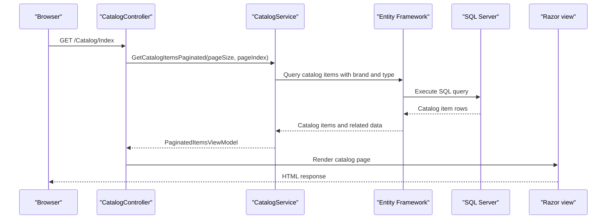

# API & Service Communication Contracts

The application exposes MVC page and form actions plus one image-upload endpoint. Request handling is synchronous within one web application, with optional external calls to SQL Server, Azure Blob Storage, and Azure Active Directory.

## Service Catalog

| Service | Port | Category | Purpose |
|---|---|---|---|
| eShopModernizedMVC | Container port 80; IIS Express SSL port 52429 | API Layer | Server-rendered catalog UI and image upload |
| SQL Server | Container port 1433 | Infrastructure | Catalog persistence when database mode is enabled |
| Azure Blob Storage | External HTTPS endpoint | Infrastructure | Optional catalog image storage |
| Azure Active Directory | External HTTPS endpoint | Infrastructure | Optional OpenID Connect sign-in |

The Compose override maps host port 5115 to the web container's port 80.

## API Endpoints Inventory

| Service | Method | Path | Request Type | Response Type |
|---|---|---|---|---|
| CatalogController | GET | `/Catalog/Index` | Optional `pageSize` and `pageIndex` query parameters | `PaginatedItemsViewModel<CatalogItem>` view |
| CatalogController | GET | `/Catalog/Details/{id}` | Optional integer route parameter `id` | `CatalogItem` view; 400 or 404 when invalid/not found |
| CatalogController | GET | `/Catalog/Create` | None | Catalog creation view |
| CatalogController | POST | `/Catalog/Create` | Bound `CatalogItem` form model | Redirect to catalog index or validation view |
| CatalogController | GET | `/Catalog/Edit/{id}` | Optional integer route parameter `id` | `CatalogItem` edit view |
| CatalogController | POST | `/Catalog/Edit/{id}` | Bound `CatalogItem` form model | Redirect to catalog index or validation view |
| CatalogController | GET | `/Catalog/Delete/{id}` | Optional integer route parameter `id` | `CatalogItem` confirmation view |
| CatalogController | POST | `/Catalog/Delete/{id}` | Integer route parameter `id` | Redirect to catalog index |
| PicController | POST | `/uploadimage` | Multipart file field `HelpSectionImages`, form field `itemId` | JSON object containing temporary image name and URL; 400 for invalid image |
| AccountController | GET | `/Account/SignIn` | None | OpenID Connect challenge when configured |
| AccountController | GET | `/Account/SignOut` | None | Sign-out action |
| AccountController | GET | `/Account/EndSession` | None | Ends the local cookie session |

The MVC default route is `/{controller}/{action}/{id?}` with `Catalog/Index` as its default. `DeleteConfirmed` is exposed under the `Delete` action name.

## Management & Observability Endpoints

| Service | Endpoint | Custom Metrics |
|---|---|---|
| eShopModernizedMVC | None identified | Application Insights is configured for telemetry; no custom metric endpoint was found |

No health-check or Swagger endpoint is defined in the assessed application.

## DTOs & Contracts

`CatalogItem` is the catalog domain entity used by the create/edit form and catalog views; `CatalogBrand` and `CatalogType` are related service-level entities. `PaginatedItemsViewModel<CatalogItem>` is the page response model. The image upload accepts a multipart file and returns an anonymous JSON object with `name` and `url` properties. No immutable request/response DTOs, OpenAPI document, protobuf schema, or GraphQL schema were found. MVC Razor rendering and MVC JSON serialization are used.

## Communication Patterns

Controllers call local catalog and image service interfaces synchronously. The database implementation uses Entity Framework 6 against SQL Server; the alternative catalog implementation uses an in-memory list. Image uploads use synchronous Azure Blob Storage operations when Azure storage is enabled, otherwise the mock/local implementation is selected. There is no message broker, service discovery, API gateway, circuit breaker, or retry policy identified.

Azure AD OpenID Connect is optional. In the non-Azure-AD path, custom middleware creates a claims identity for the request. Catalog create, edit, and delete actions have `[Authorize]`; the image-upload action has no visible authorization attribute. The project configures an IIS Express development SSL port, while the Dockerfile exposes HTTP port 80; no application-wide TLS enforcement was found.

## Service Technology Matrix

| Service | Web | Data Access | Discovery | Gateway | Actuator | Cache | Metrics |
|---|---|---|---|---|---|---|---|
| eShopModernizedMVC | ASP.NET MVC 5 | Entity Framework 6 or in-memory mock | None | None | None | None | Application Insights |

## Service Communication Sequence

